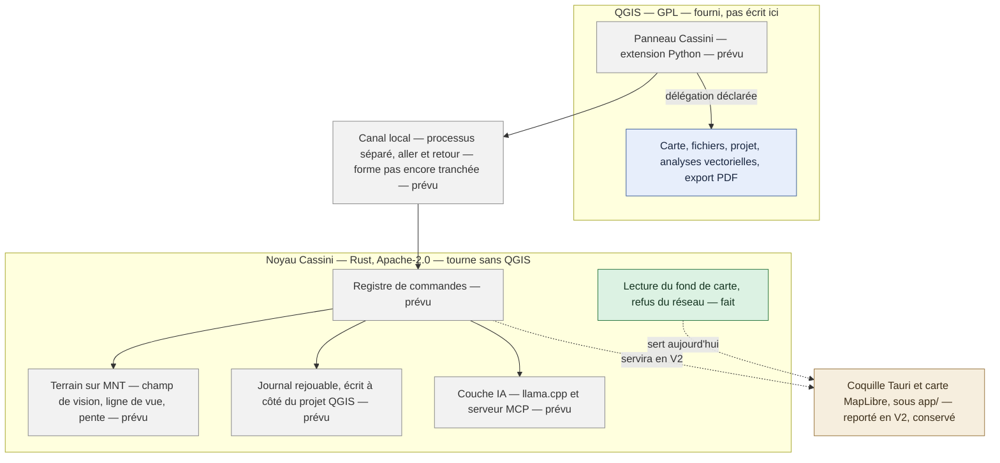
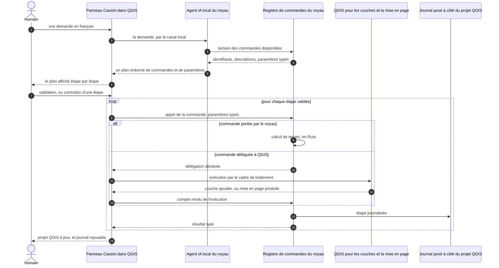
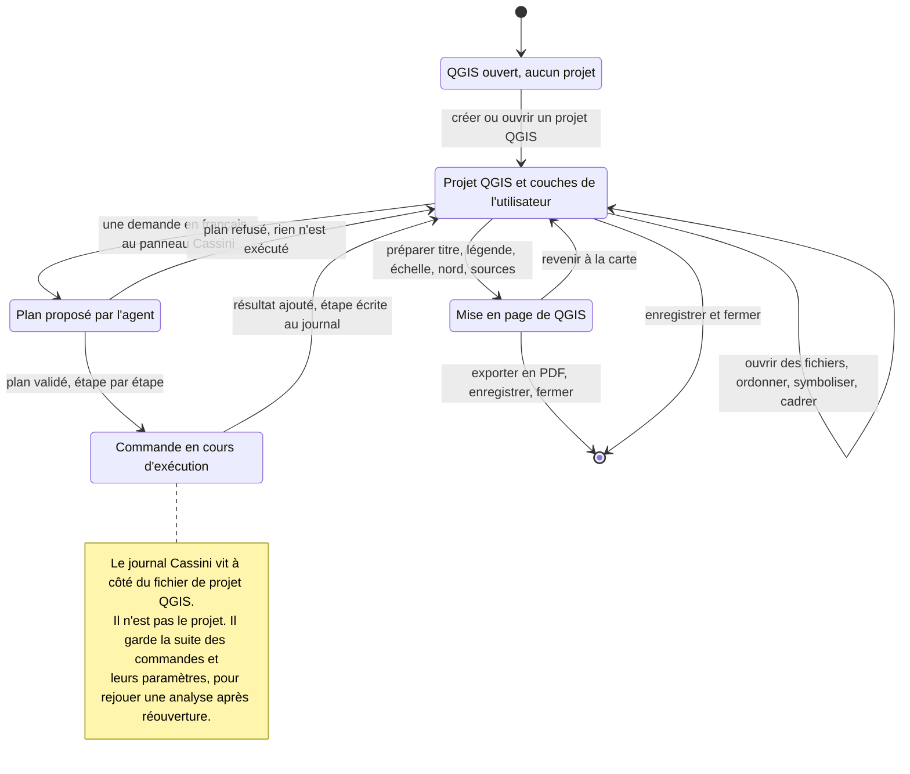

# Cassini

Cassini est l'**interface en langage naturel d'un SIG** — un système
d'information géographique — et elle fonctionne **entièrement hors ligne**.
L'utilisateur formule sa demande en français ; Cassini la traduit en une suite
d'opérations qu'elle affiche, fait valider, exécute, puis journalise pour qu'on
puisse les rejouer. Elle s'adresse aux bureaux d'études en urbanisme et en
environnement, aux collectivités et aux étudiants — en particulier à
l'utilisateur occasionnel, qui sait ce qu'il veut mais pas où cliquer.

**L'utilisateur apporte ses propres données.** Cassini n'en télécharge, n'en
catalogue et n'en redistribue aucune.

La cible, en une phrase — et c'est bien une cible, pas l'état actuel :

> « Trouve les parcelles constructibles du PLU à moins de 500 m d'une gare à
> Villeneuve-le-Roi et sors-moi la carte en PDF. »

**Cassini ne refait pas QGIS.** QGIS est libre, hors ligne, organisé en projets
et mûr depuis vingt ans : reconstruire sa carte, son ouverture de fichiers, ses
analyses et son export PDF serait perdre des années pour arriver à moins bien.
Ce qui n'existe nulle part, c'est un SIG de bureau hors ligne piloté par une IA
locale. Au MVP, Cassini est donc une **extension QGIS posée sur un noyau
indépendant** : QGIS exécute la carte, l'ouverture des fichiers, le projet, les
analyses vectorielles et l'export PDF ; le noyau porte le registre de commandes,
l'agent, le journal rejouable et un moteur de terrain en licence permissive.

Ce découpage date du 2026-10-14 et remplace un plan où Cassini était une
application de bureau complète ; le raisonnement est écrit en entier dans
[la proposition de changement](_bmad-output/initiative-cassini-mvp/change-facade-qgis-avant-app-autonome/change-facade-qgis-avant-app-autonome.md).
L'application autonome n'est pas abandonnée, elle est **reportée en V2**, et le
code déjà écrit pour elle reste au dépôt.

Le projet en est à l'**étape 1 sur 7** : le socle technique et le verrou hors
ligne. La section suivante dit exactement ce que cela couvre.

## Ce qui marche aujourd'hui

Rien de l'extension QGIS n'existe encore — le dossier `qgis-plugin/` n'est pas
créé. Ce qui est écrit, testé et conservé, c'est le socle, plus la coquille de
bureau désormais reportée en V2 :

- Un workspace Rust à deux étages : `cassini-core`, le noyau, **sans aucune
  dépendance** ; `cassini-app`, la coquille de bureau en Tauri v2.
- Une fenêtre qui s'ouvre sous Windows et affiche une carte MapLibre GL JS,
  navigable au zoom et au déplacement.
- Un fond de carte au format PMTiles **lu sur le disque** : le noyau en sert les
  octets par l'IPC de Tauri, l'interface ne connaît jamais le chemin du fichier,
  et aucune requête réseau n'intervient à aucun moment.
- Deux commandes exposées, et deux seulement : `engine_version` et
  `read_basemap`. L'interface n'appelle que la seconde. Le registre de commandes
  décrit par `CLAUDE.md` §4 n'est pas encore écrit.
- Le verrou hors ligne vit dans le noyau — `BasemapSource` refuse à la
  construction toute source qui désigne le réseau — et il est doublé d'une garde
  qui relit l'interface fichier par fichier.
- Un générateur **déterministe** de l'archive PMTiles de recette, et deux
  vérificateurs qui la relisent : conformité de l'archive, puis chemin complet de
  chargement de la carte.
- Une recette qui tient en quatre commandes : 17 tests du noyau, `cargo fmt`,
  `cargo clippy`, et le contrôle de l'interface.

La carte et la coquille sont **hors du chemin critique du MVP** depuis le
2026-10-14, mais elles marchent et elles restent : c'est la fondation de la V2
autonome. Tout le reste de ce README — registre, journal, agent IA, extension,
terrain — décrit une **cible**, pas une fonction disponible.

## Ce qui est prévu

Les sept étapes du projet, telles que les fixe `CLAUDE.md` §7. Aucune étape ne
commence avant que la précédente ne soit testée.

| Étape | Ce qu'elle apporte | État |
|---|---|---|
| 1 | Socle technique, verrou hors ligne, recette automatique | **faite pour l'essentiel** ; la recette se lance encore à la main |
| 2 | Épreuve du modèle local — un modèle quantifié sait-il transformer une phrase française en suite de commandes typées correcte, sur un registre factice | la prochaine, et la plus rentable : si elle échoue, le produit perd son angle |
| 3 | Registre de commandes et journal rejouable — l'épine dorsale | à venir |
| 4 | Façade QGIS — extension, canal local, commandes exécutées par QGIS | à venir |
| 5 | Agent IA local (llama.cpp) et serveur MCP | à venir |
| 6 | Analyse de terrain dans le noyau — champ de vision, ligne de vue, pente | à venir |
| 7 | Scénario de démo, puis publication : dépôt d'extensions QGIS, installeurs, vidéo | le présent README est pris par avance, le dépôt étant déjà public |

Formats que QGIS ouvrira pour le compte du registre : GeoPackage, Shapefile,
GeoJSON, CSV à coordonnées, GeoParquet. Systèmes de coordonnées : Lambert-93
(EPSG:2154) et WGS84 au minimum, avec reprojection quand la couche diffère du
projet. Aucune parité avec QGIS n'est visée ni revendiquée.

## Quatre principes non négociables

1. **Hors ligne total.** Aucune fonction du produit n'utilise le réseau. Il ne
   servira qu'à brancher une IA externe, en option, et jamais par défaut.
2. **Le noyau sans GPL ni LGPL ; l'extension en GPL par conséquence.** Le noyau
   n'admet que MIT, Apache-2.0 et BSD, y compris par liaison statique et y
   compris transitivement — d'où l'exclusion de GEOS. L'extension QGIS, elle, est
   forcément en GPL puisque QGIS l'est : elle vit **séparée** du noyau, le noyau
   ne lie jamais QGIS, et les deux communiquent **à distance de bras, par
   processus séparé**. La licence de chaque dépendance ajoutée est écrite dans le
   message de commit qui l'ajoute.
3. **Le noyau tourne sans QGIS.** Il se lance, s'exécute et se teste seul : c'est
   ce qui fonde le principe précédent et ce qui rend la V2 autonome possible.
   Toute dépendance du noyau envers QGIS est un bug.
4. **L'utilisateur apporte ses données, et ce dépôt reste civil.** Cassini ne
   télécharge rien et ne modifie jamais le fichier d'origine. Ce dépôt public ne
   contient aucune fonction spécialement conçue pour l'usage militaire — voir
   [Licence](#licence-et-noyau-civil).

Les principes complets, dont la règle de travail en salle blanche, sont dans
[`CLAUDE.md`](CLAUDE.md) §2, qui est la source de vérité du projet.

## Comment c'est construit

### L'architecture en couches

**Schéma d'une cible, pour l'essentiel.** QGIS existe et fonctionne, mais rien de
ce qui le relie à Cassini n'est écrit. Du noyau, une seule case est faite — la
lecture du fond de carte. La case `app/`, elle, est livrée et fonctionne, mais
elle est reportée en V2. Les cases marquées « prévu » n'existent pas encore dans
le dépôt, et `qgis-plugin/` pas davantage.



Trois conséquences de ce découpage, qui valent dès maintenant :

- **Aucune logique métier dans l'extension.** L'extension QGIS, la ligne de
  commande, l'agent local et le serveur MCP appelleront *les mêmes* commandes du
  registre.
- **Chaque commande déclare son exécutant.** Soit une implémentation en Rust dans
  le noyau, soit une délégation déclarée à QGIS — jamais implicite, jamais les
  deux.
- **Indépendance vis-à-vis des fournisseurs d'IA.** Le code ne dépendra d'aucune
  IA en particulier : IA locale par défaut, IA externes par MCP.

La forme du canal local n'est pas tranchée — entrée et sortie standard, socket
local, fichiers d'échange. C'est elle qui porte l'argument de licence du principe
2, donc elle se décide avant l'extension.

### Le trajet d'une demande en langage naturel

**Schéma d'une cible.** Ni l'extension, ni le registre, ni l'agent ne sont
écrits : le registre arrive à l'étape 3, la façade QGIS à l'étape 4, l'agent à
l'étape 5. Ce qui est déjà vrai, c'est la forme de l'échange — le panneau
demande, le noyau décide.



L'agent ne fait rien d'autre que **choisir des commandes du registre** : il n'a
pas d'accès direct à QGIS ni au disque. Toute exécution est journalisée, pour que
la même demande puisse être rejouée à l'identique.

### Le cycle de vie d'un projet QGIS

**Schéma d'une cible.** Le projet appartient à QGIS : Cassini n'a pas de format
de projet et n'en aura pas au MVP. Ce qu'il écrit, c'est son journal, posé à côté
du fichier de projet.



Le projet, ses couches, leur ordre, leur symbologie, l'étendue et la mise en page
sont enregistrés par QGIS, dans le format de QGIS. Le journal Cassini ne double
pas ce travail : il garde la trace des commandes exécutées, et c'est lui qui rend
une analyse rejouable.

## Les dossiers du dépôt

| Dossier | À quoi il sert |
|---|---|
| `core/` | Le noyau, crate `cassini-core`, sans aucune dépendance. Toute la logique métier y vivra — registre, journal et terrain sont encore à écrire — et les tests unitaires sont à côté du code qu'ils couvrent. |
| `app/` | **Reporté en V2, conservé exprès.** La coquille de bureau et la carte : `app/src` la webview — TypeScript strict, MapLibre ; `app/src-tauri` la coquille Rust qui ouvre la fenêtre et relaie les appels ; `app/scripts` les scripts de recette et le générateur de fond de carte. Hors du chemin critique du MVP depuis le 2026-10-14, mais testé et gardé comme fondation de l'application autonome. |
| `docs/` | La documentation. Index dans [`docs/README.md`](docs/README.md), dont la marche à suivre pour compiler sous Windows. |
| `fixtures/` | Les jeux de test, légers et fabriqués par le dépôt lui-même — aucune donnée géographique tierce. Voir [`fixtures/README.md`](fixtures/README.md). |
| `tests/` | Les tests qui traversent plusieurs briques, à venir avec le registre et l'extension. Ne contient encore que son [`README.md`](tests/README.md). |
| `_bmad-output/` | La planification : spécification, dossier de recherche, epics, propositions de changement, et le plan écrit de chaque entrée de travail. |
| `_bmad/` | L'outillage de planification qui produit ce qui précède. Ses scripts sont réinstallables, donc ignorés par git ; `skills-lock.json`, à la racine, en verrouille les versions. |

À la racine : [`CLAUDE.md`](CLAUDE.md), la source de vérité du projet ;
`Cargo.toml`, le workspace à deux membres (`core` et `app/src-tauri`) ; `LICENSE`.

Deux dossiers annoncés par `CLAUDE.md` §9 n'existent pas encore : `qgis-plugin/`,
l'extension QGIS en Python, **pas encore créée**, qui arrivera à l'étape 4 et
portera le panneau du MVP ; et `ai/`, la couche IA, qui arrivera à l'étape 5.

## Démarrage rapide

**Prérequis** : Rust stable avec `cargo`, Node.js avec `npm`, et les prérequis
système de Tauri v2. Sous Windows, tout est détaillé pas à pas dans
[`docs/compiler-sous-windows.md`](docs/compiler-sous-windows.md), preuve de
fonctionnement réseau coupé comprise.

Le noyau se teste seul, sans rien installer d'autre que Rust — c'est le principe
3 en pratique :

```bash
cargo test -p cassini-core
```

La coquille de bureau reportée en V2, depuis le dossier `app` :

```bash
npm install
npm run check        # typage, garde hors ligne, archive et protocole
npm run tauri dev    # ouvre la fenêtre Cassini avec son fond de carte
```

Deux précisions qui font gagner du temps :

- `npm run dev` ne lance que la webview Vite, **sans le noyau** : le fond de
  carte y reste indisponible, puisque ses octets viennent de l'IPC de Tauri. Pour
  voir l'application, c'est `npm run tauri dev`.
- `npm run fixtures` régénère l'archive PMTiles de `fixtures/`. La génération est
  déterministe : deux exécutions produisent le même fichier, octet pour octet.

Il n'y a encore rien à installer dans QGIS : l'extension arrive à l'étape 4.

## La recette

Quatre commandes, à lancer à la main pour l'instant. Une exécution automatique à
chaque poussée est la prochaine entrée de travail de l'étape 1.

| Commande | Ce qu'elle contrôle |
|---|---|
| `cargo test -p cassini-core` | Les 17 tests du noyau, dont le refus de toute source réseau et celui d'une plage d'octets hors fichier. |
| `cargo fmt --check` | La mise en forme du Rust. |
| `cargo clippy --workspace --all-targets` | Zéro avertissement, sur les deux crates et leurs tests. |
| `npm run check`, depuis `app` | Le typage strict, puis trois vérifications décrites ci-dessous. |

Ce que `npm run check` enchaîne après `tsc` :

- `scripts/check-offline.mjs` — la **garde hors ligne** côté interface : elle
  échoue si la moindre adresse réseau apparaît dans `app/index.html`, dans le
  style `app/src/basemap.style.json`, ou dans les fichiers `.ts`, `.tsx`, `.js`,
  `.mjs`, `.css` et `.html` de `app/src` — une feuille de style est une porte de
  sortie aussi directe qu'un `fetch`. Seule exception, nommée : le schéma
  `pmtiles://` suivi de la clé locale attendue, qu'elle relit dans le code plutôt
  que de la recopier.
- `scripts/verify-basemap.mjs` — 30 contrôles sur l'archive PMTiles : en-tête,
  tuiles, emprise, zooms, déterminisme, et quatre contrôles qui mettent le
  validateur en échec exprès.
- `scripts/verify-protocol.mjs` — 24 contrôles sur le chemin de chargement de la
  carte, et la preuve qu'une clé non enregistrée partirait bien sur le réseau,
  c'est-à-dire ce que la garde précédente existe pour empêcher.

Un garde-fou qu'on n'a jamais vu refuser quelque chose ne garde rien : d'où les
contrôles qui échouent exprès.

## Licence et noyau civil

Trois régimes, et celui de l'extension n'est pas un choix :

- **Le noyau et la coquille de bureau** — `core/`, `app/`, et `ai/` quand il
  existera : **Apache-2.0**, voir [`LICENSE`](LICENSE). L'usage commercial et
  institutionnel est permis, et aucune dépendance GPL ou LGPL n'y est admise,
  même par liaison statique.
- **L'extension QGIS** — `qgis-plugin/`, pas encore créée : **GPL**, comme QGIS.
  C'est une conséquence de l'hôte, pas une préférence. Elle vit séparée du noyau,
  qui ne lie jamais QGIS et reste utilisable sans lui.
- **Le module défense**, s'il voit le jour : **dépôt privé distinct**, bâti sur le
  noyau et non sur l'extension — précisément parce que l'extension est en GPL. Sa
  licence et ses conditions de commercialisation dépendent de la réponse à une
  demande de classement.

Ce dépôt est le **noyau civil** du projet, généraliste. Il ne contient, et ne
contiendra, **aucune fonction spécialement conçue pour l'usage militaire** : la
charnière du contrôle à l'exportation des équipements militaires de l'Union
européenne est précisément l'expression *specially designed for military use*, et
l'article L.2332-1 du Code de la défense soumet le commerce de matériels de guerre
à autorisation. Les fonctions de cette nature, si elles voient le jour, vivront
dans le dépôt privé cité ci-dessus, et aucune ne sera écrite avant réponse écrite
à une demande de classement.

Sont également hors du périmètre de ce dépôt : le téléchargement ou la
redistribution de données, les formats de projet propriétaires, et les formats et
symbologies de défense.
