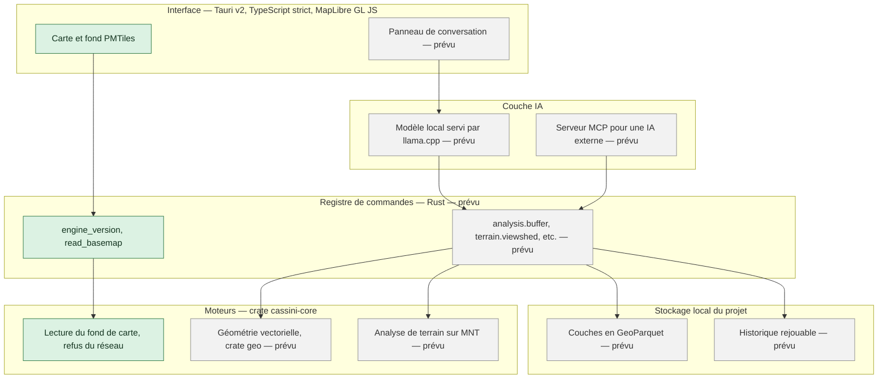
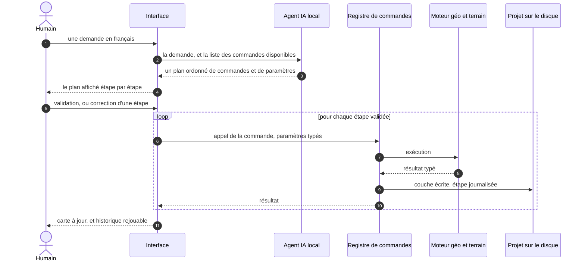
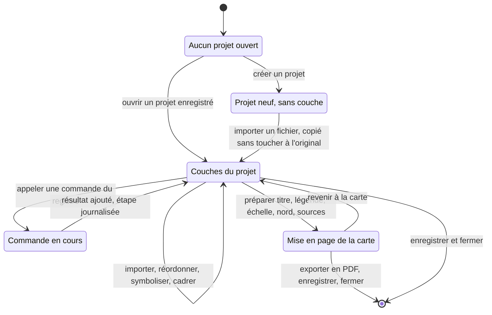

# Cassini

Cassini est un SIG — un système d'information géographique — de bureau, libre, qui
fonctionne **entièrement hors ligne**, **s'organisera en projets** comme les SIG de
bureau établis, et se pilotera **en langage naturel** grâce à un agent IA intégré.
Il s'adresse aux bureaux d'études en urbanisme et en environnement, aux
collectivités et aux étudiants, et vise les usages courants d'un SIG de bureau —
en complément d'un outil déjà installé plutôt qu'en remplacement immédiat.

**L'utilisateur apporte ses propres données.** Cassini n'en télécharge, n'en
catalogue et n'en redistribue aucune.

La cible, en une phrase — et c'est bien une cible, pas l'état actuel :

> « Trouve les parcelles constructibles du PLU à moins de 500 m d'une gare à
> Villeneuve-le-Roi et sors-moi la carte en PDF. »

Le projet en est à l'**étape 1 sur 7** : le socle technique et la carte hors ligne.
La section suivante dit exactement ce que cela couvre.

## Ce qui marche aujourd'hui

- Un workspace Rust à deux étages : `cassini-core`, le moteur, **sans aucune
  dépendance** ; `cassini-app`, la coquille de bureau en Tauri v2.
- Une fenêtre qui s'ouvre sous Windows et affiche une carte MapLibre GL JS,
  navigable au zoom et au déplacement.
- Un fond de carte au format PMTiles **lu sur le disque** : le moteur en sert les
  octets par l'IPC de Tauri, l'interface ne connaît jamais le chemin du fichier,
  et aucune requête réseau n'intervient à aucun moment.
- Deux commandes, et deux seulement : `engine_version` et `read_basemap`. Le
  registre de commandes décrit par `CLAUDE.md` §4 n'est pas encore écrit.
- Le verrou hors ligne vit dans le moteur — `BasemapSource` refuse à la
  construction toute source qui désigne le réseau — et il est doublé d'une garde
  qui relit l'interface fichier par fichier.
- Un générateur **déterministe** de l'archive PMTiles de recette, et deux
  vérificateurs qui la relisent : conformité de l'archive, puis chemin complet de
  chargement de la carte.
- Une recette qui tient en quatre commandes : 17 tests du moteur, `cargo fmt`,
  `cargo clippy`, et le contrôle de l'interface.

Tout le reste de ce README qui parle de projets, d'analyses, d'import ou d'agent
IA décrit une **cible**, pas une fonction disponible.

## Ce qui est prévu

Les sept étapes du projet, telles que les fixe `CLAUDE.md` §7. Aucune étape ne
commence avant que la précédente ne soit testée.

| Étape | Ce qu'elle apporte | État |
|---|---|---|
| 1 | Squelette Tauri, carte MapLibre, fond PMTiles hors ligne | **faite**, sauf la recette automatique, encore lancée à la main |
| 2 | Registre de commandes, notion de projet, import des formats vecteur | à venir |
| 3 | Analyses vectorielles et historique rejouable | à venir |
| 4 | Chaîne raster, modèles d'élévation et analyse de terrain | à venir |
| 5 | Agent IA local et serveur MCP | à venir |
| 6 | Export PDF et scénario de démo complet | à venir |
| 7 | Vidéo de démo, README, publication | le présent README est pris par avance, le dépôt étant déjà public |

Formats d'import visés à l'étape 2 : GeoPackage, Shapefile, GeoJSON, CSV à
coordonnées, GeoParquet. Systèmes de coordonnées : Lambert-93 (EPSG:2154) et
WGS84 au minimum, avec reprojection à l'import.

## Quatre principes non négociables

1. **Hors ligne total.** Aucune fonction du produit n'utilise le réseau. Il ne
   servira qu'à brancher une IA externe, en option, et jamais par défaut.
2. **Ni GPL ni LGPL**, dans le projet comme dans ses dépendances, y compris par
   liaison statique et y compris transitivement. Licences admises : MIT,
   Apache-2.0, BSD. La licence de chaque dépendance ajoutée est écrite dans le
   message de commit qui l'ajoute.
3. **L'utilisateur apporte ses données.** Le dépôt ne télécharge rien et l'import
   ne modifiera jamais le fichier d'origine : il en écrira une copie dans le
   projet.
4. **Noyau civil.** Ce dépôt public ne contient aucune fonction spécialement
   conçue pour l'usage militaire. Voir [Licence](#licence-et-noyau-civil).

Les principes complets, dont la règle de travail en salle blanche, sont dans
[`CLAUDE.md`](CLAUDE.md) §2, qui est la source de vérité du projet.

## Comment c'est construit

### L'architecture en couches

Les couches visées, et ce qui en est écrit. Les cases marquées « prévu »
n'existent pas encore dans le dépôt : à ce jour, le moteur expose deux
commandes, et l'interface n'en consomme qu'une, celle qui lit les octets du fond
de carte.



Deux conséquences de ce découpage, qui valent dès maintenant :

- **Aucune logique métier dans l'interface.** L'interface, la ligne de commande,
  l'agent local et le serveur MCP appelleront *les mêmes* commandes du registre.
- **Indépendance vis-à-vis des fournisseurs d'IA.** Le code ne dépendra d'aucune
  IA en particulier : IA locale par défaut, IA externes par MCP.

### Le trajet d'une demande en langage naturel

**Schéma d'une cible.** Ni l'agent ni le registre ne sont écrits : l'agent arrive
à l'étape 5, le registre à l'étape 2. Ce qui est déjà vrai, c'est la forme de
l'échange — l'interface demande, le moteur décide et exécute.



L'agent ne fait rien d'autre que **choisir des commandes du registre** : il n'a
pas d'accès direct au moteur ni au disque. Toute exécution est journalisée dans
l'historique du projet, pour que la même demande puisse être rejouée.

### Le cycle de vie d'un projet

**Schéma d'une cible.** La notion de projet arrive à l'étape 2 ; aujourd'hui
l'application ouvre une fenêtre et une carte, sans projet ni couche.



Un projet enregistré conserve ses couches, leur ordre, leur symbologie,
l'étendue, la mise en page et l'historique : le réouvrir rend l'état exact, et
l'historique permet de rejouer les analyses.

## Les dossiers du dépôt

| Dossier | À quoi il sert |
|---|---|
| `app/` | L'interface. `app/src` est la webview — TypeScript strict, MapLibre ; `app/src-tauri` la coquille Rust qui ouvre la fenêtre et relaie les appels ; `app/scripts` les scripts de recette et le générateur de fond de carte. |
| `core/` | Le moteur, crate `cassini-core`, sans aucune dépendance. Toute la logique métier y vit, et les tests unitaires sont à côté du code qu'ils couvrent. |
| `docs/` | La documentation. Index dans [`docs/README.md`](docs/README.md), dont la marche à suivre pour compiler sous Windows. |
| `fixtures/` | Les jeux de test, légers et fabriqués par le dépôt lui-même — aucune donnée géographique tierce. Voir [`fixtures/README.md`](fixtures/README.md). |
| `tests/` | Les tests qui traversent plusieurs briques, à venir avec le registre et l'agent. Ne contient encore que son [`README.md`](tests/README.md). |
| `_bmad-output/` | La planification : spécification, dossier de recherche, epics, et le plan écrit de chaque entrée de travail. |
| `_bmad/` | L'outillage de planification qui produit ce qui précède. Ses scripts sont réinstallables, donc ignorés par git. |

À la racine : [`CLAUDE.md`](CLAUDE.md), la source de vérité du projet ;
`Cargo.toml`, le workspace à deux membres (`core` et `app/src-tauri`) ; `LICENSE`.

Le dossier `/ai` annoncé par `CLAUDE.md` §9 n'existe pas encore : il arrivera avec
l'étape 5.

## Démarrage rapide

**Prérequis** : Rust stable avec `cargo`, Node.js avec `npm`, et les prérequis
système de Tauri v2. Sous Windows, tout est détaillé pas à pas dans
[`docs/compiler-sous-windows.md`](docs/compiler-sous-windows.md), preuve de
fonctionnement réseau coupé comprise.

Le moteur se teste seul, sans rien installer d'autre que Rust :

```bash
cargo test -p cassini-core
```

L'application, depuis le dossier `app` :

```bash
npm install
npm run check        # typage, garde hors ligne, archive et protocole
npm run tauri dev    # ouvre la fenêtre Cassini avec son fond de carte
```

Deux précisions qui font gagner du temps :

- `npm run dev` ne lance que la webview Vite, **sans le moteur** : le fond de
  carte y reste indisponible, puisque ses octets viennent de l'IPC de Tauri. Pour
  voir l'application, c'est `npm run tauri dev`.
- `npm run fixtures` régénère l'archive PMTiles de `fixtures/`. La génération est
  déterministe : deux exécutions produisent le même fichier, octet pour octet.

## La recette

Quatre commandes, à lancer à la main pour l'instant. Une exécution automatique à
chaque poussée est la prochaine entrée de travail de l'étape 1.

| Commande | Ce qu'elle contrôle |
|---|---|
| `cargo test -p cassini-core` | Les 17 tests du moteur, dont le refus de toute source réseau et celui d'une plage d'octets hors fichier. |
| `cargo fmt --check` | La mise en forme du Rust. |
| `cargo clippy --workspace --all-targets` | Zéro avertissement, sur les deux crates et leurs tests. |
| `npm run check`, depuis `app` | Le typage strict, puis trois vérifications décrites ci-dessous. |

Ce que `npm run check` enchaîne après `tsc` :

- `scripts/check-offline.mjs` — la **garde hors ligne** côté interface : elle
  échoue si la moindre adresse réseau apparaît dans `app/index.html`, dans le
  style `app/src/basemap.style.json`, ou dans les fichiers `.ts`, `.tsx`, `.js`,
  `.mjs`, `.css` et `.html` de `app/src` — une feuille de style est une porte de
  sortie aussi directe qu'un `fetch`. Seule exception, nommée : le schéma
  `pmtiles://` suivi de la clé locale attendue, qu'elle relit dans le code plutôt
  que de la recopier.
- `scripts/verify-basemap.mjs` — 30 contrôles sur l'archive PMTiles : en-tête,
  tuiles, emprise, zooms, déterminisme, et quatre contrôles qui mettent le
  validateur en échec exprès.
- `scripts/verify-protocol.mjs` — 24 contrôles sur le chemin de chargement de la
  carte, et la preuve qu'une clé non enregistrée partirait bien sur le réseau,
  c'est-à-dire ce que la garde précédente existe pour empêcher.

Un garde-fou qu'on n'a jamais vu refuser quelque chose ne garde rien : d'où les
contrôles qui échouent exprès.

## Licence et noyau civil

Ce dépôt est publié sous **Apache-2.0** — voir [`LICENSE`](LICENSE). L'usage
commercial et institutionnel est permis.

Ce dépôt est le **noyau civil** du projet, généraliste. Il ne contient, et ne
contiendra, **aucune fonction spécialement conçue pour l'usage militaire** : la
charnière du contrôle à l'exportation des équipements militaires de l'Union
européenne est précisément l'expression *specially designed for military use*, et
l'article L.2332-1 du Code de la défense soumet le commerce de matériels de guerre
à autorisation. Les fonctions de cette nature, si elles voient le jour, vivront
dans un dépôt privé distinct, et aucune ne sera écrite avant réponse écrite à une
demande de classement.

Sont également hors du périmètre de ce dépôt : le téléchargement ou la
redistribution de données, les formats de projet propriétaires, et les formats et
symbologies de défense.
