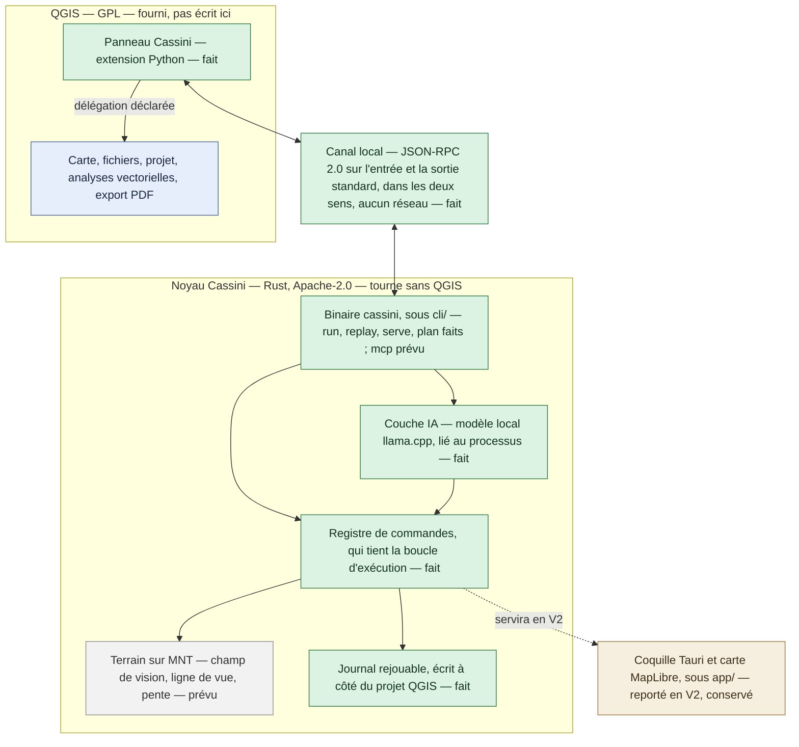
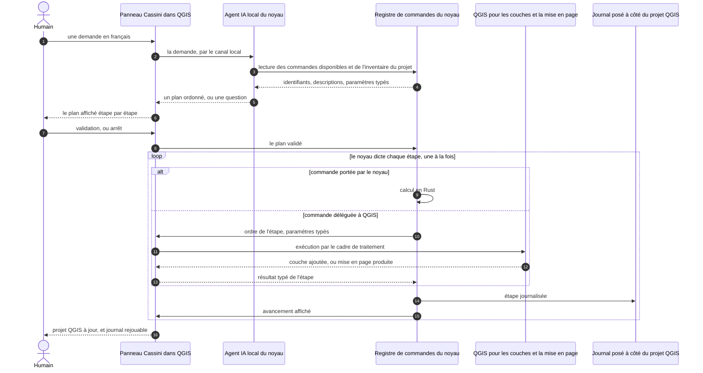
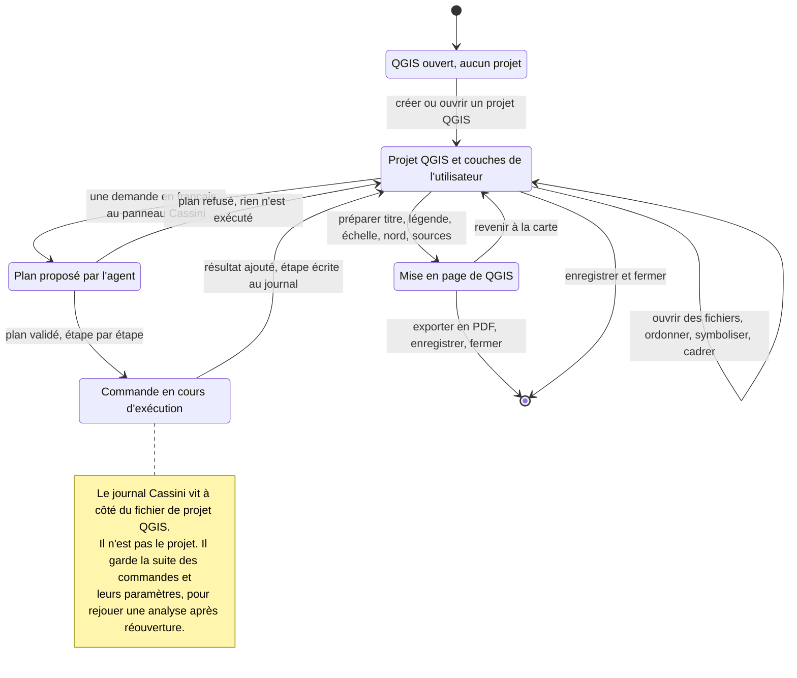

# Cassini

Cassini est l'**interface en langage naturel d'un SIG** — un système
d'information géographique — et elle fonctionne **entièrement hors ligne**.
L'utilisateur formule sa demande en français ; Cassini la traduit en une suite
d'opérations qu'elle affiche, fait valider, exécute, puis journalise pour qu'on
puisse les rejouer. Elle s'adresse aux bureaux d'études en urbanisme et en
environnement, aux collectivités et aux étudiants — en particulier à
l'utilisateur occasionnel, qui sait ce qu'il veut mais pas où cliquer.

**L'utilisateur apporte ses propres données.** Cassini n'en télécharge, n'en
catalogue et n'en redistribue aucune.

La phrase de démo, sur un projet où l'utilisateur a déjà ouvert ses fichiers :

> « Trouve les parcelles constructibles du PLU à moins de 500 m d'une gare à
> Villeneuve-le-Roi et sors-moi la carte en PDF. »

Elle passe aujourd'hui dans QGIS, sur processeur et sans réseau : le modèle local
compose le plan, l'utilisateur le valide, QGIS l'exécute et le PDF sort. Ce qui
reste avant la publication est listé plus bas.

**Cassini ne refait pas QGIS.** QGIS est libre, hors ligne, organisé en projets
et mûr depuis vingt ans : reconstruire sa carte, son ouverture de fichiers, ses
analyses et son export PDF serait perdre des années pour arriver à moins bien.
Ce qui n'existe nulle part, c'est un SIG de bureau hors ligne piloté par une IA
locale. Au MVP, Cassini est donc une **extension QGIS posée sur un noyau
indépendant** : QGIS exécute la carte, l'ouverture des fichiers, le projet, les
analyses vectorielles et l'export PDF ; le noyau porte le registre de commandes,
l'agent, le journal rejouable et, à venir, un moteur de terrain en licence
permissive.

Ce découpage date du 2026-10-14 et remplace un plan où Cassini était une
application de bureau complète ; le raisonnement est écrit en entier dans
[la proposition de changement](_bmad-output/initiative-cassini-mvp/change-facade-qgis-avant-app-autonome/change-facade-qgis-avant-app-autonome.md).
L'application autonome n'est pas abandonnée, elle est **reportée en V2**, et le
code déjà écrit pour elle reste au dépôt.

La frontière entre le noyau et l'extension est fixée par
[le contrat d'architecture](_bmad-output/initiative-cassini-mvp/architecture-noyau-et-facade-qgis/architecture-noyau-et-facade-qgis.md),
en décisions numérotées (AD-1 et suivantes) ; ce README en résume ce qui change
la forme du produit.

## Ce qui marche aujourd'hui

Le projet a franchi les étapes 1 à 4 de `CLAUDE.md` §7 et l'essentiel de la
cinquième : l'agent local tourne dans QGIS. Concrètement :

- **Le noyau** (`core/`, crate `cassini-core`) : le **registre de commandes**,
  où chaque commande s'inscrit seule et dont le registre contrôle lui-même le
  contrat (id, descriptions française et anglaise, schémas, exécutant, test) ; le
  **journal rejouable**, écrit à côté du projet QGIS en ajout seul sous verrou
  exclusif ; la validation des plans composés par l'agent, dont le garde-fou qui
  refuse une coordonnée que la demande n'a pas fournie.
- **Le binaire `cassini`** (`cli/`) : `run` exécute une commande, `replay` rejoue
  un journal, `serve` ouvre le canal local de l'extension, `plan` compose un plan
  depuis une phrase en ligne de commande, `model-check` vérifie qu'un modèle
  répond, `mcp` expose le registre à une IA externe par le protocole MCP. Un même
  appel donne le même résultat par `run`, par `serve` et par `mcp`, ce que
  contrôle un test sur le vrai binaire.
- **L'extension QGIS** (`qgis-plugin/`) : un panneau ancré dans QGIS 3.44 et
  4.x. On y écrit une demande en français, le plan proposé s'affiche étape par
  étape, on le valide ou on l'arrête, et le journal dit en une phrase ce que
  chaque étape a fait. Un mode expert lance une commande du registre à la main ;
  les Réglages choisissent la langue et le modèle.
- **Les commandes exécutées par QGIS**, toutes déclarées au registre :

  | Commande | Ce qu'elle fait |
  |---|---|
  | `layer.add` | ouvre un GeoPackage, un Shapefile, un GeoJSON, un CSV à coordonnées ou un GeoParquet, sans toucher le fichier |
  | `project.inventory`, `layer.describe` | décrivent le projet et ses couches, pour l'utilisateur et pour l'agent |
  | `analysis.buffer` | zone tampon |
  | `analysis.intersect` | intersection de deux couches |
  | `analysis.select_by_attribute` | sélection par attribut |
  | `analysis.zonal_statistics` | statistiques par zone |
  | `analysis.isochrone` | isochrones à pied et en voiture sur un réseau |
  | `layout.export_pdf` | carte en PDF avec titre, légende, échelle, flèche du nord et sources |

  S'y ajoutent deux commandes du noyau : `system.about` et `model.list`, qui liste
  les modèles présents sur le poste.
- **L'agent local** (`ai/`, crate `cassini-ai`) : un modèle quantifié au format
  GGUF, chargé **dans le processus du noyau** par llama.cpp lié en bibliothèque —
  jamais un serveur HTTP. Le modèle retenu est un Qwen3.5-4B (Apache-2.0) ajusté sur
  le registre de Cassini, choisi dans les Réglages du panneau ; il pose une question au lieu de deviner quand la demande
  est ambiguë, et enchaîne plusieurs phrases dans une même session sans saturer son
  contexte.
- **La chaîne d'entraînement** (`training/`) : le jeu d'exemples est engendré
  depuis le registre lui-même, l'entraînement et la fusion en GGUF se refont d'une
  seule commande, et un jeu tenu à l'écart mesure le modèle. Détail dans
  [`docs/entrainement-du-modele.md`](docs/entrainement-du-modele.md).
- **Le verrou hors ligne**, vérifié autrement que par lecture de code : la table
  d'imports du binaire Windows ne nomme aucune bibliothèque réseau, l'extension
  n'importe aucun module réseau, et `cargo deny` refuse tout client HTTP, toute
  couche TLS et toute licence non permissive dans le noyau.

**La durée par phrase.** L'exigence est qu'une longue phrase soit résolue en moins
de 30 s sur un processeur de bureau ordinaire. Sur dix phrases enchaînées dans une
session QGIS, bridée à quatre cœurs, huit sur neuf passent ; la phrase de démo, en
cours de session, reste juste au-dessus (32 s au mieux). Quand le poste a une carte
graphique dédiée, le noyau s'en sert seul, par Vulkan (NVIDIA, AMD et Intel), et
retombe sur le processeur sans elle, sans aucun réglage. Une carte intégrée n'est
jamais prise. Sur une RTX 3070 Ti, les neuf phrases passent sous 30 s, et la phrase de
démo en cours de session tombe à 14 s. Les relevés sont dans
[`docs/mesure-duree-par-phrase.md`](docs/mesure-duree-par-phrase.md).

**Conservé pour la V2** (`app/`) : une coquille de bureau Tauri v2 qui affiche
une carte MapLibre sur un fond PMTiles lu sur le disque, sans aucune requête
réseau. Elle marche et reste testée, mais elle est hors du chemin critique du MVP
depuis le 2026-10-14.

## Ce qui est prévu

Les sept étapes du projet, telles que les fixe `CLAUDE.md` §7. Aucune étape ne
commence avant que la précédente ne soit testée.

| Étape | Ce qu'elle apporte | État |
|---|---|---|
| 1 | Socle technique, verrou hors ligne, recette automatique | **faite** |
| 2 | Épreuve du modèle local sur un registre factice | **faite** : verdict « oui sous conditions », dans `_bmad-output/initiative-cassini-mvp/epic-epreuve-du-modele-local/` |
| 3 | Registre de commandes et journal rejouable | **faite**, suite de bout en bout comprise : exécuter, fermer, rouvrir, rejouer, comparer |
| 4 | Façade QGIS — extension, canal local, commandes exécutées par QGIS | **faite**, suite de bout en bout comprise : ouvrir, analyser, exporter, rejouer |
| 5 | Agent IA local et serveur MCP | **en cours** : l'agent est fait et tourne dans QGIS, sur carte graphique ou sur processeur ; le serveur MCP (`cassini mcp`) est écrit et n'expose que les commandes du noyau ; reste la suite de bout en bout |
| 6 | Analyse de terrain dans le noyau — champ de vision, ligne de vue, pente | à venir |
| 7 | Scénario de démo, puis publication : dépôt d'extensions QGIS, installeurs, vidéo | à venir |

Un catalogue étendu est déjà découpé pour l'après-MVP (epic 10) : reprojection,
conversion de format, plus proche voisin, plus court chemin, atlas PDF,
statistiques zonales sur un MNT, géocodage sur la Base Adresse Nationale.

Limite connue de la phrase de démo : « constructible » se traduit aujourd'hui par
la zone urbaine `U` du standard du CNIG ; les zones `AUc` ne sont pas encore
couvertes, faute d'opérateur « parmi » dans le registre.

Formats ouverts par QGIS pour le compte du registre : GeoPackage, Shapefile,
GeoJSON, CSV à coordonnées, GeoParquet. Systèmes de coordonnées : Lambert-93
(EPSG:2154) et WGS84 au minimum, avec reprojection quand la couche diffère du
projet — reprojection exécutée par QGIS, jamais par le noyau (AD-19). Aucune
parité avec QGIS n'est visée ni revendiquée.

Cassini se distribuera en deux artefacts : l'extension, légère et sans binaire,
par le dépôt d'extensions QGIS ; le noyau et le modèle d'IA, par un paquet Cassini
installé à part. Une clé USB portant les deux suffira sur un poste qui n'a jamais
vu le réseau (AD-17).

## Quatre principes non négociables

1. **Hors ligne total.** Aucune fonction du produit n'utilise le réseau. Il ne
   servira qu'à brancher une IA externe, en option, et jamais par défaut.
2. **Le noyau sans GPL ni LGPL ; l'extension en GPL par conséquence.** Le noyau
   n'admet que MIT, Apache-2.0 et BSD, y compris par liaison statique et y
   compris transitivement — d'où l'exclusion de GEOS. L'extension QGIS, elle, est
   forcément en GPL puisque QGIS l'est : elle vit **séparée** du noyau, le noyau
   ne lie jamais QGIS, et les deux communiquent **à distance de bras, par
   processus séparé**. La licence de chaque dépendance ajoutée est écrite dans le
   message de commit qui l'ajoute.
3. **Le noyau tourne sans QGIS.** Il se lance, s'exécute et se teste seul : c'est
   ce qui fonde le principe précédent et ce qui rend la V2 autonome possible.
   Toute dépendance du noyau envers QGIS est un bug.
4. **L'utilisateur apporte ses données, et ce dépôt reste civil.** Cassini ne
   télécharge rien et ne modifie jamais le fichier d'origine. Ce dépôt public ne
   contient aucune fonction spécialement conçue pour l'usage militaire — voir
   [Licence](#licence-et-noyau-civil).

Les principes complets, dont la règle de travail en salle blanche, sont dans
[`CLAUDE.md`](CLAUDE.md) §2, qui est la source de vérité du projet.

## Comment c'est construit

### L'architecture en couches

Les cases vertes sont écrites et testées ; les grises n'existent pas encore.



Trois conséquences de ce découpage :

- **Aucune logique métier dans l'extension.** L'extension QGIS, la ligne de
  commande, l'agent local et le futur serveur MCP appellent *les mêmes* commandes
  du registre.
- **Chaque commande déclare son exécutant.** Soit une implémentation en Rust dans
  le noyau, soit une délégation déclarée à QGIS — jamais implicite, jamais les
  deux.
- **Indépendance vis-à-vis des fournisseurs d'IA.** Le code ne dépend d'aucune IA
  en particulier : IA locale par défaut, IA externes par MCP.

Le canal local (AD-2, AD-3) : l'extension lance le binaire du noyau comme
processus enfant et dialogue avec lui par son entrée et sa sortie standard, en
JSON-RPC 2.0, un message par ligne, dans les deux sens. Aucune socket, aucun port,
aucun fichier d'échange. Ce qui porte l'argument de licence du principe 2, c'est
la **nature** de ce qui circule : des identifiants, des chemins relatifs, des
paramètres à schéma JSON et des résultats typés — jamais une couche entière ni une
structure interne (AD-8, AD-16). Le contrat des messages est dans
[`docs/canal-local.md`](docs/canal-local.md).

### Le trajet d'une demande en langage naturel

Le panneau demande, le noyau décide et dicte une étape à la fois (AD-5). La branche
« commande portée par le noyau » ne sert encore qu'à `system.about` et `model.list` ;
le terrain y viendra à l'étape 6.



L'agent ne fait rien d'autre que **choisir des commandes du registre** : il n'a
pas d'accès direct à QGIS ni au disque, et son plan est validé contre les schémas
des commandes avant d'être montré ; rien de ce qu'il produit n'est exécuté comme
du code (AD-23). Un plan invalide est refusé, jamais réparé en silence.
L'extension n'enchaîne jamais deux commandes d'elle-même. Toute exécution est
journalisée par le noyau seul (AD-11), pour que la même demande puisse être
rejouée à l'identique.

### Le cycle de vie d'un projet QGIS

Le projet appartient à QGIS : Cassini n'a pas de format de projet et n'en aura
pas au MVP. Ce qu'il écrit, c'est son journal, posé à côté du fichier de projet,
et les couches produites par les analyses, dans un dossier `<projet>.cassini/`.



## Les dossiers du dépôt

| Dossier | À quoi il sert |
|---|---|
| `core/` | Le noyau, crate `cassini-core` : registre de commandes, commandes, journal, canal local, validation des plans. Les tests unitaires sont à côté du code qu'ils couvrent. |
| `ai/` | La couche IA, crate `cassini-ai` : le modèle local chargé dans le processus du noyau par llama.cpp, la composition du plan, le choix des fils de calcul. `cassini-core` n'en dépend jamais (AD-13). |
| `cli/` | Le binaire unique `cassini`. Il vit à part parce qu'il a besoin du noyau **et** de la couche IA. Ses tests d'intégration lancent le vrai binaire. |
| `qgis-plugin/` | L'extension QGIS en Python, sous GPL : le panneau, l'exécutant des gestes QGIS, et ses tests. Installation et recettes manuelles dans [`qgis-plugin/README.md`](qgis-plugin/README.md). |
| `training/` | La chaîne d'entraînement du modèle : générateur d'exemples tiré du registre (Rust), entraînement et notation (Python). Ne tourne jamais en CI, sauf ses tests. |
| `app/` | **Reporté en V2, conservé exprès.** La coquille Tauri et la carte MapLibre, avec ses scripts de recette et le générateur de fond de carte. |
| `docs/` | La documentation. Index dans [`docs/README.md`](docs/README.md). |
| `fixtures/` | Les jeux de test, légers et fabriqués par le dépôt lui-même — aucune donnée géographique tierce. Voir [`fixtures/README.md`](fixtures/README.md). |
| `tests/` | Réservé aux tests qui traversent plusieurs briques ; les suites de bout en bout vivent pour l'instant dans `cli/tests/` et `qgis-plugin/tests/`. |
| `_bmad-output/` | La planification : spécification, contrat d'architecture, epics, tickets, et le plan écrit de chaque entrée de travail. |
| `_bmad/` | L'outillage de planification qui produit ce qui précède. |

À la racine : [`CLAUDE.md`](CLAUDE.md), la source de vérité du projet ;
`Cargo.toml`, le workspace (`core`, `ai`, `cli`, `training`, `app/src-tauri`) ;
`deny.toml`, la garde des licences et des dépendances ; `LICENSE`.

Les essais à la main se font sur un jeu de données réelles (Villeneuve-le-Roi,
Natural Earth, modèle d'élévation) qui vit **hors du dépôt**, dans
`../donnees-test-cassini/`, et n'est jamais commité ni redistribué.

## Démarrage rapide

**Prérequis** : Rust stable avec `cargo` (la version est figée par
`rust-toolchain.toml`), CMake et libclang pour compiler llama.cpp. Sous Windows,
la marche à suivre est dans
[`docs/modele-local-sous-windows.md`](docs/modele-local-sous-windows.md) ; la
coquille V2 demande en plus Node.js et les prérequis de Tauri v2, détaillés dans
[`docs/compiler-sous-windows.md`](docs/compiler-sous-windows.md).

Le noyau se teste seul, sans QGIS et sans modèle — c'est le principe 3 en
pratique :

```bash
cargo test -p cassini-core -p cassini-ai -p cassini
```

Pour essayer Cassini dans QGIS :

1. Construire le noyau : `cargo build --release -p cassini` donne un noyau processeur
   d'un seul fichier. Le paquet livré, qui se sert aussi de la carte graphique, se
   construit avec `--features gpu` et le SDK Vulkan : c'est un dossier, `cassini.exe` et
   ses bibliothèques — voir [`docs/paquet-du-noyau.md`](docs/paquet-du-noyau.md).
2. Poser le noyau dans `%LOCALAPPDATA%\Cassini\bin` (Windows) ou
   `~/.local/share/cassini/bin` (Linux), et un modèle `.gguf` dans le dossier
   `models/` voisin — voir [`docs/dossier-des-modeles.md`](docs/dossier-des-modeles.md).
3. Copier `qgis-plugin/cassini_qgis` dans le dossier des extensions de QGIS, puis
   activer *Cassini* — détail dans [`qgis-plugin/README.md`](qgis-plugin/README.md).
4. Ouvrir un projet QGIS avec ses couches, et écrire une demande dans le panneau.

Rien n'est téléchargé à aucun moment : le modèle se copie à la main, comme le
noyau.

### Brancher un client MCP

Une IA externe, si on en veut une, pilote Cassini par `cassini mcp`, un serveur MCP
sur l'entrée et la sortie standard — aucun port, aucune socket. Le client lance le
binaire lui-même ; avec `--project`, chaque appel est journalisé à côté du projet,
comme par `cassini run` :

```json
{
  "mcpServers": {
    "cassini": {
      "command": "cassini",
      "args": ["mcp", "--project", "C:/chemin/vers/projet.qgz"]
    }
  }
}
```

Si `cassini` n'est pas dans le `PATH` (c'est le cas du paquet Windows, posé dans
`%LOCALAPPDATA%\Cassini\bin`), `command` doit porter le chemin complet du binaire,
par exemple `C:/Users/<vous>/AppData/Local/Cassini/bin/cassini.exe`.

Seules les commandes du noyau sont exposées comme outils (`system.about`,
`model.list`), avec leurs schémas. Les commandes exécutées par QGIS n'y sont pas :
elles ont besoin de l'extension. Le serveur ne compose aucun plan : l'IA externe
appelle les commandes une à une.

Avec `--project`, le serveur tient le verrou du journal du projet **pendant toute sa
vie**. QGIS ouvert sur le même projet passe alors en lecture seule ; et si QGIS tenait
le verrou le premier, chaque appel MCP répond `journal.read_only`.

## La recette

Le workflow [`.github/workflows/recette.yml`](.github/workflows/recette.yml) la
lance à chaque poussée ; chaque contrôle se lance aussi à la main. Si l'un échoue,
le run passe au rouge.

| Contrôle | Ce qu'il vérifie |
|---|---|
| `cargo deny check` | Licences permissives seulement dans le noyau ; aucun client HTTP, aucune couche asynchrone, aucune couche TLS (AD-14). |
| `cargo fmt --all --check` | La mise en forme du Rust. |
| `cargo test -p cassini-core -p cassini-ai -p cassini -p cassini-training --locked` | Les tests du noyau, de la couche IA, du binaire et du générateur d'exemples, dont le refus de toute source réseau, la parité entre `run` et `serve`, le rejeu du journal et la suite de bout en bout. |
| `cargo run --release -p cassini -- run system.about` | Le binaire de release connaît bien les commandes du noyau. |
| `cargo clippy --workspace --all-targets --locked -- -D warnings` | Zéro avertissement, coquille Tauri comprise. |
| `cargo test --release -p cassini --test hors_ligne`, sous Windows | Ni le binaire ni les bibliothèques posées à côté de lui n'importent une bibliothèque réseau. Avec `--features gpu` (à la main, la CI n'a pas le SDK Vulkan), il vérifie aussi le contenu du paquet. |
| `python -I qgis-plugin/tests/check_extension.py` puis les tests de `qgis-plugin/tests`, sous Linux et Windows | L'extension n'importe ni module réseau ni PyQt direct, tient sous la taille permise, et ses tests passent sans QGIS. |
| les tests de `training/entrainement/tests` | La chaîne d'entraînement : lecture du jeu, notation, gardes — sans GPU. |
| `npm run check`, `npm run build` et `npm run verify:dist`, depuis `app` | La coquille V2 : typage strict, garde hors ligne de l'interface, fond de carte de recette. |

Sous WSL, `--workspace` demande `libdbus` (dépendance de la coquille Tauri) :
lancer `cargo clippy -p cassini-core -p cassini-ai -p cassini --all-targets --locked -- -D warnings`.

Deux familles de contrôles ne tournent pas en CI, parce qu'elles demandent ce que
la CI n'a pas :

- **Les sondes sous le vrai QGIS** (`qgis-plugin/tests/probe_*.py`), lancées par
  `python-qgis-ltr.bat` : elles enchaînent les commandes dans un vrai projet, le
  ferment, le rouvrent et rejouent le journal.
- **Les mesures du vrai modèle** (`ai/tests/*_reel.rs`) : justesse des plans
  (`plan_reel`), des questions (`question_reel`), score sur le jeu tenu à l'écart
  (`ecart_reel`) et durée par phrase (`duree_reel`). Elles demandent un modèle
  posé par `CASSINI_TEST_MODEL`.

Un garde-fou qu'on n'a jamais vu refuser quelque chose ne garde rien : d'où les
contrôles qui échouent exprès.

## Licence et noyau civil

Trois régimes, et celui de l'extension n'est pas un choix :

- **Le noyau, la couche IA, le binaire et la coquille de bureau** — `core/`,
  `ai/`, `cli/`, `training/`, `app/` : **Apache-2.0**, voir [`LICENSE`](LICENSE).
  L'usage commercial et institutionnel est permis, et aucune dépendance GPL ou
  LGPL n'y est admise, même par liaison statique.
- **L'extension QGIS** — `qgis-plugin/` : **GPL**, comme QGIS. C'est une
  conséquence de l'hôte, pas une préférence. Elle vit séparée du noyau, qui ne lie
  jamais QGIS et reste utilisable sans lui.
- **Le module défense**, s'il voit le jour : **dépôt privé distinct**, bâti sur le
  noyau et non sur l'extension — précisément parce que l'extension est en GPL. Sa
  licence et ses conditions de commercialisation dépendent de la réponse à une
  demande de classement.

Ce dépôt est le **noyau civil** du projet, généraliste. Il ne contient, et ne
contiendra, **aucune fonction spécialement conçue pour l'usage militaire** : la
charnière du contrôle à l'exportation des équipements militaires de l'Union
européenne est précisément l'expression *specially designed for military use*, et
l'article L.2332-1 du Code de la défense soumet le commerce de matériels de guerre
à autorisation. Les fonctions de cette nature, si elles voient le jour, vivront
dans le dépôt privé cité ci-dessus, et leur diffusion est subordonnée aux
autorisations que la réglementation impose.

Sont également hors du périmètre de ce dépôt : le téléchargement ou la
redistribution de données, les formats de projet propriétaires, et les formats et
symbologies de défense.
