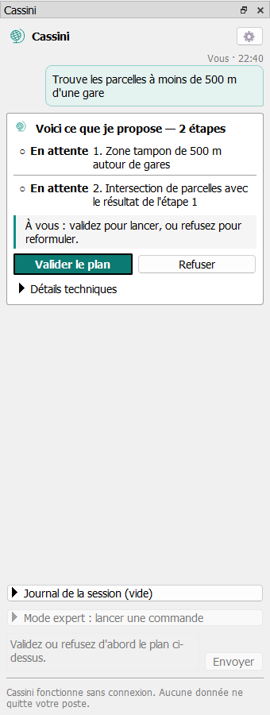
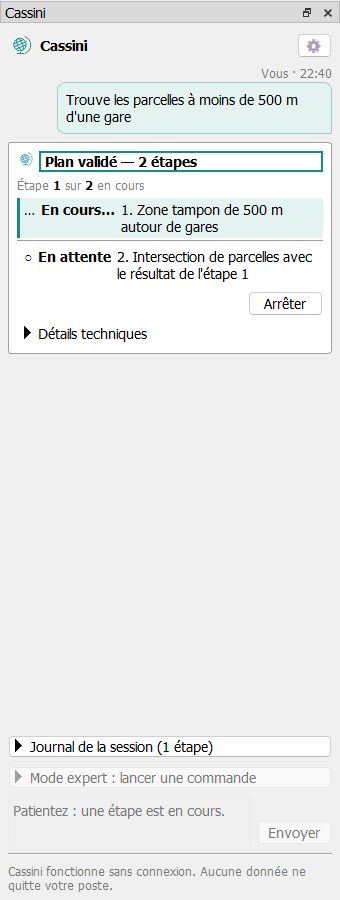
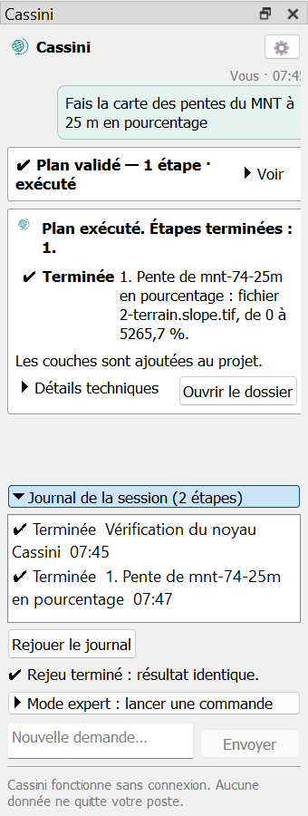
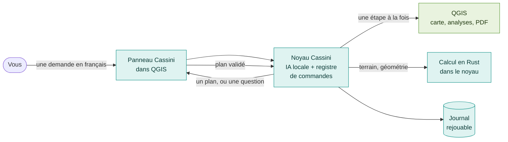
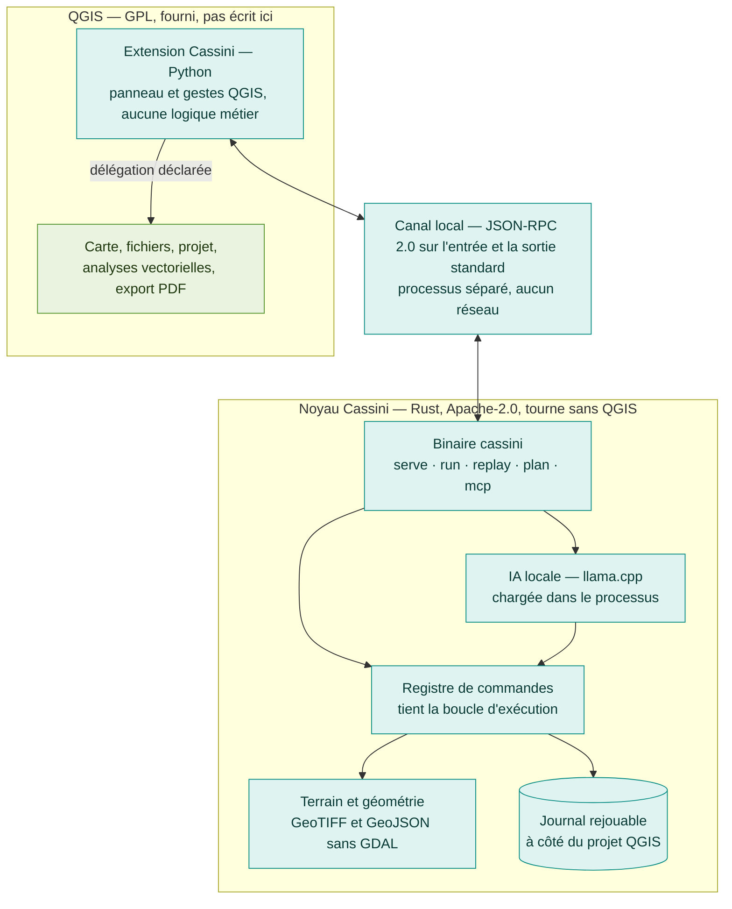
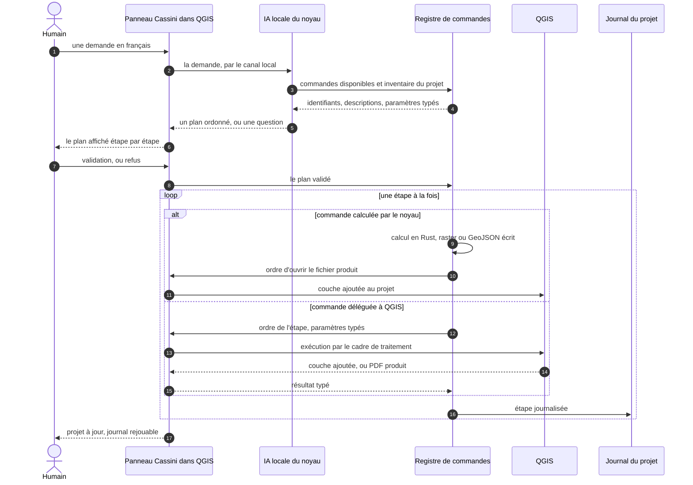

<div align="center">

<picture>
  <source media="(prefers-color-scheme: dark)" srcset="docs/images/logo-cassini-dark.svg">
  
</picture>

# Cassini

**Pilotez QGIS en français, avec une IA qui tourne sur votre poste.**<br>
Sans connexion, sans compte, et sans que vos données quittent votre machine.

[](#les-principes)
[](qgis-plugin/README.md)
[](core/)
[](LICENSE)
[](qgis-plugin/)
[](.github/workflows/recette.yml)

[Ce qu'il fait](#ce-que-cassini-sait-faire) ·
[Comment ça marche](#comment-ça-marche) ·
[Où en est le projet](#où-en-est-le-projet) ·
[Installer](#installer) ·
[Architecture](#sous-le-capot) ·
[Licence](#licence)

</div>

---

> **« Trouve les parcelles constructibles du PLU à moins de 500 m d'une gare à Annecy
> et sors-moi la carte en PDF. »**

Vous écrivez cette phrase dans QGIS. Cassini vous montre son plan, étape par étape.
Vous le validez. QGIS l'exécute, la carte s'affiche et le PDF sort. Tout est écrit
dans un journal, pour refaire exactement la même analyse plus tard.

<table>
  <tr>
    <td align="center" width="33%"></td>
    <td align="center" width="33%"></td>
    <td align="center" width="33%"></td>
  </tr>
  <tr>
    <td align="center"><b>1. Cassini propose</b><br><sub>le plan, en français, avant d'agir</sub></td>
    <td align="center"><b>2. Vous validez, QGIS exécute</b><br><sub>une étape à la fois, arrêtable</sub></td>
    <td align="center"><b>3. Tout se rejoue</b><br><sub>même journal, même résultat</sub></td>
  </tr>
</table>

## Pour qui, et pourquoi

Cassini s'adresse aux **bureaux d'études** (urbanisme, environnement), aux
**collectivités** et aux **étudiants** — et d'abord à l'utilisateur occasionnel,
qui sait ce qu'il veut mais pas où cliquer.

|  |  |
|---|---|
| 🔌 **Entièrement hors ligne** | Le modèle d'IA tourne dans le programme Cassini, sur votre poste. Aucune requête réseau, aucun compte, aucun abonnement. |
| 👀 **Rien sans votre accord** | L'IA ne fait que *proposer* une suite de commandes. Rien ne s'exécute avant que vous ayez validé le plan. |
| 🔁 **Reproductible** | Chaque étape est journalisée à côté du projet QGIS. On rouvre le projet, on rejoue, on obtient la même chose. |
| 📂 **Vos données restent les vôtres** | Vous ouvrez vos propres fichiers. Cassini ne télécharge aucune donnée et ne modifie jamais un fichier d'origine. |
| 🎨 **Une carte lisible tout de suite** | Une phrase met vos couches aux couleurs de l'IGN et du standard CNIG des PLU, et range le projet par thème. |
| 🗺️ **QGIS, pas un SIG de plus** | QGIS fait la carte, les analyses et l'export depuis vingt ans. Cassini ne le refait pas : il le pilote. |

Ce qui n'existait nulle part, c'est un SIG de bureau hors ligne **piloté par une IA
locale**. C'est tout ce que Cassini ajoute.

## Ce que Cassini sait faire

**32 commandes** sont aujourd'hui offertes à l'IA, toutes testées. Chacune est
décrite une seule fois, dans [le catalogue des commandes](_bmad-output/initiative-cassini-mvp/spec-cassini-mvp/catalogue-des-commandes.md),
et appelée à l'identique depuis le panneau, la ligne de commande et une IA externe.

| Domaine | Ce qu'on peut demander | Calculé par |
|---|---|---|
| **Données et projet** | ouvrir un GeoPackage, un Shapefile, un GeoJSON, un CSV ou un GeoParquet ; décrire le projet et ses couches ; reprojeter ou convertir une couche ; retirer une couche du projet | QGIS |
| **Analyses** | zone tampon, intersection, sélection par attribut, comptage de points par zone, isochrones à pied ou en voiture | QGIS |
| **Terrain** | pente, exposition, ombrage, ligne de vue, champ de vision simple ou cumulé, points hauts, coût de déplacement et chemin de moindre coût | noyau Cassini |
| **Rasters** | reclassement, superposition pondérée de plusieurs critères | noyau Cassini |
| **Coordonnées** | conversion WGS84 ↔ UTM ↔ MGRS, distance et azimut, point par azimut et distance, recoupement de deux visées, reprojection d'un point | noyau Cassini · QGIS |
| **Carte** | couleurs officielles de l'IGN et du CNIG en un mot, dégradé selon un champ, export PDF avec titre, légende, échelle, nord, sources, format et carroyage | noyau Cassini · QGIS |

### 🎨 Une carte aux couleurs de l'IGN, en une phrase

> **« Je voudrais que la carte ressemble à une carte IGN. »**

Vous ouvrez vos couches BD TOPO, votre PLU et votre MNT : elles arrivent dans QGIS avec
des couleurs au hasard. Une phrase suffit pour que Cassini les mette aux couleurs
**de la carte IGN au 1:25 000** et **du standard CNIG pour les zones de PLU**, puis les
range par thème :

- **chaque couche est reconnue** d'après son nom et ses champs (`nature` et
  `importance` de la BD TOPO, `typezone` du PLU) ;
- **chaque classe a sa couleur** : routes par importance, bâti par usage, zones U, AU,
  A et N du PLU, MNT en teintes d'altitude sous un ombrage ;
- **le projet est rangé** : vos résultats en haut, puis les points, les lignes, les
  surfaces, et le relief tout en dessous ;
- **rien n'est modifié** dans vos fichiers, et la mise en forme se rejoue comme le
  reste.

Une couche que Cassini ne reconnaît pas garde son style : il ne devine pas.

<details>
<summary><b>La liste complète des commandes</b></summary>

**Exécutées par QGIS**, à la demande du noyau :

| Commande | Ce qu'elle fait |
|---|---|
| `layer.add` | ouvre un fichier vecteur sans le toucher |
| `project.inventory`, `layer.describe` | décrivent le projet et ses couches, pour vous et pour l'IA |
| `layer.remove` | retire une couche du projet, sans effacer ni modifier son fichier |
| `data.reproject`, `data.convert`, `data.convert_raster` | reprojettent une couche, la convertissent dans un autre format, écrivent un raster (ASCII Grid, IMG, JP2…) en GeoTIFF pour les commandes de terrain |
| `data.transform_point` | reprojette un seul point vers un code EPSG |
| `analysis.buffer` | zone tampon |
| `analysis.intersect` | intersection de deux couches |
| `analysis.select_by_attribute` | sélection par attribut |
| `analysis.zonal_statistics` | nombre de points dans chaque zone |
| `analysis.isochrone` | isochrones à pied et en voiture sur un réseau |
| `layout.export_pdf` | carte en PDF : titre, légende, échelle, flèche du nord, sources, format, orientation, carroyage |

**Calculées par le noyau**, en Rust, testées sans QGIS :

| Commande | Ce qu'elle fait |
|---|---|
| `terrain.slope` | pente d'un MNT, en degrés ou en pourcentage |
| `terrain.aspect`, `terrain.hillshade` | exposition et ombrage |
| `terrain.line_of_sight` | ligne de vue entre deux points, courbure et réfraction comprises |
| `terrain.viewshed`, `terrain.viewshed_cumulative` | champ de vision depuis un point, ou nombre d'observateurs qui voient chaque cellule |
| `terrain.peaks` | points hauts, par proéminence |
| `terrain.cost_distance`, `terrain.least_cost_path` | coût de déplacement cumulé, chemin de moindre coût |
| `raster.reclassify`, `raster.weighted_overlay` | reclassement, superposition pondérée |
| `coord.convert` | conversion d'une coordonnée entre WGS84, UTM et MGRS |
| `geo.distance_azimuth`, `geo.destination_point`, `geo.bearing_intersection` | géodésie : distance et azimut, point d'arrivée, recoupement |
| `map.topographic_style` | couleurs de la carte IGN au 1:25 000 et du standard CNIG des PLU, couches rangées par thème |
| `map.graduated_style` | dégradé de couleurs selon un champ numérique (intervalles égaux, quantiles, Jenks) |
| `system.about`, `model.list` | version du noyau, modèles présents sur le poste |

Quatre commandes de plus (`layer.open_raster`, `layer.open_vector`, `layer.set_style`,
`layer.arrange`) ne sont **dictées que par le noyau**, après l'étape qui les rend
nécessaires : elles ne sont offertes ni à l'IA locale ni à une IA externe (AD-30).

</details>

**Le terrain est calculé par Cassini lui-même.** Aucune ligne n'en vient de GRASS,
de Whitebox, de GDAL ni de QGIS : chaque calcul est écrit d'après sa publication
(Horn pour la pente, Franklin et Ray pour la visibilité, Karney pour la géodésie, la
spécification de la NGA pour MGRS). Comparé à QGIS et à GRASS sur un vrai MNT, il
donne les mêmes résultats, **2,9 à 124 fois plus vite** —
[le détail](docs/comparaison-terrain-qgis.md).

**L'IA répond vite.** Sur une carte graphique (RTX 3070 Ti), la phrase de démo est
résolue en 14 s. Sans carte graphique, sur un processeur de bureau bridé à quatre
cœurs, huit phrases longues sur neuf passent sous 30 s ; la phrase de démo reste
juste au-dessus. Cassini choisit seul la carte graphique quand il y en a une
(NVIDIA, AMD, Intel, par Vulkan), sans réglage —
[les mesures](docs/mesure-duree-par-phrase.md).

**Quand la demande est ambiguë, Cassini pose une question** au lieu de deviner.

## Comment ça marche



1. **Vous demandez**, en français, dans le panneau ancré dans QGIS.
2. **L'IA locale compose un plan** à partir des seules commandes du catalogue et des
   couches de votre projet. Elle n'a aucun accès direct à QGIS ni au disque, et rien
   de ce qu'elle produit n'est exécuté comme du code.
3. **Le plan est vérifié puis affiché.** Un plan invalide est refusé, jamais réparé
   en silence. Vous le validez, ou vous le refusez pour reformuler.
4. **Le noyau dicte chaque étape**, une à la fois : QGIS exécute les couches et la
   mise en page, le noyau calcule le terrain et la géométrie.
5. **Tout est journalisé** à côté du projet QGIS, et se rejoue d'un clic.

## Où en est le projet

| | Étape | État |
|:-:|---|---|
| ✅ | **1.** Socle technique, verrou hors ligne, recette automatique | fait |
| ✅ | **2.** Épreuve du modèle local : une IA quantifiée sait-elle composer des commandes ? | fait — « oui, sous conditions » |
| ✅ | **3.** Registre de commandes et journal rejouable | fait |
| ✅ | **4.** Extension QGIS et canal local | fait |
| ✅ | **5.** Agent IA local et serveur MCP | fait |
| ✅ | **6.** Analyse de terrain dans le noyau | fait, comparée à QGIS et GRASS |
| 🔨 | **6 bis.** Géométrie, terrain étendu, catalogue figé | presque fait : reste la démonstration de bout en bout dans QGIS |
| ⏳ | **7.** Démo filmée sur Annecy, puis publication : dépôt d'extensions QGIS, installeurs, vidéo | à venir |

**Ensuite** : un catalogue étendu est déjà décrit — plus proche voisin, plus court
chemin sur un réseau, atlas PDF, courbes de niveau, vectorisation, statistiques
zonales sur un MNT, géocodage sur la Base Adresse Nationale — et des identifiants
sont réservés pour l'hydrologie et la couverture radio.

<details>
<summary><b>Limites connues</b></summary>

- « Constructible » se traduit aujourd'hui par la zone urbaine `U` du standard du
  CNIG ; les zones `AUc` ne sont pas encore couvertes, faute d'opérateur « parmi »
  dans la sélection par attribut.
- Formats vecteur : GeoPackage, Shapefile, GeoJSON, CSV à coordonnées, GeoParquet.
  Raster : MNT et rasters de critères en GeoTIFF à une bande.
- Le noyau ne convertit que des **coordonnées ponctuelles** (WGS84, UTM, MGRS) ;
  toute couche est reprojetée par QGIS (AD-19).
- Aucune parité avec QGIS n'est visée ni revendiquée.

</details>

## Installer

### Bientôt : deux installeurs

À la publication (étape 7), Cassini s'installera en deux temps : **l'extension**
depuis le dépôt officiel d'extensions de QGIS, et **le moteur Cassini** (le noyau et
le modèle d'IA) par l'une de deux portes, sous Windows et Linux d'abord.

| | Installeur léger | Installeur complet |
|---|---|---|
| **Pour** | un poste avec Internet | un poste isolé du réseau |
| **Comment** | télécharge une seule fois, pendant l'installation, le noyau et le modèle à des adresses fixes, et vérifie l'empreinte de chaque fichier | un seul fichier qui contient tout |
| **Mises à jour** | « Mettre à jour Cassini », lancé à la main ; un nouveau modèle s'installe à côté de l'ancien | nouvel installeur complet |

Une fois installés, ni le noyau ni l'extension ne touchent plus jamais au réseau.
Si l'extension ne trouve pas le moteur, elle propose un bouton qui ouvre la page de
téléchargement dans votre navigateur — elle ne télécharge rien elle-même.

### Aujourd'hui : depuis les sources

<details>
<summary><b>Construire et essayer Cassini dans QGIS</b></summary>

**Prérequis** : Rust stable (version figée par `rust-toolchain.toml`), CMake et
libclang pour compiler llama.cpp. Sous Windows :
[`docs/modele-local-sous-windows.md`](docs/modele-local-sous-windows.md).

Sous WSL ou Linux, `bindgen` a besoin d'aide pour trouver libclang et les en-têtes
de gcc :

```bash
sudo apt install build-essential cmake clang libclang-dev
export LIBCLANG_PATH=/usr/lib/llvm-18/lib        # le dossier qui contient libclang.so
export BINDGEN_EXTRA_CLANG_ARGS=-I/usr/lib/gcc/x86_64-linux-gnu/13/include
```

(`ls /usr/lib/llvm-*` et `ls /usr/lib/gcc/x86_64-linux-gnu` donnent les numéros de
votre poste.)

Le noyau se teste seul, sans QGIS et sans modèle :

```bash
cargo test -p cassini-core -p cassini-ai -p cassini
```

Puis, pour l'essayer dans QGIS :

1. **Construire le noyau** : `cargo build --release -p cassini`. Le paquet livré, qui
   sait aussi se servir de la carte graphique, se construit avec `--features gpu` et
   le SDK Vulkan — voir [`docs/paquet-du-noyau.md`](docs/paquet-du-noyau.md).
2. **Le poser** dans `%LOCALAPPDATA%\Cassini\bin` (Windows) ou
   `~/.local/share/cassini/bin` (Linux), avec un modèle `.gguf` dans le dossier
   `models/` voisin — voir [`docs/dossier-des-modeles.md`](docs/dossier-des-modeles.md).
3. **Copier l'extension** `qgis-plugin/cassini_qgis` dans le dossier des extensions de
   QGIS et activer *Cassini* — voir [`qgis-plugin/README.md`](qgis-plugin/README.md).
4. **Ouvrir un projet** avec vos couches, et écrire une demande dans le panneau.

</details>

### Brancher une IA externe (facultatif)

Si vous préférez une IA externe, elle peut piloter Cassini par le protocole MCP :
`cassini mcp` est un serveur sur l'entrée et la sortie standard, sans port ni
socket. C'est l'application de l'IA qui lance le binaire ; Cassini ne contient
aucune ligne propre à un fournisseur. Dans le panneau, cochez **« Autoriser une IA
externe »** : chaque appel défile au journal, sous vos yeux, et **Couper** l'arrête.

<details>
<summary><b>Claude Desktop, Claude Code, ChatGPT / Codex, Gemini, Antigravity</b></summary>

Toutes les fiches lancent la même commande : le chemin du binaire (Windows :
`C:/Users/<vous>/AppData/Local/Cassini/bin/cassini.exe`) suivi de `mcp`. Les outils
portent le nom de la commande, le point remplacé par un souligné
(`analysis_buffer` pour `analysis.buffer`).

**Claude Desktop** ([documentation](https://modelcontextprotocol.io/docs/develop/connect-local-servers)).
Réglages › Développeur › *Modifier la configuration* ouvre `claude_desktop_config.json`
(`%APPDATA%\Claude\` ; version du Microsoft Store :
`%LOCALAPPDATA%\Packages\Claude_<suffixe>\LocalCache\Roaming\Claude\`). Y mettre, puis
quitter complètement Claude Desktop et le rouvrir :

```json
{
  "mcpServers": {
    "cassini": {
      "command": "C:/Users/<vous>/AppData/Local/Cassini/bin/cassini.exe",
      "args": ["mcp"]
    }
  }
}
```

**Claude Code** ([documentation](https://code.claude.com/docs/en/mcp)) :
`claude mcp add cassini -- C:/Users/<vous>/AppData/Local/Cassini/bin/cassini.exe mcp`.

**ChatGPT pour ordinateur et Codex CLI** ([documentation](https://learn.chatgpt.com/docs/extend/mcp)).
Les deux lisent `%USERPROFILE%\.codex\config.toml`. Dans l'application : Réglages ›
*MCP servers* › *Add server*, type **STDIO**, puis *Restart*. En ligne de commande :
`codex mcp add cassini -- C:/Users/<vous>/AppData/Local/Cassini/bin/cassini.exe mcp`.
Ou dans le fichier :

```toml
[mcp_servers.cassini]
command = "C:/Users/<vous>/AppData/Local/Cassini/bin/cassini.exe"
args = ["mcp"]
```

`default_tools_approval_mode = "approve"` sous `[mcp_servers.cassini]` évite une
confirmation à chaque appel. Codex ne pense pas toujours de lui-même à Cassini :
commencez la demande par « Dans mon projet QGIS ouvert, avec les outils Cassini : ».
L'application web de ChatGPT ne lance pas de programme sur le poste : elle ne peut
pas servir.

**Gemini CLI** ([documentation](https://github.com/google-gemini/gemini-cli/blob/main/docs/tools/mcp-server.md)).
`gemini mcp add -s user cassini C:/Users/<vous>/AppData/Local/Cassini/bin/cassini.exe mcp`,
ou la même entrée `mcpServers` que Claude Desktop dans `%USERPROFILE%\.gemini\settings.json` ;
`"trust": true` évite une confirmation à chaque appel. Constaté lors de la recette du
31 octobre 2026 : prendre une version récente (`npm install -g @google/gemini-cli@latest`),
et une clé d'API de Google AI Studio dans `GEMINI_API_KEY` si la connexion par compte
personnel est refusée. Les avertissements « unknown format "uint64" ignored » sont sans
effet.

**Antigravity CLI** (`agy`). Constaté avec `agy` 1.4.12 : le serveur se déclare dans
`%USERPROFILE%\.gemini\config\mcp_config.json` (même entrée `mcpServers`), et ses outils
s'autorisent dans `%USERPROFILE%\.gemini\antigravity-cli\settings.json` :

```json
{ "permissions": { "allow": ["mcp(cassini/*)"] } }
```

En `agy -p`, le modèle commence par une commande shell refusée et s'arrête : préférer une
session interactive, ou interdire les commandes système pour la session
(`agy --settings <fichier.json> -p "<demande>"`, avec
`{"permissions": {"allow": ["mcp(cassini/*)"], "deny": ["command(*)"]}}`).

</details>

<details>
<summary><b>Les deux modes du serveur MCP</b></summary>

- **Relais**, quand une session QGIS a autorisé l'IA externe : `cassini mcp` pilote
  cette session. Les outils sont les commandes de la session, **commandes exécutées
  par QGIS comprises** ; chaque appel est exécuté et journalisé par la session, avec
  l'origine `external`. Le relais ne décide et n'exécute rien lui-même, et aucun
  chemin absolu ne passe sur le canal.
- **Autonome** sinon : seules les commandes du noyau sont exposées, sans QGIS.
  `--project C:/chemin/vers/projet.qgz` journalise alors chaque appel à côté du
  projet, en ne prenant le verrou du journal que le temps d'un appel.

Tout changement de mode est annoncé au client (`notifications/tools/list_changed`).
Un appel commencé en relais ne finit jamais en autonome : si QGIS se ferme pendant
l'appel, le client reçoit `external.session_lost`. Une session d'une autre version du
protocole refuse chaque appel par `session.protocol_mismatch`, qui nomme le binaire à
mettre à jour. La sonde `qgis-plugin/tests/probe_external.py` joue cette recette sans
écran, puis rejoue le journal, qui doit rendre `identical: true`.

</details>

## Sous le capot

Cassini est une **extension QGIS posée sur un noyau indépendant**. QGIS exécute la
carte, les fichiers, le projet, les analyses vectorielles et l'export PDF ; le noyau
porte le registre de commandes, l'IA locale, le journal et le moteur de terrain.



- **Une seule source de commandes.** Le panneau, la ligne de commande, l'IA locale et
  le serveur MCP appellent les mêmes commandes du registre. Chacune déclare son
  exécutant : le noyau, ou QGIS — jamais implicite, jamais les deux.
- **Le noyau décide, l'extension exécute.** Le noyau compose le plan, le fait valider,
  dicte une étape à la fois et journalise. L'extension n'enchaîne jamais deux
  commandes d'elle-même (AD-5, AD-11).
- **À distance de bras.** L'extension lance le noyau comme processus enfant et lui
  parle par messages publics et documentés — identifiants, chemins relatifs,
  paramètres à schéma JSON, résultats typés —, jamais une structure interne
  ([le contrat des messages](docs/canal-local.md)).
- **Une IA sans serveur.** Le modèle, un Qwen3.5-4B (Apache-2.0) ajusté sur le
  catalogue de Cassini et quantifié en GGUF, est chargé par llama.cpp lié en
  bibliothèque — jamais un serveur HTTP. Il est ré-entraîné par lots quand le
  catalogue grandit, et n'est installé que s'il tient des barres fixes sur des phrases
  qu'il n'a jamais vues ([la chaîne d'entraînement](docs/entrainement-du-modele.md)).
- **Un verrou hors ligne vérifié**, pas seulement promis : la table d'imports du
  binaire Windows ne nomme aucune bibliothèque réseau, l'extension n'importe aucun
  module réseau, et `cargo deny` refuse tout client HTTP et toute couche TLS.

<details>
<summary><b>Le trajet détaillé d'une demande</b></summary>



Le projet appartient à QGIS : Cassini n'a pas de format de projet. Il écrit son
journal à côté du fichier de projet, et les couches produites dans un dossier
`<projet>.cassini/`.

</details>

<details>
<summary><b>Les dossiers du dépôt</b></summary>

| Dossier | À quoi il sert |
|---|---|
| `core/` | Le noyau, crate `cassini-core` : registre, commandes, journal, canal local, validation des plans, terrain, géodésie, GeoTIFF et GeoJSON. |
| `ai/` | La couche IA, crate `cassini-ai` : modèle local et composition du plan. `cassini-core` n'en dépend jamais (AD-13). |
| `cli/` | Le binaire unique `cassini`, qui a besoin du noyau **et** de la couche IA. |
| `qgis-plugin/` | L'extension QGIS en Python, sous GPL — [son README](qgis-plugin/README.md). |
| `training/` | La chaîne d'entraînement : générateur d'exemples tiré du registre (Rust), entraînement et notation (Python). |
| `app/` | Reporté en V2, conservé : une coquille de bureau Tauri avec une carte MapLibre hors ligne. |
| `docs/` | La documentation — [index](docs/README.md). |
| `fixtures/` | Jeux de test légers, fabriqués par le dépôt — aucune donnée tierce. |
| `_bmad-output/` | La planification : spécification, [catalogue des commandes](_bmad-output/initiative-cassini-mvp/spec-cassini-mvp/catalogue-des-commandes.md), [contrat d'architecture](_bmad-output/initiative-cassini-mvp/architecture-noyau-et-facade-qgis/architecture-noyau-et-facade-qgis.md) (AD-1 à AD-31), changements de cap, epics. |

À la racine : [`CLAUDE.md`](CLAUDE.md), la source de vérité du projet ; `deny.toml`,
la garde des licences ; `LICENSE`.

</details>

<details>
<summary><b>La recette</b></summary>

Le workflow [`recette.yml`](.github/workflows/recette.yml) tourne à chaque poussée ;
un seul contrôle en échec fait passer le run au rouge.

| Contrôle | Ce qu'il vérifie |
|---|---|
| `cargo deny check` | Licences permissives seulement dans le noyau ; aucun client HTTP, aucune couche asynchrone ni TLS (AD-14). |
| `cargo fmt --all --check` | La mise en forme du Rust. |
| `cargo test -p cassini-core -p cassini-ai -p cassini -p cassini-training --locked` | Noyau, couche IA, binaire et générateur : refus de toute source réseau, parité entre `run` et `serve`, rejeu du journal, suite de bout en bout, catalogue confronté au registre. |
| `cargo clippy --workspace --all-targets --locked -- -D warnings` | Zéro avertissement. |
| `cargo test --release -p cassini --test hors_ligne`, sous Windows | Ni le binaire ni ses bibliothèques n'importent une bibliothèque réseau. |
| `python -I qgis-plugin/tests/check_extension.py` et les tests de l'extension | Ni module réseau ni PyQt direct, taille permise, tests sans QGIS, sous Linux et Windows. |
| les tests de `training/entrainement/tests` | Lecture du jeu, notation, gardes — sans GPU. |
| `npm run check`, `build`, `verify:dist`, depuis `app` | La coquille V2 : typage strict, garde hors ligne. |

Deux familles ne tournent pas en CI, parce qu'elles demandent ce que la CI n'a pas :
**les sondes sous le vrai QGIS** (`qgis-plugin/tests/probe_*.py`), qui enchaînent les
commandes dans un vrai projet, le rouvrent et rejouent le journal ; et **les mesures du
vrai modèle** (`ai/tests/*_reel.rs`) : justesse des plans et des questions, score sur
des phrases tenues à l'écart, durée par phrase.

Un garde-fou qu'on n'a jamais vu refuser quelque chose ne garde rien : d'où les
contrôles qui échouent exprès.

</details>

## Les principes

1. **Hors ligne total.** Aucune fonction du produit n'utilise le réseau. Seul
   l'installeur, programme séparé, télécharge, une fois, pendant l'installation.
2. **Vos données, intactes.** Cassini ne télécharge aucune donnée et ne modifie
   jamais un fichier d'origine.
3. **Le noyau tourne sans QGIS.** Il se lance, s'exécute et se teste seul — c'est ce
   qui rend possible, plus tard, une application autonome.
4. **Pas de GPL dans le noyau.** MIT, Apache-2.0 et BSD seulement, y compris
   transitivement — d'où l'absence de GDAL et de GEOS dans le noyau.
5. **Salle blanche.** Rien n'est copié d'un produit propriétaire : on part de la
   documentation publique et des publications scientifiques.
6. **Petit et solide.** Mieux vaut cinq fonctions fiables que cinquante à moitié
   finies.

Les principes complets sont dans [`CLAUDE.md`](CLAUDE.md) §2.

## Licence

| Partie | Licence | Pourquoi |
|---|---|---|
| Noyau, couche IA, binaire, entraînement, coquille V2 (`core/`, `ai/`, `cli/`, `training/`, `app/`) | **Apache-2.0** — [`LICENSE`](LICENSE) | usage commercial et institutionnel permis |
| Extension QGIS (`qgis-plugin/`) | **GPL** | QGIS l'est : c'est une conséquence, pas un choix |

L'extension vit séparée du noyau, qui ne lie jamais QGIS et reste utilisable sans
lui. Ce dépôt est un noyau **civil et généraliste** : il ne contient aucune fonction
spécialement conçue pour l'usage militaire, ni téléchargement de données, ni format
de projet propriétaire.

<div align="center">
<sub>Cassini, du nom de la famille de cartographes qui leva la première carte générale de la France.</sub>
</div>
