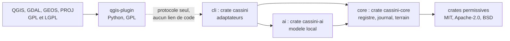
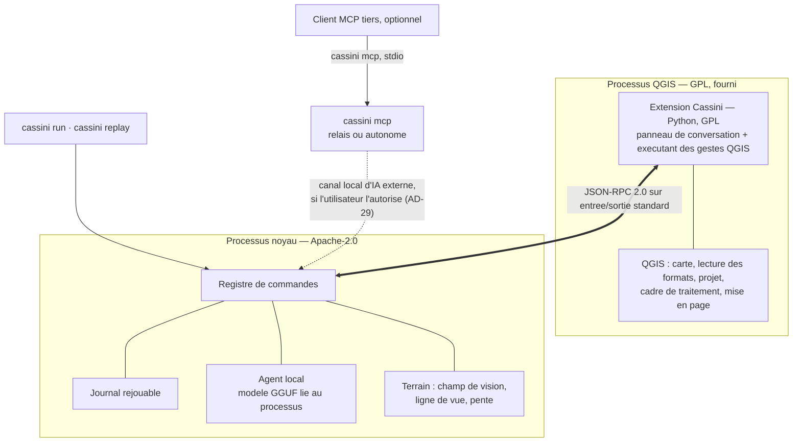
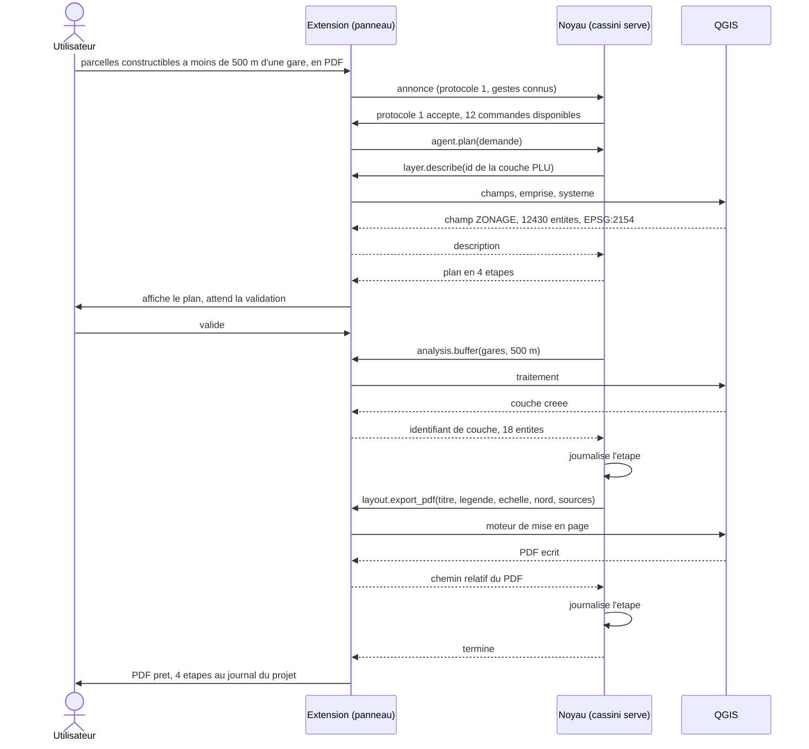
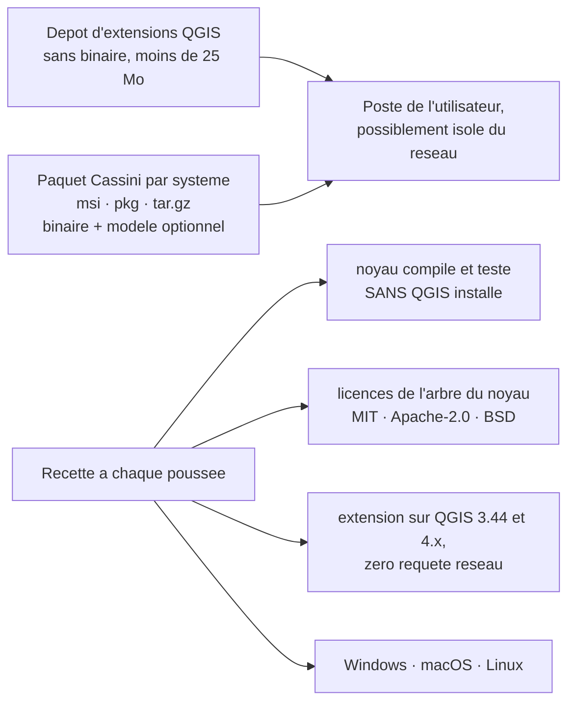

# Architecture Spine — Noyau Cassini et façade QGIS

## Design Paradigm

**Hexagonal, ports et adaptateurs, avec un adaptateur sortant distant.**

Le noyau est l'hexagone : le registre de commandes au centre, le journal, l'agent
et le terrain autour. Il ne connaît que des **ports**, jamais des outils.

- **Ports entrants** — un adaptateur par point d'entrée : canal de l'extension,
  ligne de commande, serveur MCP. Tous appellent le même registre.
- **Port sortant `QgisExecutor`** — défini dans le noyau, en termes de commandes
  du registre. Son unique implémentation au MVP est **distante** : l'extension
  QGIS, de l'autre côté d'un processus. C'est la pièce centrale de cette
  architecture : le noyau délègue sans jamais lier ce à quoi il délègue.

Correspondance avec les dossiers : `core/` l'hexagone et ses ports, `ai/` et
`cli/` des adaptateurs entrants, `qgis-plugin/` l'adaptateur sortant distant.

## Invariants & Rules

### AD-1 — Le noyau ne connaît jamais QGIS [ADOPTED]

- **Binds:** tout, CAP-13, CAP-11
- **Prevents:** le noyau devient un greffon de QGIS ; la V2 autonome et le module
  défense privé deviennent impossibles ; l'argument de distance de bras tombe.
- **Rule:** aucune crate du noyau ne nomme, n'importe ni ne lie QGIS, PyQGIS,
  GDAL, GEOS ou PROJ, même par dépendance indirecte. Le noyau s'adresse au port
  `QgisExecutor` qu'il définit lui-même. La recette compile le noyau et exécute
  la totalité de ses tests sur une machine **sans QGIS installé** ; cet emploi
  est un travail de recette obligatoire, pas une option.

### AD-2 — Un seul canal : l'entrée et la sortie standard d'un processus enfant

- **Binds:** CAP-13, CAP-1, CAP-8
- **Prevents:** une interface réseau ouverte sur la machine, qui rendrait la
  preuve « zéro réseau » négociable et déclencherait le pare-feu de Windows ;
  deux transports concurrents ; un service fantôme dont le cycle de vie
  divergerait de celui de QGIS.
- **Rule:** l'extension lance le binaire du noyau en `cassini serve` et dialogue
  par son entrée et sa sortie standard. Aucune socket réseau, aucun port TCP,
  aucun fichier d'échange, dans aucune des deux moitiés. **Seule exception, le
  canal d'IA externe (AD-29, 2026-10-30)** : quand l'utilisateur l'autorise dans
  le panneau, le noyau de la session ouvre un canal local réservé à `cassini
  mcp` — tube nommé Windows qui refuse les clients distants et n'admet que
  l'utilisateur courant, socket de domaine Unix dans un dossier privé de
  l'utilisateur ailleurs — fermé dès que l'interrupteur s'éteint ou que la
  session s'arrête. Les deux se nomment désormais **canal de l'extension**
  (stdio) et **canal d'IA externe** ; « canal local » seul désigne le premier. La sortie d'erreur standard
  est réservée aux traces de mise au point et ne porte jamais de message de
  protocole. Le noyau s'arrête de lui-même quand son entrée standard se ferme.

### AD-3 — Grammaire des messages : JSON-RPC 2.0, un message par ligne, symétrique

- **Binds:** CAP-13, CAP-6, CAP-8
- **Prevents:** deux encodages ou deux cadrages choisis séparément ; et surtout
  la supposition qu'un seul des deux côtés a le droit de demander, qui rendrait
  la délégation à QGIS impossible à écrire.
- **Rule:** JSON-RPC 2.0, UTF-8, un objet JSON par ligne, sans retour à la ligne
  littéral dans le message — exactement le cadrage du transport stdio de MCP,
  qui délimite ses messages par la ligne sur les flux standard d'un processus
  enfant lancé par le client (révision 2026-07-28 de la spécification). Sur le
  canal de l'extension, **les deux côtés** émettent requêtes et notifications sur
  la même connexion. Le serveur MCP réemploie le cadrage mais **pas** cette
  symétrie : il répond à son client et ne lui donne jamais d'ordre, les révisions
  récentes de MCP ayant restreint qui peut initier une requête.

### AD-4 — Aucun des deux côtés ne bloque en attendant l'autre

- **Binds:** CAP-13, CAP-4, CAP-3, CAP-5
- **Prevents:** l'interblocage — l'extension attend sa réponse sur une lecture
  bloquante pendant que le noyau lui demande d'exécuter une étape, et les deux
  moitiés s'immobilisent. C'est la panne que la symétrie de AD-3 rend possible.
- **Rule:** toute requête porte un `id` ; les réponses peuvent arriver dans un
  autre ordre que les demandes et chaque côté doit le supporter. Côté extension,
  la lecture passe par les signaux de `QProcess` dans la boucle d'événements de
  Qt, jamais par une lecture bloquante, et aucun traitement ne gèle le fil
  d'interface. Aucune implémentation synchrone n'est admise, pas même pour un
  prototype jetable. L'extension **draine en continu** la sortie d'erreur du
  noyau : un tampon du système d'exploitation qui se remplit bloque le noyau en
  écriture, définitivement, et cette panne ne se montre qu'en charge.

### AD-5 — Le noyau tient la boucle d'exécution

- **Binds:** CAP-4, CAP-6, CAP-7, CAP-13
- **Prevents:** quatre boucles d'orchestration divergentes, une par point
  d'entrée, ce que CAP-6 interdit ; et un journal à plusieurs auteurs, dont le
  rejeu ne serait plus fiable.
- **Rule:** l'extension n'enchaîne jamais deux commandes d'elle-même. Elle
  transmet la demande, affiche le plan que le noyau a composé, recueille la
  validation de l'utilisateur, puis exécute **un ordre à la fois** et rend
  compte. Aucune logique métier, aucun calcul géographique et aucune décision de
  nommage ne vivent dans l'extension.

### AD-6 — Le registre est la seule source des commandes ; les schémas sont engendrés depuis les types Rust

- **Binds:** CAP-6, tout
- **Prevents:** une commande qui existe dans l'extension sans exister au
  registre ; un schéma JSON écrit à la main qui dérive silencieusement du type
  Rust qu'il est censé décrire.
- **Rule:** chaque commande porte un `id` en `domaine.verbe`, anglais et
  snake_case ; une description courte en français et en anglais ; des paramètres
  et un résultat typés en Rust, dont les schémas JSON sont **engendrés** par
  `schemars` et jamais écrits à la main ; un champ `runs_in` valant `core` ou
  `qgis`, obligatoire, unique et déclaré ; au moins un test. Rien n'est appelable
  qui ne soit au registre, depuis aucun point d'entrée. Les paramètres sont
  validés **par le noyau, avant l'envoi de l'ordre** ; l'exécutant a le droit de
  faire confiance à ce qu'il reçoit, et la validation n'est donc écrite qu'une
  fois, du côté qui possède les schémas.
- **Précision (2026-10-18) :** les méthodes du protocole forment une liste
  fermée — `session.*`, `command.run`, `plan.*`, `order.execute`,
  `journal.replay`, `request.cancel`, `agent.models`. Ce ne sont pas des
  commandes : `command.run` et `order.execute` transportent une commande du
  registre, journalisée ; les autres ne lisent ni n'écrivent le projet ni les
  données de l'utilisateur, et aucune n'est offerte au modèle ni à un client MCP.
  Ajouter une méthode demande d'amender ce contrat ; toute action sur le projet ou
  sur les données est une commande du registre.
- **Amendement (2026-10-30, AD-29) :** la liste fermée gagne quatre méthodes,
  aucune n'étant une commande ni offerte au modèle. Canal de l'extension :
  `session.external` (extension → noyau : allumer ou éteindre le canal d'IA
  externe, et la case de validation), `external.call` (notification noyau →
  extension : début et fin de chaque appel externe) et `external.approve`
  (requête noyau → extension, réponse : un booléen `approved`). Canal d'IA externe :
  `external.attach` (poignée de main du relais). Le relais n'y emploie sinon que
  `command.run` et `request.cancel`. Un joker comme `session.*` ne couvre aucune
  méthode qui n'est pas nommée ici.

- **Amendement (2026-11-05) — catalogue des commandes.** Le catalogue
  (`../spec-cassini-mvp/catalogue-des-commandes.md`) fige l'identifiant, les
  paramètres et le résultat de chaque commande faite, planifiée ou réservée. Un
  test de la recette le confronte au registre : chaque commande enregistrée y
  figure avec les mêmes identifiant, paramètres et résultat ; une entrée du
  catalogue absente du registre y est marquée planifiée ou réservée. Un écart
  fait échouer la recette ; le catalogue ne change que par un changement de cap.

- **Amendement (2026-11-10, changement de cap `change-commandes-d-un-module-exterieur`, approuvé
  par le propriétaire le 2026-11-10) —
  commandes ajoutées.** Un programme construit sur la bibliothèque du noyau peut enregistrer
  des commandes `runs_in: core` hors des familles du catalogue ; le registre refuse toute
  collision au démarrage. Ces commandes sont annoncées, offertes, journalisées et rejouées
  comme les autres ; le catalogue public fait foi sur le registre officiel seul. Le modèle
  local ne les voit que si sa déclaration les nomme. L'extension n'en connaît aucune.
  Conditions de l'approbation (changement de cap, Statut) : rien n'est construit avant la
  publication et l'epic 10 ; pas de chargement dynamique ; le panneau affiche le programme
  branché et demande confirmation au premier branchement ; `cassini/core_path` est rendu
  visible (entrées 2.14, 9.15, 5.52).

### AD-7 — Annonce au branchement : refus net sur le protocole, dégradation sur les commandes

- **Binds:** CAP-13, CAP-6, CAP-4
- **Prevents:** un noyau plus récent qui immobilise tous les postes dont
  l'extension n'est pas à jour, alors que les deux artefacts s'installent
  séparément et seront donc souvent dépareillés ; et un agent qui planifie une
  étape vouée à l'échec.
- **Rule:** le premier échange est une **requête de l'extension**,
  `session.hello`, à laquelle le noyau **répond** ; aucun ordre n'est émis avant
  cette réponse. La requête porte la version de protocole que l'extension parle,
  la liste des `id` qu'elle sait exécuter, et **le chemin absolu du fichier de
  projet ouvert** : c'est par là, et par aucun autre moyen, que le noyau apprend
  contre quoi résoudre les chemins relatifs de AD-9, AD-10 et AD-11. Si la
  version diffère, le noyau refuse de servir et rend un message nommant
  précisément quoi mettre à jour ; sinon il marque **indisponible** toute
  commande `runs_in: qgis` absente de la liste annoncée. L'agent ne planifie que
  des commandes disponibles. La version de protocole est un entier, incrémenté à
  chaque rupture de compatibilité, et jamais réutilisé. Une session vaut pour un
  projet : ouvrir un autre projet termine la session et en ouvre une neuve.
- **Précision (2026-10-30) :** les méthodes de AD-29 font passer le protocole à
  **2**. Le relais l'annonce par `external.attach` ; un écart rend
  `session.protocol_mismatch` avec un message qui nomme le binaire à mettre à
  jour — le relais, la session ou l'extension, selon celui qui est en retard.

### AD-8 — Ce qui traverse : des références, et des géométries explicitement bornées

- **Binds:** CAP-13, CAP-3, CAP-9, CAP-11
- **Prevents:** la qualification d'« échange assez intime » que la FAQ de la FSF
  réserve, et qui ferait des deux moitiés un seul programme ; l'effondrement des
  performances dès qu'une couche grossit ; le retour de la géométrie dans le
  noyau, que le virage du 2026-10-14 voulait précisément éviter.
- **Rule:** le canal porte des identifiants de couche, des chemins relatifs au
  projet, des dénombrements, des emprises, des descriptions de champs, et des
  géométries GeoJSON (RFC 7946) **en nombre borné par le schéma de la commande**
  — aucun schéma du registre ne déclare une collection de géométries non bornée.
  Ne traversent jamais : la géométrie d'une couche entière, un objet PyQGIS
  sérialisé, une structure de données interne du noyau. Au-delà du plafond, on
  passe un chemin de fichier. Les listes de points d'entrée du terrain étendu
  (observateurs d'un champ de vision cumulé, sources d'un coût cumulé) sont
  bornées par leur schéma comme les autres (2026-11-05).

### AD-9 — Les couches se désignent par leur identifiant QGIS, les fichiers par un chemin relatif au projet

- **Binds:** CAP-7, CAP-9, CAP-10, CAP-3
- **Prevents:** la désignation par nom, qui n'est pas unique, ou par rang dans la
  légende, qui change dès que l'utilisateur réordonne ; et un journal qui casse
  au déplacement du dossier, alors que CAP-10 exige qu'il survive au
  déplacement sur un autre poste.
- **Rule:** une couche se référence par l'identifiant que QGIS lui a donné
  (`QgsMapLayer.id()`), et cet identifiant ne vaut que **pour la session en
  cours** : il n'est jamais une clé de résolution d'un fichier ni d'une couche
  entre deux sessions, et rien ne dépend de sa persistance d'une ouverture de
  projet à l'autre. Le journal garde pourtant le `layer_id` rendu par chaque
  étape, et **le rejeu le lie, à l'intérieur d'une même exécution**, à celui qu'il
  obtient en rejouant l'étape qui l'a produit (comparaison de chaîne entière,
  `layer_id` de premier niveau des paramètres) ; il ne s'en sert pas pour
  retrouver un fichier, qui se résout par le chemin (AD-11). Tout chemin qui
  entre au journal est relatif au fichier de projet et écrit avec des séparateurs
  POSIX ; aucun chemin absolu, messages d'erreur compris. Un fichier situé hors
  de l'arborescence du projet est accepté mais journalisé comme **non portable**,
  et le rejeu sur un autre poste le signale avant de commencer.
- **Exception volontaire (2026-10-15) :** sur le canal de l'extension, et là seulement,
  `order.execute` porte des chemins absolus décidés par le noyau, et
  `session.hello` le chemin absolu du projet (AD-7). Le noyau et l'extension
  sont sur la même machine, et l'extension a besoin du chemin réel pour écrire.
  Ces chemins ne sont jamais écrits au journal (il garde les chemins relatifs) ni
  rendus dans un message d'erreur ; le noyau refuse un `project` non absolu.
  Sur le canal d'IA externe (AD-29), aucun chemin absolu ne passe, dans aucun
  sens : un paramètre de chemin absolu ou qui sort de l'arborescence du projet est
  refusé (`external.path_refused`), et aucune réponse n'en porte. Le chemin réel
  du poste ne part jamais chez un fournisseur d'IA.
  **Complément (2026-11-04, ticket 4.3) :** sur le canal de l'extension, les
  réponses de `command.run` et de `plan.execute` et la notification `external.call`
  (`finished`) portent **le résultat brut, chemins absolus compris** : l'extension ouvre ainsi
  dans le projet un raster écrit par le noyau. Le journal reste relatif ; ce qui
  repart vers le relais d'IA externe reste relatif et nettoyé.
  **Amendement (2026-11-05, ticket 4.9) :** l'extension n'ouvre plus de raster
  d'elle-même. L'ouverture d'un raster du noyau est une commande du registre déléguée
  à QGIS, `layer.open_raster {path: "out:<k>.<n>"}`, que **le noyau dicte lui-même**
  juste après chaque étape `runs_in: core` dont la sortie est un GeoTIFF, avec le même
  `origin` et le même `plan_step`, si l'extension l'annonce ; il la journalise avec le
  `layer_id` rendu. Le rejeu la rejoue comme toute étape, et la couche d'origine est
  laissée hors de la carte de l'export rejoué par le mécanisme de 5.36 ; dans une
  session neuve, le rejeu rouvre le raster qu'il recalcule. Une ouverture en échec est
  une étape en erreur, nommée (AD-21). La commande porte `dictated_by_core` : elle
  n'est offerte ni au modèle (prompt et grammaire inchangés), ni au client MCP, ni au
  formulaire du panneau, et `command.run` la refuse (`registry.dictated`). Sans QGIS
  branché (CLI `run`, MCP autonome) ou sans le geste annoncé, rien n'est dicté. Les
  résultats bruts du complément ci-dessus restent tels quels ; aucune méthode n'est
  ajoutée au protocole.

### AD-10 — Le noyau décide des chemins et des noms de sortie

- **Binds:** CAP-7, CAP-5, CAP-3, CAP-10
- **Prevents:** deux conventions de nommage des sorties, inventées de chaque
  côté ; et des résultats que le journal ne sait pas retrouver au rejeu.
- **Rule:** toute sortie — couche créée, PDF, fichier intermédiaire — est nommée
  par le noyau dans un dossier de travail situé à côté du fichier de projet, et
  nommé d'après lui. L'extension n'invente jamais un chemin ni un nom de couche :
  elle reçoit celui que le noyau lui donne. Les fichiers d'origine de
  l'utilisateur ne sont ni modifiés ni déplacés, et rien n'est écrit en dehors de
  ce dossier de travail. Le noyau ne supprime jamais un fichier que l'exécutant
  peut tenir ouvert : il lui demande de le libérer, puis de le retirer. Sous
  Windows, un fichier qu'une couche QGIS tient ouvert ne peut pas être supprimé,
  et une suppression tentée depuis le noyau échouerait en laissant sur le disque
  le fichier à moitié écrit qu'elle visait.

### AD-11 — Le journal a un seul auteur, et le rejeu est conduit par le noyau

- **Binds:** CAP-7, CAP-10, CAP-6
- **Prevents:** deux écrivains concurrents sur le même fichier ; et un rejeu qui
  réinterpréterait les étapes autrement que l'exécution d'origine.
- **Rule:** seul le noyau écrit le journal, en **ajout seul**, une ligne JSON par
  étape exécutée, dans le dossier de travail de AD-10. Chaque ligne porte l'`id`
  de la commande, ses paramètres canonisés, ses références d'entrée (chemin
  relatif, identifiant de couche, taille et date de dernière modification du
  fichier), un résumé du résultat, et les versions du noyau, du protocole et du
  registre. Le rejeu réexécute les mêmes étapes par le même chemin que
  l'exécution d'origine ; si l'exécutant branché ne sait pas faire une commande
  du journal, il échoue en la nommant au lieu de sauter l'étape. Les sorties sont
  désignées dans le journal par des **repères locaux à l'étape** — sortie *n* de
  l'étape *k* — et jamais par l'identifiant de couche, que le rejeu ne peut pas
  retrouver puisque QGIS en attribue de neufs : le rejeu lie chaque repère à
  l'identifiant neuf, et les étapes suivantes se résolvent par le repère. Le
  noyau prend un **verrou exclusif** sur le journal à l'ouverture de la session ;
  une seconde session sur le même projet — deux fenêtres de QGIS, donc deux
  noyaux — obtient un accès en lecture seule, le dit explicitement, et peut
  rejouer sans écrire.
- **Écart assumé (ticket 14) :** `layer.add` n'a pas de sortie fichier, donc pas de
  repère `out:k.n`. Le journal garde le `layer_id` rendu par l'étape (champ
  `layer_id` de la ligne) ; le rejeu le lie à celui qu'il obtient et le substitue dans
  les paramètres suivants, puis l'ignore à la comparaison. Les octets d'une sortie
  produite par QGIS (GeoPackage, PDF) ne sont pas comparés : elle doit exister et
  n'être pas vide, la fidélité tient au résultat typé comparé.
- **Resserré (2026-10-18) :** chaque ligne d'une commande déléguée porte aussi la
  version de QGIS et la version de chaîne de sa ligne de table (AD-24), annoncées
  à `session.hello` ; le rejeu signale toute différence avant de commencer, sans
  refuser. Les marqueurs d'un résultat résumé dans le journal vivent sous une clé
  réservée, qu'aucun résultat de commande ne peut porter.
- **Complété (2026-11-03, ticket 5.34) :** chaque ligne écrite par `plan.execute`
  porte une clé facultative `plan_step`, la place de l'étape dans son plan (un
  nouveau plan recommence à 1), comme `origin`. Le noyau en déduit les couches
  intermédiaires cachées au modèle, reconnues par leur fichier de sortie ; le
  rejeu ne la lit pas. Une ligne sans la clé (journal ancien, appel hors plan)
  ne cache rien.
- **Amendement (2026-11-10, changement de cap `change-journal-chaine-par-empreinte`, approuvé
  par le propriétaire le 2026-11-10) —
  journal chaîné.** Chaque ligne écrite porte `prev`, l'empreinte SHA-256 des octets de la
  ligne précédente (`null` pour la première), et `chain`, la version du chaînage. Le noyau
  vérifie la chaîne à l'ouverture de la session et en rend l'état ; une chaîne rompue est
  signalée avant le rejeu, sans refuser. Le rejeu ne lit pas ces clés ; une ligne qui ne les
  porte pas (journal ancien) est non chaînée et se rejoue à l'identique. Le chaînage prouve
  l'intégrité du journal, pas son auteur.
  Conditions de l'approbation (changement de cap, Statut) : construit après la démo ;
  l'empreinte de tête au pied du PDF est une décision séparée, non prise (entrée 2.13).

### AD-12 — Toute étape est annulable par message, jamais en tuant le processus

- **Binds:** CAP-4, CAP-13, CAP-7
- **Prevents:** une annulation implémentée en tuant le noyau — ce que les deux
  moitiés feraient faute de mieux — qui perd la fin du journal et laisse des
  sorties à moitié écrites sur le disque.
- **Rule:** le protocole porte l'annulation par `id` de requête **dès la version
  1**. L'extension expose un arrêt à l'utilisateur ; le noyau journalise l'étape
  comme annulée et nettoie ses sorties partielles. Aucun côté ne tue l'autre pour
  arrêter un travail en cours. Une commande que l'exécutant ne sait pas
  interrompre — tout traitement de QGIS n'accepte pas un objet de retour
  annulable — est déclarée **non annulable au registre** ; sans cette
  déclaration, une moitié promettrait ce que l'autre ne peut pas tenir.

### AD-13 — Un seul binaire, quatre points d'entrée, un seul registre

- **Binds:** CAP-6, CAP-8, CAP-4
- **Prevents:** quatre registres physiquement distincts qui divergent à la
  première commande ajoutée.
- **Rule:** un binaire unique, `cassini`, expose les sous-commandes `serve` (le
  canal de l'extension), `mcp` (le serveur MCP sur stdio), `run` (une commande
  en ligne de commande) et `replay`. Les quatre traversent le même registre
  compilé dans `cassini-core`. Aucun point d'entrée ne porte de commande qui lui
  soit propre, et aucun ne modifie le comportement d'une commande.
- **Précision (2026-10-30) :** `mcp` a deux modes. **Relais** quand une session
  QGIS a ouvert le canal d'IA externe : il n'exécute rien lui-même (AD-29).
  **Autonome** sinon : il sert le registre du noyau, commandes `runs_in: core`
  seules (ticket 5.7). Le mode se décide à chaque requête MCP (`tools/list`,
  `tools/call`) : relais si le canal d'IA externe répond, autonome sinon ; un
  changement de mode ou de catalogue envoie `notifications/tools/list_changed`.
  Un appel commencé en relais ne finit jamais en autonome. En mode autonome, le
  verrou du projet n'est pris que le temps d'un appel, comme `cassini run` :
  `mcp` n'empêche jamais une session QGIS de s'ouvrir en écriture.
- **Précision (2026-11-10, changement de cap `change-commandes-d-un-module-exterieur`, approuvé
  par le propriétaire le 2026-11-10) :** un programme dérivé garde un binaire, un registre et
  les quatre points d'entrée ; aucune commande propre à un point d'entrée. Rien n'y est chargé
  dynamiquement : le programme est composé à la compilation (entrée 2.14).

### AD-14 — Le réseau est absent par construction, et prouvé des deux côtés

- **Binds:** CAP-1
- **Prevents:** une sortie réseau introduite par une dépendance ou par un simple
  réglage ; et une preuve qui se réduirait à une relecture de code, ce que CAP-1
  refuse explicitement.
- **Rule:** côté noyau, la recette refuse l'arbre de dépendances par une liste
  nommée et versionnée de crates interdites — `cargo-deny`, section `bans`,
  couvrant les clients HTTP et les piles réseau asynchrones — et le verrou
  existant refuse **à la construction** toute source qui désigne le réseau. Côté
  extension, un test se branche sur le signal `requestAboutToBeCreated` de
  `QgsNetworkAccessManager`, que QGIS propage au fil principal — un seul
  branchement voit donc les requêtes créées depuis n'importe quel fil — et exige
  zéro requête créée sur le chemin nominal, et la recette refuse dans l'extension tout import
  de `urllib`, `requests`, `socket` ou `http`. Aucun garde-fou global n'est posé
  à l'exécution : QGIS et les autres extensions de l'utilisateur gardent leur
  accès au réseau, ce qu'on prouve c'est que Cassini ne s'en sert pas.
- **Précision (2026-10-30) :** `tokio` n'est admis que sous `rmcp` (serveur MCP,
  ticket 5.7), sa feature `net` interdite par `cargo-deny`. Le canal d'IA externe
  (AD-29) est prouvé local : un test montre qu'il refuse un client distant, et le
  test de la table d'imports du binaire (aucune DLL réseau de Windows) reste vert.
  Le canal s'écrit sans tokio, sur des fils bloquants : `std::os::unix::net`
  ailleurs que sous Windows ; sous Windows, l'API Win32 des tubes nommés
  (`kernel32`, `advapi32` pour le descripteur de sécurité), par une crate
  permissive dont la licence est demandée au ticket ; AF_UNIX y est interdit
  (il passe par Winsock). Tube Windows : `PIPE_REJECT_REMOTE_CLIENTS`,
  `FILE_FLAG_FIRST_PIPE_INSTANCE` sur la première instance (les suivantes,
  ouvertes par le même noyau, servent d'autres relais), descripteur réservé à
  l'utilisateur courant, client en `SECURITY_SQOS_PRESENT` ; un test montre
  qu'une connexion par `\\localhost\pipe\…` échoue. Unix : socket dans un
  dossier propre à l'utilisateur en 0700, jamais l'espace abstrait de Linux,
  socket orpheline d'un noyau mort supprimée avant d'ouvrir.

### AD-15 — L'IA locale est une bibliothèque liée, jamais un serveur

- **Binds:** CAP-1, CAP-4, CAP-8
- **Prevents:** un modèle servi par HTTP sur la machine locale, qui rouvrirait
  une interface réseau et contredirait AD-2 et AD-14 ; et trois découvertes de
  modèle écrites séparément dans l'extension, la ligne de commande et l'agent.
- **Rule:** le modèle local est chargé **dans le processus du noyau** par
  `llama-cpp-2` ; ni `llama-server`, ni aucun service HTTP, ni aucun client HTTP.
  Le noyau seul découvre les modèles, dans un dossier connu à côté de son
  installation ou dans un dossier désigné par réglage. L'extension ignore ce
  qu'est un modèle : elle affiche la liste qu'on lui rend.
- **Écart assumé (2026-10-18, à construire par le ticket 5.14) :** la liste est
  rendue à l'extension par la méthode du canal `agent.models`, hors registre et
  non journalisée, sans dossier ni chemin ; `plan.propose` accepte `model`, un nom
  de fichier de cette liste (absent : le premier), et un nom inconnu rend
  `models.unknown`. La commande `model.list` reste au registre pour la ligne de
  commande, et ne rend aucun chemin absolu (AD-9). Passer par `command.run`
  journaliserait la liste, et le rejeu divergerait dès qu'un fichier de modèle
  change.
- **Amendement (2026-11-10, changement de cap `change-empreinte-du-modele-verifiee`, approuvé
  par le propriétaire le 2026-11-10) —
  modèle vérifié.** Une déclaration `*.modele.json` porte l'empreinte SHA-256 de chaque
  fichier qu'elle nomme. Le noyau la vérifie au premier chargement dans la session et refuse
  un fichier qui ne correspond pas (`models.tampered`), sans jamais rien télécharger. Les
  empreintes viennent du manifeste des versions des deux portes d'AD-17. Une déclaration
  sans empreintes ou un GGUF seul sont acceptés et signalés.
  Conditions de l'approbation (changement de cap, Statut) : temps de lancement mesuré sur
  l'i5 ; empreinte facultative pendant une version (entrée 5.51).

### AD-16 — Licences : le noyau reste propre, l'extension est en GPL, et la frontière se tient par ce qui circule

- **Binds:** tout
- **Prevents:** une dépendance GPL ou LGPL qui entre au noyau par transitivité ;
  un module défense privé impossible à construire parce que le noyau aurait été
  contaminé ; et un argument de distance de bras affaibli par la nature de ce qui
  passe dans le tuyau.
- **Rule:** toute dépendance du noyau est MIT, Apache-2.0 ou BSD, liaison
  statique et transitivité comprises, et la recette le vérifie à chaque poussée ;
  GDAL, GEOS et PROJ sont interdits dans le noyau même indirectement. L'extension
  est sous GPL v2 ou ultérieure — c'est une exigence écrite du dépôt d'extensions
  de QGIS, pas une déduction. Le canal ne porte que des messages publics et
  documentés (AD-8) : c'est la condition explicite de l'argument de distance de
  bras, la FAQ de la FSF réservant le cas d'un échange assez intime pour que deux
  programmes n'en fassent qu'un.

### AD-17 — Distribution en deux artefacts, et un seul ordre de recherche

- **Binds:** CAP-13, CAP-1
- **Prevents:** un binaire dans l'archive de l'extension, que le dépôt interdit ;
  deux ordres de recherche du noyau écrits séparément ; et toute tentation de
  réparer une installation par le réseau.
- **Rule:** l'extension part au dépôt d'extensions de QGIS **sans binaire** et
  sous 25 Mo, et déclare le noyau comme dépendance externe dans le champ *About*
  de `metadata.txt`. Le paquet Cassini, un installeur par système, porte le
  binaire et, en option, un modèle. L'extension cherche le noyau dans cet ordre
  et dans aucun autre : réglage QGIS `cassini/core_path`, variable
  d'environnement `CASSINI_CORE`, emplacement d'installation du paquet, `PATH`.
  Introuvable, elle explique quoi installer et propose de désigner le fichier à
  la main. Elle ne télécharge jamais rien.
- **Amendement (2026-11-10, changement de cap `change-distribution-deux-portes`) —
  deux portes d'installation.** La règle ci-dessus ne change pas : l'extension ne
  télécharge jamais rien, le noyau non plus. Le paquet Cassini existe sous deux
  formes, l'une et l'autre **programmes séparés du noyau et de l'extension** :
  - **porte 1, installeur léger en ligne** (quelques Mo) : il télécharge le noyau
    depuis une release GitHub et le modèle depuis un dépôt public Hugging Face,
    à des **adresses fixes**, et vérifie l'**empreinte SHA-256** de chaque fichier
    avant de l'installer ;
  - **porte 2, installeur complet hors ligne** : un seul fichier qui contient le
    noyau et le modèle, pour les postes isolés du réseau.

  Frontière : seul un installeur peut télécharger, **une fois, pendant
  l'installation**, à des adresses fixes, empreintes vérifiées. Jamais le noyau
  ni l'extension, jamais à l'exécution, et jamais pour « réparer » une
  installation : un noyau ou un modèle introuvable se signale comme avant
  (l'extension explique quoi installer), il ne déclenche aucun téléchargement.
  Après l'installation, Cassini ne touche plus au réseau (AD-14 inchangé). Le
  noyau, l'extension et l'ordre de recherche ne changent pas.

  Complément du même jour (2026-11-10) : l'installeur hors ligne, qui dépasse
  2 Gio, est hébergé sur Hugging Face à côté du modèle, et il contient aussi
  l'archive de l'extension, installable à la main. Dans l'installeur en ligne,
  le modèle reste facultatif. Les empreintes de référence viennent d'un
  **manifeste des versions** publié dans la release GitHub, à adresse fixe
  (version et SHA-256 de chaque fichier). **« Mettre à jour Cassini »** est le
  même programme que l'installeur en ligne et obéit à la **même frontière** :
  séparé du noyau et de l'extension, lancé à la main par l'utilisateur, adresses
  fixes, empreintes vérifiées ; aucune vérification automatique en arrière-plan.
  Un nouveau modèle s'installe à côté des autres, l'ancien n'est jamais supprimé.
  Le panneau affiche la version installée et, passé un délai depuis
  l'installation ou la dernière mise à jour, rappelle de lancer « Mettre à jour
  Cassini » : ce rappel est un calcul de date local et **ne touche pas au
  réseau**.
- **Renvoi (2026-11-10, changement de cap `change-empreinte-du-modele-verifiee`) :** AD-17 ne
  change pas : la déclaration remplie par l'installeur est une conséquence de sa règle
  « empreintes vérifiées ». La vérification au lancement est portée par AD-15.

### AD-18 — Une seule extension pour les deux séries de QGIS, et aucun import direct de PyQt

- **Binds:** CAP-13
- **Prevents:** deux variantes d'extension à maintenir ; et la dérive où un
  contributeur importe PyQt5 pendant qu'un autre importe PyQt6 dans le même code.
- **Rule:** `qgisMinimumVersion=3.44` et `qgisMaximumVersion=4.99` dans
  `metadata.txt`. Tout accès à Qt passe par le shim `qgis.PyQt` que QGIS
  fournit ; `import PyQt5` et `import PyQt6` sont refusés par la recette, qui
  exécute l'extension sur les deux séries.

### AD-19 — QGIS possède les systèmes de coordonnées ; le noyau ne reprojette pas

- **Binds:** CAP-9, CAP-3, CAP-11, CAP-15
- **Prevents:** deux moteurs de reprojection qui se contredisent sur les bords ;
  et une coordonnée sans système, interprétée différemment de chaque côté.
- **Rule:** toute coordonnée qui traverse le canal porte son code EPSG explicite.
  La reprojection est exécutée par QGIS, jamais par le noyau. Le terrain travaille
  dans le système du modèle d'élévation : le noyau **exige** les coordonnées
  d'observation dans ce système et refuse une coordonnée exprimée dans un autre
  au lieu de la convertir silencieusement.
- **Amendement (2026-11-05, CAP-15) :** une seule exception, bornée. Le noyau
  convertit des **coordonnées ponctuelles** entre WGS84 (EPSG:4326), UTM sur
  WGS84 (EPSG:32601 à 32660 et 32701 à 32760) et MGRS, par des formules publiées
  (NGA, Karney), testées sur jeux de référence publics. Il ne convertit jamais
  une couche, ni vers ou depuis un autre système (Lambert-93 compris), et le
  terrain continue d'exiger le système du MNT : une conversion n'est jamais
  insérée en silence avant un calcul, elle est une étape `coord.convert`
  visible du plan.
- **Amendement (2026-11-08, ticket 11.22) :** la conversion d'un point vers le
  système du raster d'une commande du noyau est une étape `data.transform_point`
  (exécutée par QGIS), que **le noyau ajoute au plan** dans `plan.propose`, après
  la vérification du plan du modèle et le garde-fou d'AD-23, avant de le montrer :
  - un point par étape ;
  - juste avant la commande qui l'emploie ;
  - la commande reçoit `step:k.point`, et les références suivantes sont
    renumérotées.

  Le noyau ne l'ajoute que si le système du point diffère de celui du raster, lu
  par le noyau dans l'en-tête du GeoTIFF (AD-20), et si l'extension annonce
  `data.transform_point`. Un raster cité par `step:k` est suivi jusqu'à l'étape
  `k` (une commande du noyau garde la grille de son raster) ; un système inconnu
  ou un raster illisible n'ajoute rien. Un point déjà cité par une référence n'est
  jamais converti une seconde fois. Le plan complété est revérifié, puis gardé,
  montré, exécuté et journalisé comme un plan ordinaire. Un appel direct
  (`command.run`, MCP, CLI `run`) ou un rejeu n'est jamais complété : il reste
  refusé par `terrain.crs_mismatch`.

### AD-20 — Le noyau lit ses rasters lui-même, derrière un seul module remplaçable

- **Binds:** CAP-11, CAP-15
- **Prevents:** un noyau qui aurait besoin de QGIS pour analyser un relief, donc
  un module défense privé qui hériterait d'une dépendance à la GPL — ce que la
  séparation civil/défense interdit ; et une lecture de raster dispersée dans
  plusieurs modules, impossible à remplacer quand la maturité de la bibliothèque
  jeune se révélera insuffisante.
- **Rule:** la lecture d'un modèle numérique d'élévation vit dans un **unique**
  module du noyau, et aucun autre module n'ouvre un fichier raster. QGIS ne passe
  qu'un chemin de fichier et une emprise. Les trois commandes de terrain du MVP
  sont réimplémentées en Rust, avec attribution si du code de
  `whitebox_next_gen` est porté. L'epic terrain commence par compiler un cas
  d'essai sur `wbgeotiff` et `wbraster` avant d'engager CAP-11.
- **Amendement (2026-11-05, CAP-15) :** le même module unique lit aussi les
  rasters mono-bande de coût et de critères (`raster.reclassify`,
  `raster.weighted_overlay`, `terrain.cost_distance`,
  `terrain.least_cost_path`). Quand une commande prend plusieurs rasters, leurs
  grilles doivent être identiques (système, taille de cellule, origine,
  dimensions) : sinon l'erreur `raster.grid_mismatch` (AD-21) nomme l'écart, et
  le noyau ne rééchantillonne jamais. L'alignement est un geste QGIS,
  `raster.align` ; avant lui (epic 10), seuls se combinent des rasters de même
  grille, ce qui est le cas de tous ceux dérivés d'un même MNT. Deux grilles sont
  identiques quand leurs codes EPSG et leurs dimensions sont égaux et que taille
  de cellule et origine diffèrent de moins d'un millionième de cellule. Une
  cellule NoData en entrée donne NoData en sortie ; `raster.reclassify` garde le
  NoData tel quel.
- **Coût (2026-11-05, CAP-15).** Un seul module du noyau calcule le coût, pour
  `terrain.cost_distance` et `terrain.least_cost_path`. La valeur d'une cellule
  d'un raster de coût est un coût par mètre parcouru ; une cellule NoData, nulle
  ou négative est infranchissable. Le déplacement se fait aux 8 voisins, au coût
  moyen des deux cellules multiplié par la distance (taille de cellule, ou
  taille × √2 en diagonale). Le coût cumulé rendu est dans l'unité du raster
  multipliée par des mètres. La ligne de moindre coût va du départ à l'arrivée,
  dans cet ordre.

### AD-21 — Une seule forme d'erreur, et aucun échec silencieux [ADOPTED]

- **Binds:** tout
- **Prevents:** des erreurs en chaîne de caractères, formées différemment de
  chaque côté, qu'aucune interface ne sait traiter ni traduire ; et les
  troncatures silencieuses, qui font échouer le travail plus loin, là où la cause
  n'est plus visible.
- **Rule:** toute erreur qui traverse le canal porte un code machine stable en
  `domaine.cause`, un message en français destiné à l'utilisateur, et l'`id` de
  l'étape concernée quand il y en a une. Dans le noyau, les erreurs restent des
  énumérations typées par module, converties en cette forme au bord de
  l'adaptateur — convention déjà établie par le code existant et ratifiée ici.
  Une lecture plus courte que demandée, un résultat partiel ou une couche absente
  sont des erreurs nommées, jamais un succès dégradé.

### AD-22 — Les paramètres sont neutres ; le vocabulaire de QGIS reste dans l'extension

- **Binds:** CAP-3, CAP-5, CAP-6, CAP-9, CAP-11, CAP-14
- **Prevents:** un noyau qui connaîtrait le langage d'expression de QGIS ou les
  noms de ses algorithmes, donc un noyau de forme QGIS que le module défense
  privé et la V2 autonome hériteraient — AD-1 contournée en esprit sans être
  enfreinte à la lettre ; et deux implémentations qui divergeraient sur le type
  même d'un paramètre de filtre.
- **Rule:** les paramètres du registre sont neutres et typés : un filtre est un
  champ, un opérateur et une valeur, jamais une expression textuelle ; une
  opération est `analysis.buffer`, jamais `native:buffer`. La traduction vers le
  langage d'expression et vers les noms d'algorithmes de QGIS vit **entièrement
  dans l'extension**. Aucune chaîne de caractères destinée à être interprétée par
  QGIS n'est composée par le noyau.

### AD-23 — Le modèle n'émet que des appels du registre, jamais du code

- **Binds:** CAP-4, CAP-6, CAP-8
- **Prevents:** la seule vraie faille du produit — un plan composé par un modèle
  est une entrée non fiable ; s'il peut rendre du code, une expression ou un
  chemin absolu, il contourne AD-8, AD-9 et AD-22 sans que personne ne l'ait
  décidé ; et un point inventé par le modèle, montré comme juste, qui rend un
  résultat faux sans aucun signal.
- **Rule:** la sortie du modèle est contrainte à une suite d'appels de commandes
  du registre, validée contre les schémas engendrés avant d'être montrée à
  l'utilisateur ; une sortie non conforme est rejetée et redemandée, jamais
  réparée à la main. Rien de ce que le modèle produit n'est exécuté comme du
  code, du Python, du SQL ou une expression. Un plan ne peut nommer que des
  commandes disponibles (AD-7) et des chemins déjà connus de la session.
  - **Coordonnées (2026-10-23).** Une coordonnée d'un plan composé par le
    modèle local vient de la demande de l'utilisateur ou du résultat d'une
    étape précédente, jamais du modèle seul ; sinon le noyau ne montre pas le
    plan et rend une question qui demande le point (x, y et système).
    - **Un seul type.** Toute coordonnée du registre est le type `Point`
      partagé du noyau (x, y, epsg), porté tel quel par chaque commande et
      marqué dans le schéma engendré (AD-6), à travers références, objets
      imbriqués et tableaux. Le contrôle de contrat refuse un champ `x` ou `y`
      numérique hors de `Point`. Une emprise n'est pas un `Point` et reste hors
      de cette règle.
    - **Dans la demande.** x, y et le système y figurent tous trois, comparés
      comme nombres, x et y distincts l'un de l'autre et des autres nombres
      déjà pris par le plan (distance, durée). Un système absent de la demande
      n'est pas pris au projet : c'est la question. Un système nommé compte pour
      son code, sur une liste fermée : Lambert-93 (2154), WGS84 (4326) et, depuis
      le 2026-11-05, une zone UTM sur WGS84 nommée par son numéro et son
      hémisphère (« UTM 31N » compte pour 32631, « UTM 31S » pour 32731).
    - **MGRS (2026-11-05, CAP-15).** Une référence MGRS n'a pas de code EPSG : elle
      est le type partagé `MgrsRef` du noyau (une chaîne validée par la grammaire
      de la NGA, zone, bande, carré de 100 km, puis 1 à 5 chiffres par axe),
      marqué dans le schéma engendré comme `Point`, et soumis à la même garde :
      elle figure telle quelle dans la demande (espaces ignorés, casse
      ignorée), ou vient d'une référence `step:` vers un champ déclaré `MgrsRef`.
      `coord.convert` rend des `Point` et des `MgrsRef`, utilisables comme
      références d'étape. Vers MGRS, la conversion tronque (convention de la
      NGA), elle n'arrondit pas. En WGS84, x est la longitude et y la latitude.
    - **D'une étape.** Le paramètre entier est une référence `step:` vers un
      champ que le schéma de sortie de cette étape déclare `Point`. Une
      coordonnée lue dans l'inventaire du projet ne compte pas.
      *Amendement du 2026-11-08 (ticket 11.22) :* `step:k.point` est aussi admis
      comme **élément d'un tableau de `Point`** (`observers`, `sources`), et
      seulement là ; il désigne le `point` rendu par une étape `k` précédente, et
      la vérification du plan comme le garde-fou le contrôlent comme au premier
      niveau. Le garde-fou s'applique au plan du modèle, avant la complétion
      d'AD-19 ; les étapes que celle-ci ajoute sont du noyau.
    - **Où.** Une fonction pure du noyau, appliquée au plan validé, sans changer
      le prompt ni le tour de redemande ; tous les chemins de composition y
      passent (canal, ligne de commande, mesures). Une sortie rejetée par la
      validation passe aussi par elle (décision du propriétaire, 2026-10-23,
      recette de 5.16) : si elle porte un point qui ne vient ni de la demande ni
      d'une étape, même incomplet, la question est rendue tout de suite, sans
      redemande ; sinon le rejet suit son cours.
    - **Trace.** La question rendue porte sa provenance, `model` ou `guard`,
      hors de la grammaire du modèle. Le journal (AD-11) n'en porte rien : il ne
      tient que des étapes exécutées, et le rejeu ne compose pas.
    - **Hors règle.** Le serveur MCP : le noyau n'y compose aucun plan, l'IA
      externe appelle les commandes une à une ; le risque d'un point inventé par
      elle est accepté.
  - **Vue triée d'un gros projet (2026-11-10).** Au-delà d'un seuil, le modèle voit un index
    réduit de toutes les couches et le détail de celles que la demande désigne. La vue est une
    fonction pure du noyau (inventaire, demande, journal), jamais journalisée. Si un plan fait
    porter un paramètre de champ sur une couche montrée réduite, le noyau recompose une fois
    avec cette couche détaillée : c'est une redemande, pas une réparation. Le plan rendu passe
    par les mêmes schémas et le même garde-fou, et le rejeu (AD-11) n'en dépend pas.
  - **Précision (2026-11-10, changement de cap `change-commandes-d-un-module-exterieur`,
    approuvé par le propriétaire le 2026-11-10) :** la grammaire du modèle ne contient que les
    commandes que sa déclaration connaît. La grammaire du modèle local n'inclut une commande
    ajoutée que si la déclaration du modèle (`*.modele.json`) la nomme parmi les commandes qu'il
    connaît ; sinon elle est exclue de la grammaire et le modèle ne peut pas l'inventer. Elle
    reste offerte par le formulaire du panneau et par le MCP (entrée 5.52).

### AD-24 — Une primitive de QGIS est une commande écrite à la main, exécutée par une ligne d'une table fermée

- **Binds:** CAP-14, CAP-6, CAP-3
- **Prevents:** deux façons d'ajouter une commande déléguée ; une commande
  passe-partout qui ferait écrire au modèle des noms d'algorithmes ; un catalogue
  engendré depuis les quelque mille algorithmes de QGIS, dont les schémas ne
  viendraient plus des types Rust ; un enchaînement codé dans l'extension qui
  prendrait des décisions.
- **Rule:** chaque primitive du cadre de traitement de QGIS entre au registre
  comme une commande écrite à la main, avec ses types Rust et `runs_in: qgis`
  (AD-6), et du côté de l'extension comme **une ligne** d'une table fermée, qui
  associe l'`id` de la commande à une **chaîne fixe** d'algorithmes, à la
  traduction de ses paramètres et à une **version de chaîne**, incrémentée à
  chaque changement de la ligne (AD-11).
  - **Genres.** Une entrée est d'un genre fermé — `vector`, `raster`, `layout` —
    et une sortie aussi — `layer`, `table`, `file`. Un genre s'ajoute une seule
    fois au geste générique de l'extension, jamais par un geste à part. Le nombre
    de sorties est fixe et déclaré au registre. Un format de sortie variable est
    une énumération typée, dont le noyau déduit l'extension du fichier (AD-10).
    *Amendement du 2026-11-08 :* une commande peut changer l'état du projet sans
    produire ni couche ni fichier (`layer.set_style`, `layer.arrange`).
    - Elle est d'entrée `project` et de sortie `none`.
    - Sa ligne de la table fermée associe son `id` à un **geste fixe** de l'API de projet
      de QGIS (style d'une couche, arbre des couches), et non à une chaîne d'algorithmes.
      Elle garde sa version de chaîne.
    - Elle ne rend que des identifiants ou des compteurs.
    - Au rejeu, le même état revient parce que les paramètres journalisés, `StyleSpec`
      compris, sont rejoués tels quels ; le résultat comparé ne sert qu'à vérifier la
      couche visée.
    Un raster se désigne toujours par un chemin `RasterPath` (amendement du
    2026-11-05 ci-dessous), jamais par son identifiant de couche ; aucune
    commande `raster.*` ne refait un calcul de `terrain.*`.
  - **Chaîne.** Une étape peut porter une garde, qui rend une erreur nommée
    (AD-21) ; aucune étape ne choisit entre deux suites. Toute valeur vient des
    paramètres du noyau. Seule la dernière étape écrit la sortie nommée par le
    noyau ; les intermédiaires sont des temporaires de QGIS, jamais nommés par le
    noyau ni journalisés — écart explicite à AD-10, qui ne vaut que pour eux.
    Une commande n'est déclarée annulable (AD-12) que si chaque algorithme de sa
    chaîne l'est, et un test confronte la table au registre sur ce point.
  - **Liste blanche.** Aucune ligne ne nomme un algorithme qui accède au réseau
    ou ouvre une page — au moins `native:filedownloader`, `native:httprequest`,
    `native:downloadvectortiles`, `native:openurl`,
    `native:batchnominatimgeocoder` — ni un algorithme qui écrit dans l'une de
    ses entrées. La recette tient cette liste nommée et refuse la table qui en
    cite un (AD-14). Les fournisseurs sous GPL (GRASS, extensions tierces) ne
    s'exécutent que dans le processus de QGIS.
  - **Seuils.** Un seuil est une valeur métier qu'une phrase peut dire —
    distance, durée, vitesse, pente, surface — et c'est toujours un paramètre.
    Sa valeur par défaut, s'il en a une, est déclarée dans le schéma Rust, jamais
    dans la ligne de table.

- **Amendement (2026-11-05, CAP-15) — une seule forme de raster.** Tranche la
  question « Désigner un raster » ouverte le 2026-11-04. Tout paramètre raster de
  toute commande, du noyau ou déléguée, est du type partagé `RasterPath` marqué
  dans le schéma : un chemin relatif au projet (AD-9), ou une référence `step:k`
  vers la sortie raster d'une étape, journalisée comme le repère `out:k.n`
  d'AD-11 et jamais comme un chemin résolu. Une commande déléguée qui produit un
  raster l'écrit à l'emplacement décidé par le noyau (AD-10) ; le noyau dicte
  ensuite `layer.open_raster`, comme pour un GeoTIFF du noyau (amendement 4.9
  d'AD-9). Une recette vérifie que la table fermée de l'extension contient
  exactement les commandes déclarées `runs_in: qgis` du registre, ni plus ni
  moins : une ligne pour une commande calculée par le noyau (par exemple
  `raster.reclassify`) la fait échouer.

### AD-25 — Une commande déléguée n'est annoncée que si toute sa chaîne existe chez l'utilisateur

- **Binds:** CAP-14, CAP-13, CAP-4
- **Prevents:** une commande annoncée qui échoue à l'exécution faute de GRASS ou
  d'une extension tierce absente du poste ; un agent qui planifie une étape vouée
  à l'échec ; une annonce faite avant que QGIS ait chargé ses fournisseurs.
- **Rule:** l'extension envoie `session.hello` une fois l'initialisation de QGIS
  terminée, fournisseurs de traitement chargés. Elle n'annonce une commande que
  si chaque algorithme de sa chaîne existe dans le registre de traitement du
  QGIS hôte ; sinon la commande est indisponible (AD-7). L'annonce porte aussi la
  version de QGIS et la version de chaîne de chaque commande annoncée (AD-11).
  Les noms de paramètres propres à une série de QGIS vivent dans la traduction
  de la ligne, vérifiée par la recette sur les deux séries (AD-18). Un plan qui
  nomme une commande indisponible est refusé avant d'être montré (AD-23).

### AD-26 — Le géocodage sur la Base Adresse Nationale est fait par le noyau

- **Binds:** CAP-14, CAP-9
- **Prevents:** de la logique métier dans l'extension (AD-5) — l'appariement
  d'adresses est un raisonnement, pas un geste — ; un géocodage limité aux
  écritures identiques, qu'une simple jointure attributaire de QGIS donnerait ;
  deux façons de désigner les fichiers d'entrée ou d'ouvrir le résultat.
- **Rule:** une commande `geocode.*` est `runs_in: core`. Ses entrées — le
  fichier d'adresses et le fichier de la Base Adresse Nationale, tous deux en CSV
  — sont des chemins relatifs déjà connus de la session (inventaire ou choix de
  fichier dans le panneau), jamais un réglage ni une variable d'environnement ;
  le journal garde leur taille et leur date (AD-11), et le rejeu signale un
  fichier changé. Le noyau apparie et écrit dans le dossier de travail (AD-10)
  **un** CSV, déterministe, qui porte les colonnes `lon` et `lat` de la Base
  Adresse Nationale, en EPSG:4326 partout — ses colonnes `x` et `y` changent de
  projection outre-mer. Le résultat rend `crs`, `x_field` et `y_field`, que reprend
  une étape `layer.add` explicite du plan. Le noyau ne reprojette pas (AD-19) et
  ne lit aucun autre format vectoriel. La commande est non annulable tant que
  l'annulation n'est pas écrite (AD-12). Toute crate ajoutée pour lire le CSV est
  validée avec sa licence avant ajout (AD-16).
- **Écart à la spec (2026-10-18) :** CAP-14 dit chaque primitive « exécutée par
  le cadre de traitement de QGIS », et l'epic 10 « pas de nouveau calcul dans le
  noyau ». Le géocodage fait exception, par choix du propriétaire ; la spec et
  l'epic sont à mettre à jour.

### AD-27 — Un seul gabarit de résumé chiffré, validé par le noyau

- **Binds:** CAP-14, CAP-3, CAP-4
- **Prevents:** chaque primitive qui invente sa forme de résumé — l'agent et le
  panneau ne sauraient plus les lire ; une borne écrite deux fois qui diverge ;
  un résultat mal formé de l'extension accepté et journalisé.
- **Rule:** tout résumé chiffré rendu par une commande suit un gabarit défini une
  fois en Rust : `rows`, une liste d'éléments `{label, values}` où `values` associe
  un nom à `{value, unit}`, et `truncated`, explicite. L'étiquette vient d'un champ
  désigné ou du rang, jamais de l'identifiant d'entité. La borne est une constante
  du noyau, transmise dans l'ordre ; la couche produite garde tout (AD-8, AD-21).
  Le noyau valide tout résultat reçu de l'extension contre le schéma de sortie de
  la commande, et rejette l'écart en `qgis.bad_result`.

### AD-28 — Un seul contrat de réseau

- **Binds:** CAP-14, CAP-3
- **Prevents:** un réseau préparé par une commande que les isochrones et le plus
  court chemin lisent chacun à sa façon — sens de circulation, vitesse,
  tolérance.
- **Rule:** les commandes qui lisent un réseau d'itinéraires
  (`analysis.isochrone`, `network.*`) partagent un même type de paramètres Rust,
  défini une fois : sens de circulation, vitesse (champ ou valeur), tolérance.
  La commande de préparation produit une couche de lignes que ces commandes
  lisent sans autre traitement. Les constantes actuelles de `analysis.isochrone`
  (vitesses, accrochage de l'origine à 100 m) sont un écart, à résorber avant le
  premier `network.*`.

### Direction des dépendances

Qui a le droit de dépendre de qui. Toute flèche en sens inverse est un bug.



- Rien ne dépend de `qgis-plugin` : il est une extrémité.
- Aucune crate du noyau ne dépend de QGIS ni d'une de ses bibliothèques (AD-1).
- `cassini-core` ne dépend pas de `cassini-ai` : le module défense privé et la
  V2 autonome doivent pouvoir prendre le registre et le terrain sans l'IA.
- La flèche en pointillés est la frontière de licence : elle ne porte que des
  messages, et c'est tout l'argument de AD-16.

### AD-29 — Une IA externe pilote la session ouverte par relais, sous les yeux de l'utilisateur

- **Binds:** CAP-8, CAP-13, CAP-1
- **Prevents:** une IA externe aveugle, qui travaille sans QGIS et que
  l'utilisateur ne voit pas ; un second auteur du journal ; deux états
  d'occupation qui laisseraient un appel externe s'intercaler dans un plan ; le
  chemin réel du poste envoyé chez un fournisseur ; du code propre à un
  fournisseur d'IA.
- **Rule:** la session ouverte dans QGIS (`cassini serve`) reste le seul
  exécutant : elle valide, dicte un ordre à la fois (AD-5), journalise (AD-11).
  `cassini mcp` en mode relais transporte et ne décide rien ; il prend son
  catalogue et ses schémas dans la session, jamais dans son propre registre.
  - **Poignée de main.** Le relais envoie `external.attach` (version de
    protocole, AD-7). Il n'ouvre ni session ni journal. Le noyau répond par le
    catalogue disponible de la session (AD-25), sans aucun chemin, ou par
    `session.not_started` si l'extension n'a pas ouvert de session.
  - **Un seul état d'occupation par processus**, partagé par toutes les
    connexions et valable dans les deux sens. Sont occupants : une composition de
    plan, un plan proposé non tranché, l'exécution d'un plan, un appel en cours,
    l'attente d'un `external.approve`. Toute requête qui exige l'exécutant reçoit
    alors `session.busy` aussitôt ; rien n'est mis en file. Le noyau lit toutes
    ses connexions pendant tout travail long (AD-4) ; elles alimentent une seule
    file d'entrée et un seul écrivain par connexion.
  - **Plusieurs relais** peuvent se brancher ; leurs appels passent un à la fois
    par l'état d'occupation. Les `id` de requête sont propres à chaque connexion :
    une annulation ne vise que l'appel de sa connexion. Chaque appel externe
    reçoit du noyau un identifiant d'appel, porté par `external.call` ; le
    panneau l'arrête en le renvoyant dans `request.cancel` (aucune méthode
    nouvelle).
  - **Visibilité.** Le noyau émet `external.call` vers l'extension au début et à
    la fin de chaque appel externe (commande, paramètres, résultat ou erreur
    AD-21, durée), commandes `core` comprises ; le panneau le montre et peut
    l'arrêter (AD-12). Le journal note l'origine `external` de l'étape ; le
    rejeu l'ignore.
  - **Validation.** Case « Me demander avant chaque appel », éteinte par défaut
    (décision du propriétaire, 2026-10-30) : allumée, le noyau envoie
    `external.approve` avant d'exécuter, sans bloquer (AD-4), borné à 120 s et
    annulable ; un refus ou un délai rend `external.not_approved`. Éteinte, c'est
    l'écart volontaire à la validation préalable de AD-5 : l'IA externe appelle
    les commandes une à une (comme AD-23, hors règle).
  - **Consentement et cycle de vie.** Le canal n'existe que tant que
    l'interrupteur `session.external` est allumé ; éteint par défaut, jamais
    rallumé seul. Une seule session par utilisateur l'ouvre (première instance
    du tube, AD-14) ; la seconde reçoit `external.channel_taken` et le panneau le
    dit. Interrupteur coupé ou QGIS fermé : les appels en cours sont annulés s'ils
    sont annulables, sinon terminés et journalisés ; le relais reçoit
    `external.session_lost`. Relais déconnecté en plein appel : même traitement,
    la réponse est abandonnée.
  - **Traduction MCP.** `notifications/cancelled` devient `request.cancel`. Une
    erreur AD-21 devient un résultat d'outil `isError` portant `code` et
    `message` (comme en 5.7) ; une demande hors catalogue reste une erreur de
    protocole.
  - **Aucun fournisseur nommé.** Le relais parle MCP et rien d'autre : tout
    client MCP local (Claude, ChatGPT pour ordinateur et Codex, Gemini CLI) est
    servi par le même code. Cassini n'appelle jamais l'API d'un fournisseur.

### AD-30 — Le noyau rend ses entités dans un fichier GeoJSON qui déclare son système

- **Binds:** CAP-15
- **Prevents:** chaque commande du noyau qui rend des points ou des lignes
  (points hauts, chemin de moindre coût) inventant sa propre sortie — CSV ici,
  liste dans le résultat là — ; une géométrie de taille non bornée dans le canal
  (AD-8) ; une sortie que QGIS lirait dans un autre système que celui du calcul.
- **Rule:** une commande du noyau qui rend des entités écrit **un** fichier
  GeoJSON au format de 2008, celui qu'écrit et lit par défaut le pilote GeoJSON
  de GDAL, dans le système du raster source, déclaré par le membre
  `"crs": {"type": "name", "properties": {"name": "urn:ogc:def:crs:EPSG::<code>"}}`.
  L'écart à la RFC 7946, qui impose WGS84, est voulu : le noyau ne reprojette
  pas (AD-19). Le fichier est placé et nommé par le noyau (AD-10) dans le
  dossier de sortie, et ouvert dans QGIS par l'étape dictée ci-dessous,
  jamais en silence. Le résultat du canal porte le chemin relatif, le nombre
  d'entités et, au plus, une liste bornée par le schéma de la commande (AD-8),
  dont les positions sont des `Point` (AD-23), utilisables comme références
  d'étape. L'écriture se fait par `serde_json`, sans dépendance nouvelle.
- **Un seul écrivain.** Un module unique du noyau écrit ces fichiers : les noms
  et types des propriétés de chaque commande sont déclarés dans son schéma de
  sortie et dans le catalogue des commandes ; la sortie est déterministe (ordre
  des entités et des propriétés fixe, nombres écrits de la même façon, aucune
  date), de sorte que le rejeu compare le fichier par son contenu.
- **Ouverture dictée.** Comme un GeoTIFF du noyau (amendement 4.9 d'AD-9), le
  fichier est ouvert par une commande déléguée que le noyau dicte lui-même juste
  après l'étape, `layer.open_vector {path: "out:<k>.<n>"}`, portée
  `dictated_by_core`, offerte ni au modèle ni au client MCP, avec le même
  traitement au rejeu (couche d'origine hors de l'export rejoué, réécriture
  selon AD-10 et AD-11).
- **Amendement du 2026-11-08 — plusieurs ordres dictés pour une demande**
  (changement de cap
  `../change-styles-topographiques-officiels/change-styles-topographiques-officiels.md`).
  - **Lecture d'abord.** Avant de calculer, `map.topographic_style` lit l'inventaire du
    projet par l'ordre `project.inventory`, comme `plan.propose` : une lecture, qui n'est
    pas une étape du journal, de sorte que `project.inventory` reste une commande ordinaire
    (`dictated_by_core: false`).
  - **Ordres dictés après la ligne.** La ligne de `map.topographic_style` est journalisée
    avec son résultat. La session dicte ensuite un `layer.set_style` par couche reconnue,
    puis un seul `layer.arrange`. Ce sont deux commandes `dictated_by_core`, offertes ni au
    modèle, ni au client MCP, ni au formulaire. Chaque ordre est une ligne du journal, juste
    après celle de `map.topographic_style`, de même `origin` et de même `plan_step`.
  - **Décisions du noyau.** La reconnaissance du thème, la table des couleurs et le nom des
    groupes sont des décisions du noyau (AD-5). L'extension n'applique que le `StyleSpec`
    neutre (AD-22) ou la liste de groupes qu'on lui dicte.
  - **Rejeu.** Comme pour `layer.open_raster`, chaque ligne est rejouée seule (AD-11). La
    ligne de `map.topographic_style` relit l'inventaire et compare son résultat, mais ne
    dicte rien. Les lignes dictées sont rejouées avec leurs paramètres journalisés.
  - **Échec.** Un ordre refusé arrête la suite par son erreur (AD-21). Les styles déjà
    posés restent, chacun journalisé.
  - **Bornes.** Le nombre d'ordres est borné par le nombre de couches du projet, et aucune
    géométrie ne traverse le canal (AD-8).
  - **Disponibilité.** Sans QGIS, ou sans les trois gestes annoncés, la commande n'est pas
    offerte (AD-25).
- **Amendement du 2026-11-09 — style dicté après l'ouverture d'un raster de résultat**
  (décision du propriétaire ; changement de cap
  `../change-style-des-rasters-de-resultat/change-style-des-rasters-de-resultat.md`).
  - **Second chemin de dictée.** Hors du mécanisme des ordres qu'une commande demande
    (`dictates`), la session dicte elle-même un `layer.set_style` juste après l'ouverture
    dictée (`layer.open_raster`) du raster d'une commande du noyau qui déclare son style de
    résultat (`result_style` au registre, une commande à une seule sortie). L'ordre vise le
    `layer_id` que l'ouverture rend ; il porte le même `origin` et le même `plan_step` et
    devient une ligne du journal.
  - **Décision du noyau.** Le style est composé par le noyau d'après la commande et son
    résultat (forme `result_ramp` d'AD-22, ou `hillshade` pour un ombrage) ; l'extension ne
    fait que l'appliquer (AD-4, AD-5).
  - **Condition.** L'ordre n'est dicté que si l'extension annonce le geste `layer.set_style`
    **et** la forme `result_ramp` dans `style_kinds` de `session.hello`. Sinon le raster est
    ouvert sans style, sans erreur : une extension plus ancienne que ce changement garde la
    conduite d'avant (AD-25). Ce n'est pas un geste requis des commandes de terrain.
  - **Échec.** Un style refusé par l'extension est l'erreur de l'appel, journalisée à sa ligne
    (AD-21) ; un style que le noyau composerait invalide est une erreur nommée du noyau
    (`style.invalid`), avant l'ouverture, jamais un style sauté en silence.
  - **Rejeu.** La ligne est rejouée seule, avec son style journalisé et l'id de la couche
    rejouée (AD-11). Un exécutant qui n'annonce pas le geste, ou pas la forme `result_ramp`,
    arrête le rejeu à cette ligne sur `style.unavailable`. Un journal écrit avant ce
    changement n'a pas de ligne de style : il se rejoue sans style, à l'identique.

### AD-31 — Géodésie et angles : une seule convention

- **Binds:** CAP-15
- **Prevents:** deux commandes de `geo.*` ou de `terrain.*` qui rendent des
  angles dans des unités ou depuis des nords différents, ou des distances
  planes ici et géodésiques là, que l'agent enchaînerait sans le voir ; un point
  dans un système que la géodésie du noyau ne sait pas traiter, converti en
  silence.
- **Rule:** les commandes `geo.*` n'acceptent que des `Point` en WGS84 (4326) ou
  en UTM sur WGS84 (326NN, 327NN) ; une référence MGRS passe d'abord par une
  étape `coord.convert`, un point dans un autre système par une étape
  `data.transform_point`, déléguée à QGIS (AD-19). Tout autre système est refusé
  par l'erreur `geo.unsupported_crs` (AD-21), qui nomme l'étape à ajouter.
  Distances et azimuts sont géodésiques, sur l'ellipsoïde WGS84 (formules de
  Karney), en mètres. Un angle est le type partagé `Angle {value, unit}`, unité
  `deg` (par défaut) ou `gon` ; un azimut se compte depuis le nord vrai, dans le
  sens horaire, dans [0, 360) degrés. Les rasters d'exposition et d'ombrage, eux,
  se rapportent au nord du quadrillage du MNT, en degrés ; une cellule plate a
  l'exposition NoData. Une même commande ne change jamais d'unité selon la
  demande sans le paramètre `unit`.
- **Amendement (2026-11-10, changement de cap
  `change-complements-geometrie-et-mise-en-page`, approuvé par le propriétaire le
  2026-11-10) — nord choisi.** Un azimut se compte depuis le nord vrai, sauf quand la
  commande reçoit `north` : `grid` (nord du quadrillage UTM, par la convergence des
  méridiens calculée d'après la publication, ce qui n'est pas une conversion de
  coordonnées au sens d'AD-19) ou `magnetic` (déclinaison du modèle magnétique mondial
  embarqué, à une date journalisée). Le nord employé est toujours rendu dans le résultat ;
  une commande ne change jamais de nord sans ce paramètre. Les coefficients du modèle
  magnétique sont une donnée compilée dans le noyau, mise à jour par une nouvelle version
  du noyau (AD-17), jamais lue par le réseau. Le gisement ne se calcule qu'en UTM
  (décision du propriétaire du 2026-11-10 : pas de Lambert-93, AD-19 inchangé).

## Consistency Conventions

| Concern | Convention |
| --- | --- |
| Nommage des commandes | `domaine.verbe` en anglais, snake_case : `layer.add`, `layer.describe`, `analysis.buffer`, `project.inventory`, `layout.export_pdf`, `terrain.viewshed`, `terrain.line_of_sight`, `terrain.slope` |
| Familles de commandes | `layer.*` et `project.*` ouvrir, décrire, inventorier ; `analysis.*` analyses vectorielles ; `network.*` réseau d'itinéraires ; `raster.*` analyses de raster déléguées ; `data.*` reprojection et conversion ; `layout.*` PDF et atlas ; `geocode.*` géocodage, dans le noyau (AD-26) ; `terrain.*` réservé au noyau, jamais délégué ; `coord.*` conversion de coordonnées ponctuelles WGS84, UTM et MGRS et `geo.*` géodésie (distance, azimut, point par azimut et distance, recoupement), dans le noyau (AD-19, AD-31, CAP-15) ; `data.transform_point`, reprojection d'un point dans un système quelconque, est déléguée à QGIS comme tout `data.*`. Dans `raster.*`, `raster.reclassify` et `raster.weighted_overlay` sont calculées par le noyau (AD-20), les autres sont déléguées à QGIS. Le catalogue des commandes (`../spec-cassini-mvp/catalogue-des-commandes.md`) fige identifiants, paramètres et résultats ; il fait foi sur cette liste. Le comptage de points par polygone s'appelle `analysis.count_points_in_polygon` (ex-`analysis.zonal_statistics`), les statistiques d'un raster par polygone `raster.zonal_statistics` ; `analysis.isochrone` garde son nom |
| Nommage du code | crates `cassini-core`, `cassini-ai`, `cassini` ; paquet Python `cassini_qgis` — le nom ne répète pas le mot « plugin », le dépôt le demande ; noms de types et de variables en anglais, documentation et commentaires en français (CLAUDE.md §9) |
| Identifiants | une couche : l'identifiant QGIS, opaque, jamais interprété par le noyau ; une étape : un entier croissant dans le journal ; une requête : l'`id` JSON-RPC |
| Chemins | relatifs au fichier de projet, séparateurs POSIX, jamais d'absolu (AD-9) |
| Dates et nombres | dates en ISO 8601 UTC ; nombres en notation JSON, jamais formatés selon la langue |
| Schémas | JSON Schema draft 2020-12, engendré par `schemars` depuis les types Rust (AD-6) ; le dialecte est déclaré explicitement et la version de `schemars` épinglée, sa valeur par défaut étant annoncée comme susceptible de changer |
| Mesures | toute distance, surface ou hauteur porte son unité explicite ; aucune valeur nue ne traverse le canal (AD-19) |
| Erreurs | l'enveloppe de AD-21 ; énumérations typées par module à l'intérieur du noyau |
| Mutation d'état | le projet est muté par QGIS seul, sur ordre du noyau ; le journal est écrit par le noyau seul ; aucun état partagé entre les deux moitiés en dehors des messages |
| Traces | sortie d'erreur standard, jamais la sortie standard (AD-2) ; messages destinés à l'utilisateur en français, traces de mise au point en anglais |
| Réglages | côté extension, les réglages QGIS sous le préfixe `cassini/` ; côté extension aussi la variable `CASSINI_CORE` (AD-17) ; côté noyau, des variables d'environnement lues au démarrage (`CASSINI_MODELS`, et `CASSINI_GPU_LAYERS` pour les mesures sur GPU), sans fichier de configuration ; aucun réglage ne peut ouvrir un accès réseau (AD-14) |
| Sources et clean-room | aucun code, icône, nom de produit, preset ou asset d'Esri ; aucun format de projet Esri lu ni écrit ; lire un format publié comme le Shapefile reste permis, et c'est QGIS qui le fait (CLAUDE.md §2.1) |
| Tests | une commande, au moins un test ; le noyau testé sans QGIS (AD-1) ; l'extension testée sur les deux séries de QGIS (AD-18) |

## Stack

Vérifié courant le 2026-10-14 ; le code en devient propriétaire dès qu'il existe.

| Name | Version |
| --- | --- |
| QGIS (hôte, fourni, non écrit ici) | 3.44 LTR minimum, déclaré jusqu'à 4.99 |
| Python de l'extension (fourni par QGIS) | 3.9 minimum |
| Rust | chaîne stable, édition 2021 |
| cassini-core | 0.1.0 |
| serde_json | 1.0.154 |
| schemars | 1.2.3 |
| rmcp (SDK Rust officiel de MCP, Apache-2.0) | 3.8.0 (feature `server` seule), avec tokio (MIT) en `rt` et `io-std`, sans `net` |
| llama-cpp-2 (MIT OR Apache-2.0) | 0.1.159 |
| wbgeotiff (MIT OR Apache-2.0) | 0.1.2 |
| wbraster (MIT OR Apache-2.0) | 0.2.1 |
| JSON-RPC | 2.0 |
| Spécification MCP (révision) | 2026-07-28 |
| GeoJSON | RFC 7946 |
| Protocole Cassini | 2 (AD-29, 2026-10-30) |

## Structural Seed

### Vue d'ensemble



### La phrase de démonstration, de bout en bout



### Enveloppe d'exploitation

Deux artefacts, deux canaux, une seule version de protocole qui les accorde.



Une clé USB portant les deux artefacts suffit à installer Cassini sur un poste
qui n'a jamais vu le réseau : c'est le critère d'acceptation de l'enveloppe.

`llama-cpp-2` compile llama.cpp : le poste de compilation et la recette ont donc
besoin de cmake et d'un compilateur C++ sur les trois systèmes. C'est la seule
dépendance de construction lourde du noyau, et elle ne pèse que sur celui qui
compile, jamais sur l'utilisateur.

### Arborescence

```text
cassini/
  core/          crate cassini-core : registre, journal, terrain, types du protocole
  ai/            crate cassini-ai : modele local lie, planification
  cli/           crate cassini : binaire unique, sous-commandes serve, mcp, run, replay
  qgis-plugin/   extension Python sous GPL : panneau et executant des gestes QGIS
  app/           coquille Tauri et carte MapLibre, reportees en V2, conservees
  fixtures/      jeux de donnees de recette, legers
  tests/         tests d'integration et harnais Python de l'extension
  docs/          documentation et feuille de route
```

`cli/` est nouveau par rapport à la structure de CLAUDE.md §9 : le binaire a
besoin du noyau **et** de la couche IA, et `cassini-core` ne doit pas dépendre de
`cassini-ai` (voir la direction des dépendances). La mise à jour de §9 est à
faire.

## Capability → Architecture Map

| Capability / Area | Lives in | Governed by |
| --- | --- | --- |
| CAP-1 Affichage hors ligne vérifié | `core` (verrou existant), `qgis-plugin` (test réseau) | AD-2, AD-14, AD-15, AD-17 |
| CAP-3 Analyses vectorielles | registre dans `core`, exécution par QGIS | AD-5, AD-6, AD-8, AD-9, AD-19, AD-22 |
| CAP-4 Agent en langage naturel | `ai`, boucle dans `core`, panneau dans `qgis-plugin` | AD-4, AD-5, AD-7, AD-12, AD-15, AD-23 |
| CAP-5 Export PDF | registre dans `core`, mise en page par QGIS | AD-5, AD-6, AD-10 |
| CAP-6 Registre de commandes | `core` | AD-6, AD-13, AD-21 |
| CAP-7 Journal rejouable | `core` | AD-9, AD-10, AD-11, AD-12 |
| CAP-8 Serveur MCP | `cli` (sous-commande `mcp`, relais vers la session ou autonome), registre et écouteur du canal d'IA externe dans `core` (boucle de session) | AD-2, AD-3, AD-13, AD-14, AD-29 |
| CAP-9 Ouverture des données de l'utilisateur | registre dans `core`, lecture par QGIS | AD-8, AD-9, AD-10, AD-19 |
| CAP-10 Projet | projet QGIS, journal à côté par `core` | AD-9, AD-10, AD-11 |
| CAP-11 Analyse de terrain | `core` | AD-1, AD-19, AD-20, AD-22 |
| CAP-13 Façade QGIS | `qgis-plugin` et le canal | AD-2, AD-3, AD-4, AD-7, AD-17, AD-18 |
| CAP-15 Géométrie et terrain étendu | `core` (module de géodésie et de coordonnées, module raster unique, écriture GeoJSON) ; carroyage et format de page par la mise en page de QGIS | AD-6, AD-8, AD-9, AD-10, AD-11, AD-19, AD-20, AD-21, AD-22, AD-23, AD-24, AD-30, AD-31 |
| CAP-14 Catalogue étendu (après le MVP) | registre dans `core`, table fermée dans `qgis-plugin` ; géocodage dans `core` | AD-6, AD-8, AD-10, AD-11, AD-12, AD-22, AD-23, AD-24, AD-25, AD-26, AD-27, AD-28 |
| Frontière de licence et module défense privé | la frontière elle-même | AD-1, AD-8, AD-16, AD-20 |
| Enveloppe d'exploitation : installation, recette, plateformes | paquet et recette | AD-14, AD-16, AD-17, AD-18 |

## Deferred

- **Dessin du panneau.** L'expérience devient un panneau ancré dans un outil
  d'expert, alors que l'argument de vente est qu'un non-cartographe obtient sa
  réponse en parlant. Rien ici n'en dépend : le contrat fixe qui décide quoi, pas
  ce que l'utilisateur voit. À esquisser avant l'epic de façade, par `bmad-ux`.
- **Forme de l'invite et du plan rendu par le modèle local.** Tranchée par
  l'épreuve du modèle local, qui précède le registre dans la séquence : décider
  avant le verdict serait décider à l'aveugle.
- **Confirmation juridique de la frontière GPL.** Le raisonnement de distance de
  bras est à faire confirmer par un juriste avant toute vente, pas avant
  d'écrire du code. AD-8 et AD-16 sont écrites pour tenir cet examen.
- **Socket locale au lieu de l'entrée/sortie standard** pour le canal de
  l'extension (le canal d'IA externe de AD-29 est un ajout, pas ce remplacement).
  Reportée en V2 : le
  protocole de AD-3 ne nomme pas son transport, le changer plus tard ne touche la
  logique d'aucune des deux moitiés. Le seul gain attendu — un modèle partagé en
  mémoire entre plusieurs clients — ne se présente pas au MVP.
- **Rejeu sans QGIS.** Rejouer un journal contenant des commandes déléguées exige
  un exécutant qui les sache faire. Un exécutant sans interface, bâti sur
  `qgis_process`, est possible plus tard ; AD-11 impose déjà d'échouer en les
  nommant plutôt que de sauter l'étape.
- **Désigner un raster et enchaîner des étapes rejouables entre le noyau et
  QGIS.** *Tranché le 2026-11-05 par l'amendement d'AD-24 (`RasterPath` unique,
  référence d'étape journalisée comme repère `out:k.n`, ouverture dictée par le
  noyau).* Relectures : `reviews/review-grille-2026-11-05.md`,
  `reviews/review-adverse-2026-11-05.md`.
- **Hydrologie et couverture radio** (identifiants réservés au catalogue) et
  **l'application autonome de V2** (carte MapLibre, chaîne vectorielle propre,
  crate `geo`) : hors périmètre du MVP par la spec ; les autres commandes de
  terrain passent à CAP-15 (2026-11-05). AD-1 et AD-20 sont ce qui les garde possibles.
- **Module défense privé.** Aucune fonction ici. Il s'appuiera sur
  `cassini-core` seul, ce que AD-1, AD-16 et AD-20 rendent praticable. Son
  périmètre reste indéterminé jusqu'à la réponse écrite à la demande de
  classement.
- **Liste exacte des systèmes de coordonnées.** La question se dissout pour le
  vecteur, QGIS portant tout ce qu'il connaît (AD-19) ; elle reste ouverte pour
  le terrain, où le noyau lit le système du modèle d'élévation sans savoir le
  convertir. Depuis le 2026-11-05, seule exception : la conversion de
  coordonnées ponctuelles WGS84, UTM et MGRS (amendement d'AD-19, CAP-15).
- **Jeu de recette.** Données fabriquées à la main ou échantillon réel sous
  licence ouverte : choix de l'epic de socle, sans effet sur les invariants.
- **Reconnaissance des schémas français** (cadastre Etalab, zonage du GPU) et
  **définition de « parcelle constructible »** : contenu métier, pas structure.
  Resteront des descriptions de commandes, gouvernées par AD-6.
- **Révision de MCP servie par `rmcp`.** *Vérifié le 2026-10-30 (ticket 5.7).*
  `rmcp` 3.8.0 connaît les révisions 2024-11-05 à 2026-07-28
  (`ProtocolVersion::KNOWN_VERSIONS`) : il répond à la poignée de main `initialize`
  jusqu'à 2025-11-25, la dernière qui en ait une, et sert 2026-07-28 par les
  métadonnées portées par chaque requête. `cassini mcp` les sert toutes, sur
  l'entrée et la sortie standard seules (feature `server`, sans `transport-io`).
- **Version de Python de l'extension à confirmer** sur QGIS 3.44 sous Windows :
  le plancher annoncé au tableau de pile n'a pas été vérifié sur le poste le plus
  ancien visé.
- **Isochrones.** QGIS les calcule sur un réseau routier que l'utilisateur
  apporte ; que ce réseau soit disponible chez l'utilisateur visé reste à
  confirmer à l'epic de façade. Sans effet sur la frontière.
- **Catalogue montré au modèle et taille du prompt.** Aujourd'hui le modèle voit
  tout le registre, disponible ou non, pour garder le cache de 5.12 ; avec 25 à
  30 commandes, la partie fixe du prompt menace le budget de 30 s sur processeur.
  Montrer les seules commandes disponibles (cache par ensemble annoncé) ou un
  sous-ensemble choisi par demande, et ce qu'une commande ajoutée apporte au
  prompt et au jeu de 5.10 : à trancher à l'inception de l'epic 10, avant que le
  catalogue dépasse 20 commandes. AD-7, AD-23 et AD-25 tiennent dans tous les cas.
- **Couches distantes à l'export.** Un export de mise en page ou d'atlas dessine
  les couches WMS ou XYZ que l'utilisateur a mises dans son projet, donc QGIS
  peut toucher le réseau. Préexistant à `layout.export_pdf` ; à trancher avec la
  commande d'atlas, face à AD-14.
- **Fichier de la Base Adresse Nationale.** Il est distribué compressé
  (`.csv.gz`) : décompression par l'utilisateur ou crate à valider avec sa
  licence ; séparateur et encodage à lire sur un vrai fichier à l'inception d'E4.
- **Choix des primitives et phrases réelles de mesure.** Quelles primitives de
  CAP-14 entrent, et dans quel ordre, dépend du jeu de phrases réelles que le
  propriétaire fournit avant l'inception de l'epic 10 : contenu, pas structure.
