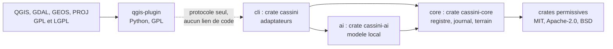
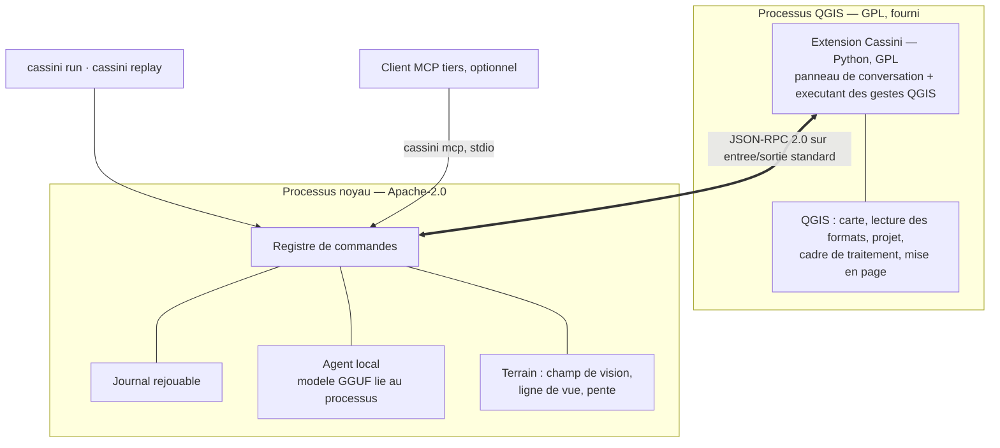
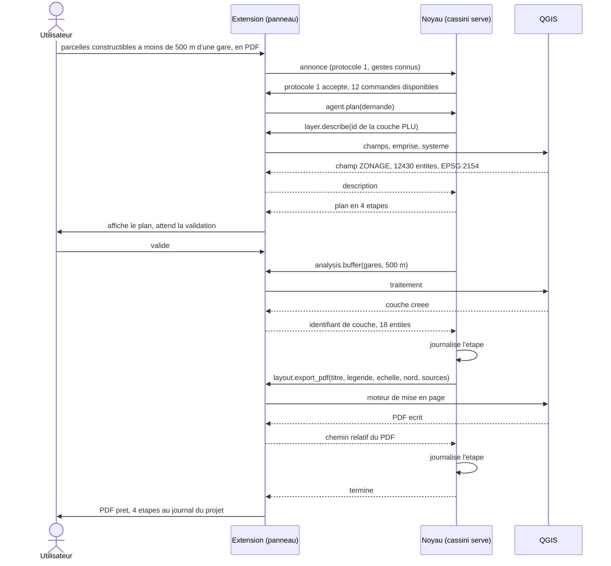
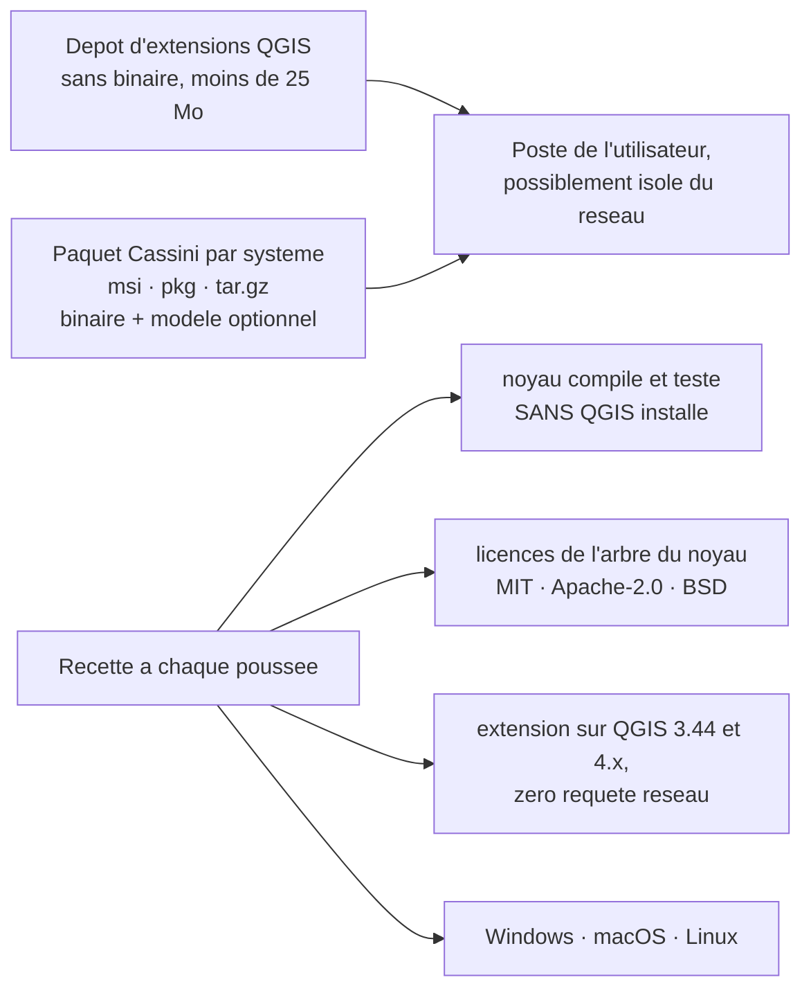

# Architecture Spine — Noyau Cassini et façade QGIS

## Design Paradigm

**Hexagonal, ports et adaptateurs, avec un adaptateur sortant distant.**

Le noyau est l'hexagone : le registre de commandes au centre, le journal, l'agent
et le terrain autour. Il ne connaît que des **ports**, jamais des outils.

- **Ports entrants** — un adaptateur par point d'entrée : canal de l'extension,
  ligne de commande, serveur MCP. Tous appellent le même registre.
- **Port sortant `QgisExecutor`** — défini dans le noyau, en termes de commandes
  du registre. Son unique implémentation au MVP est **distante** : l'extension
  QGIS, de l'autre côté d'un processus. C'est la pièce centrale de cette
  architecture : le noyau délègue sans jamais lier ce à quoi il délègue.

Correspondance avec les dossiers : `core/` l'hexagone et ses ports, `ai/` et
`cli/` des adaptateurs entrants, `qgis-plugin/` l'adaptateur sortant distant.

## Invariants & Rules

### AD-1 — Le noyau ne connaît jamais QGIS [ADOPTED]

- **Binds:** tout, CAP-13, CAP-11
- **Prevents:** le noyau devient un greffon de QGIS ; la V2 autonome et le module
  défense privé deviennent impossibles ; l'argument de distance de bras tombe.
- **Rule:** aucune crate du noyau ne nomme, n'importe ni ne lie QGIS, PyQGIS,
  GDAL, GEOS ou PROJ, même par dépendance indirecte. Le noyau s'adresse au port
  `QgisExecutor` qu'il définit lui-même. La recette compile le noyau et exécute
  la totalité de ses tests sur une machine **sans QGIS installé** ; cet emploi
  est un travail de recette obligatoire, pas une option.

### AD-2 — Un seul canal : l'entrée et la sortie standard d'un processus enfant

- **Binds:** CAP-13, CAP-1, CAP-8
- **Prevents:** une interface réseau ouverte sur la machine, qui rendrait la
  preuve « zéro réseau » négociable et déclencherait le pare-feu de Windows ;
  deux transports concurrents ; un service fantôme dont le cycle de vie
  divergerait de celui de QGIS.
- **Rule:** l'extension lance le binaire du noyau en `cassini serve` et dialogue
  par son entrée et sa sortie standard. Aucune socket, aucun port TCP, aucun
  fichier d'échange, dans aucune des deux moitiés. La sortie d'erreur standard
  est réservée aux traces de mise au point et ne porte jamais de message de
  protocole. Le noyau s'arrête de lui-même quand son entrée standard se ferme.

### AD-3 — Grammaire des messages : JSON-RPC 2.0, un message par ligne, symétrique

- **Binds:** CAP-13, CAP-6, CAP-8
- **Prevents:** deux encodages ou deux cadrages choisis séparément ; et surtout
  la supposition qu'un seul des deux côtés a le droit de demander, qui rendrait
  la délégation à QGIS impossible à écrire.
- **Rule:** JSON-RPC 2.0, UTF-8, un objet JSON par ligne, sans retour à la ligne
  littéral dans le message — exactement le cadrage du transport stdio de MCP,
  qui délimite ses messages par la ligne sur les flux standard d'un processus
  enfant lancé par le client (révision 2026-07-28 de la spécification). Sur le
  canal de l'extension, **les deux côtés** émettent requêtes et notifications sur
  la même connexion. Le serveur MCP réemploie le cadrage mais **pas** cette
  symétrie : il répond à son client et ne lui donne jamais d'ordre, les révisions
  récentes de MCP ayant restreint qui peut initier une requête.

### AD-4 — Aucun des deux côtés ne bloque en attendant l'autre

- **Binds:** CAP-13, CAP-4, CAP-3, CAP-5
- **Prevents:** l'interblocage — l'extension attend sa réponse sur une lecture
  bloquante pendant que le noyau lui demande d'exécuter une étape, et les deux
  moitiés s'immobilisent. C'est la panne que la symétrie de AD-3 rend possible.
- **Rule:** toute requête porte un `id` ; les réponses peuvent arriver dans un
  autre ordre que les demandes et chaque côté doit le supporter. Côté extension,
  la lecture passe par les signaux de `QProcess` dans la boucle d'événements de
  Qt, jamais par une lecture bloquante, et aucun traitement ne gèle le fil
  d'interface. Aucune implémentation synchrone n'est admise, pas même pour un
  prototype jetable. L'extension **draine en continu** la sortie d'erreur du
  noyau : un tampon du système d'exploitation qui se remplit bloque le noyau en
  écriture, définitivement, et cette panne ne se montre qu'en charge.

### AD-5 — Le noyau tient la boucle d'exécution

- **Binds:** CAP-4, CAP-6, CAP-7, CAP-13
- **Prevents:** quatre boucles d'orchestration divergentes, une par point
  d'entrée, ce que CAP-6 interdit ; et un journal à plusieurs auteurs, dont le
  rejeu ne serait plus fiable.
- **Rule:** l'extension n'enchaîne jamais deux commandes d'elle-même. Elle
  transmet la demande, affiche le plan que le noyau a composé, recueille la
  validation de l'utilisateur, puis exécute **un ordre à la fois** et rend
  compte. Aucune logique métier, aucun calcul géographique et aucune décision de
  nommage ne vivent dans l'extension.

### AD-6 — Le registre est la seule source des commandes ; les schémas sont engendrés depuis les types Rust

- **Binds:** CAP-6, tout
- **Prevents:** une commande qui existe dans l'extension sans exister au
  registre ; un schéma JSON écrit à la main qui dérive silencieusement du type
  Rust qu'il est censé décrire.
- **Rule:** chaque commande porte un `id` en `domaine.verbe`, anglais et
  snake_case ; une description courte en français et en anglais ; des paramètres
  et un résultat typés en Rust, dont les schémas JSON sont **engendrés** par
  `schemars` et jamais écrits à la main ; un champ `runs_in` valant `core` ou
  `qgis`, obligatoire, unique et déclaré ; au moins un test. Rien n'est appelable
  qui ne soit au registre, depuis aucun point d'entrée. Les paramètres sont
  validés **par le noyau, avant l'envoi de l'ordre** ; l'exécutant a le droit de
  faire confiance à ce qu'il reçoit, et la validation n'est donc écrite qu'une
  fois, du côté qui possède les schémas.

### AD-7 — Annonce au branchement : refus net sur le protocole, dégradation sur les commandes

- **Binds:** CAP-13, CAP-6, CAP-4
- **Prevents:** un noyau plus récent qui immobilise tous les postes dont
  l'extension n'est pas à jour, alors que les deux artefacts s'installent
  séparément et seront donc souvent dépareillés ; et un agent qui planifie une
  étape vouée à l'échec.
- **Rule:** le premier échange est une **requête de l'extension**,
  `session.hello`, à laquelle le noyau **répond** ; aucun ordre n'est émis avant
  cette réponse. La requête porte la version de protocole que l'extension parle,
  la liste des `id` qu'elle sait exécuter, et **le chemin absolu du fichier de
  projet ouvert** : c'est par là, et par aucun autre moyen, que le noyau apprend
  contre quoi résoudre les chemins relatifs de AD-9, AD-10 et AD-11. Si la
  version diffère, le noyau refuse de servir et rend un message nommant
  précisément quoi mettre à jour ; sinon il marque **indisponible** toute
  commande `runs_in: qgis` absente de la liste annoncée. L'agent ne planifie que
  des commandes disponibles. La version de protocole est un entier, incrémenté à
  chaque rupture de compatibilité, et jamais réutilisé. Une session vaut pour un
  projet : ouvrir un autre projet termine la session et en ouvre une neuve.

### AD-8 — Ce qui traverse : des références, et des géométries explicitement bornées

- **Binds:** CAP-13, CAP-3, CAP-9, CAP-11
- **Prevents:** la qualification d'« échange assez intime » que la FAQ de la FSF
  réserve, et qui ferait des deux moitiés un seul programme ; l'effondrement des
  performances dès qu'une couche grossit ; le retour de la géométrie dans le
  noyau, que le virage du 2026-10-14 voulait précisément éviter.
- **Rule:** le canal porte des identifiants de couche, des chemins relatifs au
  projet, des dénombrements, des emprises, des descriptions de champs, et des
  géométries GeoJSON (RFC 7946) **en nombre borné par le schéma de la commande**
  — aucun schéma du registre ne déclare une collection de géométries non bornée.
  Ne traversent jamais : la géométrie d'une couche entière, un objet PyQGIS
  sérialisé, une structure de données interne du noyau. Au-delà du plafond, on
  passe un chemin de fichier.

### AD-9 — Les couches se désignent par leur identifiant QGIS, les fichiers par un chemin relatif au projet

- **Binds:** CAP-7, CAP-9, CAP-10, CAP-3
- **Prevents:** la désignation par nom, qui n'est pas unique, ou par rang dans la
  légende, qui change dès que l'utilisateur réordonne ; et un journal qui casse
  au déplacement du dossier, alors que CAP-10 exige qu'il survive au
  déplacement sur un autre poste.
- **Rule:** une couche se référence par l'identifiant que QGIS lui a donné
  (`QgsMapLayer.id()`), et cet identifiant ne vaut que **pour la session en
  cours** : il n'est jamais une clé de résolution dans le journal, qui résout par
  le chemin (AD-11). Rien dans l'architecture ne dépend donc de sa persistance
  d'une ouverture de projet à l'autre. Tout chemin
  qui traverse le canal ou entre au journal est relatif au fichier de projet et
  écrit avec des séparateurs POSIX ; aucun chemin absolu, messages d'erreur
  compris. Un fichier situé hors de l'arborescence du projet est accepté mais
  journalisé comme **non portable**, et le rejeu sur un autre poste le signale
  avant de commencer.

### AD-10 — Le noyau décide des chemins et des noms de sortie

- **Binds:** CAP-7, CAP-5, CAP-3, CAP-10
- **Prevents:** deux conventions de nommage des sorties, inventées de chaque
  côté ; et des résultats que le journal ne sait pas retrouver au rejeu.
- **Rule:** toute sortie — couche créée, PDF, fichier intermédiaire — est nommée
  par le noyau dans un dossier de travail situé à côté du fichier de projet, et
  nommé d'après lui. L'extension n'invente jamais un chemin ni un nom de couche :
  elle reçoit celui que le noyau lui donne. Les fichiers d'origine de
  l'utilisateur ne sont ni modifiés ni déplacés, et rien n'est écrit en dehors de
  ce dossier de travail. Le noyau ne supprime jamais un fichier que l'exécutant
  peut tenir ouvert : il lui demande de le libérer, puis de le retirer. Sous
  Windows, un fichier qu'une couche QGIS tient ouvert ne peut pas être supprimé,
  et une suppression tentée depuis le noyau échouerait en laissant sur le disque
  le fichier à moitié écrit qu'elle visait.

### AD-11 — Le journal a un seul auteur, et le rejeu est conduit par le noyau

- **Binds:** CAP-7, CAP-10, CAP-6
- **Prevents:** deux écrivains concurrents sur le même fichier ; et un rejeu qui
  réinterpréterait les étapes autrement que l'exécution d'origine.
- **Rule:** seul le noyau écrit le journal, en **ajout seul**, une ligne JSON par
  étape exécutée, dans le dossier de travail de AD-10. Chaque ligne porte l'`id`
  de la commande, ses paramètres canonisés, ses références d'entrée (chemin
  relatif, identifiant de couche, taille et date de dernière modification du
  fichier), un résumé du résultat, et les versions du noyau, du protocole et du
  registre. Le rejeu réexécute les mêmes étapes par le même chemin que
  l'exécution d'origine ; si l'exécutant branché ne sait pas faire une commande
  du journal, il échoue en la nommant au lieu de sauter l'étape. Les sorties sont
  désignées dans le journal par des **repères locaux à l'étape** — sortie *n* de
  l'étape *k* — et jamais par l'identifiant de couche, que le rejeu ne peut pas
  retrouver puisque QGIS en attribue de neufs : le rejeu lie chaque repère à
  l'identifiant neuf, et les étapes suivantes se résolvent par le repère. Le
  noyau prend un **verrou exclusif** sur le journal à l'ouverture de la session ;
  une seconde session sur le même projet — deux fenêtres de QGIS, donc deux
  noyaux — obtient un accès en lecture seule, le dit explicitement, et peut
  rejouer sans écrire.
- **Écart assumé (ticket 14) :** `layer.add` n'a pas de sortie fichier, donc pas de
  repère `out:k.n`. Le journal garde le `layer_id` rendu par l'étape (champ
  `layer_id` de la ligne) ; le rejeu le lie à celui qu'il obtient et le substitue dans
  les paramètres suivants, puis l'ignore à la comparaison. Les octets d'une sortie
  produite par QGIS (GeoPackage, PDF) ne sont pas comparés : elle doit exister et
  n'être pas vide, la fidélité tient au résultat typé comparé.

### AD-12 — Toute étape est annulable par message, jamais en tuant le processus

- **Binds:** CAP-4, CAP-13, CAP-7
- **Prevents:** une annulation implémentée en tuant le noyau — ce que les deux
  moitiés feraient faute de mieux — qui perd la fin du journal et laisse des
  sorties à moitié écrites sur le disque.
- **Rule:** le protocole porte l'annulation par `id` de requête **dès la version
  1**. L'extension expose un arrêt à l'utilisateur ; le noyau journalise l'étape
  comme annulée et nettoie ses sorties partielles. Aucun côté ne tue l'autre pour
  arrêter un travail en cours. Une commande que l'exécutant ne sait pas
  interrompre — tout traitement de QGIS n'accepte pas un objet de retour
  annulable — est déclarée **non annulable au registre** ; sans cette
  déclaration, une moitié promettrait ce que l'autre ne peut pas tenir.

### AD-13 — Un seul binaire, quatre points d'entrée, un seul registre

- **Binds:** CAP-6, CAP-8, CAP-4
- **Prevents:** quatre registres physiquement distincts qui divergent à la
  première commande ajoutée.
- **Rule:** un binaire unique, `cassini`, expose les sous-commandes `serve` (le
  canal de l'extension), `mcp` (le serveur MCP sur stdio), `run` (une commande
  en ligne de commande) et `replay`. Les quatre traversent le même registre
  compilé dans `cassini-core`. Aucun point d'entrée ne porte de commande qui lui
  soit propre, et aucun ne modifie le comportement d'une commande.

### AD-14 — Le réseau est absent par construction, et prouvé des deux côtés

- **Binds:** CAP-1
- **Prevents:** une sortie réseau introduite par une dépendance ou par un simple
  réglage ; et une preuve qui se réduirait à une relecture de code, ce que CAP-1
  refuse explicitement.
- **Rule:** côté noyau, la recette refuse l'arbre de dépendances par une liste
  nommée et versionnée de crates interdites — `cargo-deny`, section `bans`,
  couvrant les clients HTTP et les piles réseau asynchrones — et le verrou
  existant refuse **à la construction** toute source qui désigne le réseau. Côté
  extension, un test se branche sur le signal `requestAboutToBeCreated` de
  `QgsNetworkAccessManager`, que QGIS propage au fil principal — un seul
  branchement voit donc les requêtes créées depuis n'importe quel fil — et exige
  zéro requête créée sur le chemin nominal, et la recette refuse dans l'extension tout import
  de `urllib`, `requests`, `socket` ou `http`. Aucun garde-fou global n'est posé
  à l'exécution : QGIS et les autres extensions de l'utilisateur gardent leur
  accès au réseau, ce qu'on prouve c'est que Cassini ne s'en sert pas.

### AD-15 — L'IA locale est une bibliothèque liée, jamais un serveur

- **Binds:** CAP-1, CAP-4, CAP-8
- **Prevents:** un modèle servi par HTTP sur la machine locale, qui rouvrirait
  une interface réseau et contredirait AD-2 et AD-14 ; et trois découvertes de
  modèle écrites séparément dans l'extension, la ligne de commande et l'agent.
- **Rule:** le modèle local est chargé **dans le processus du noyau** par
  `llama-cpp-2` ; ni `llama-server`, ni aucun service HTTP, ni aucun client HTTP.
  Le noyau seul découvre les modèles, dans un dossier connu à côté de son
  installation ou dans un dossier désigné par réglage, et en expose la liste par
  une commande du registre. L'extension ignore ce qu'est un modèle : elle affiche
  la liste qu'on lui rend.

### AD-16 — Licences : le noyau reste propre, l'extension est en GPL, et la frontière se tient par ce qui circule

- **Binds:** tout
- **Prevents:** une dépendance GPL ou LGPL qui entre au noyau par transitivité ;
  un module défense privé impossible à construire parce que le noyau aurait été
  contaminé ; et un argument de distance de bras affaibli par la nature de ce qui
  passe dans le tuyau.
- **Rule:** toute dépendance du noyau est MIT, Apache-2.0 ou BSD, liaison
  statique et transitivité comprises, et la recette le vérifie à chaque poussée ;
  GDAL, GEOS et PROJ sont interdits dans le noyau même indirectement. L'extension
  est sous GPL v2 ou ultérieure — c'est une exigence écrite du dépôt d'extensions
  de QGIS, pas une déduction. Le canal ne porte que des messages publics et
  documentés (AD-8) : c'est la condition explicite de l'argument de distance de
  bras, la FAQ de la FSF réservant le cas d'un échange assez intime pour que deux
  programmes n'en fassent qu'un.

### AD-17 — Distribution en deux artefacts, et un seul ordre de recherche

- **Binds:** CAP-13, CAP-1
- **Prevents:** un binaire dans l'archive de l'extension, que le dépôt interdit ;
  deux ordres de recherche du noyau écrits séparément ; et toute tentation de
  réparer une installation par le réseau.
- **Rule:** l'extension part au dépôt d'extensions de QGIS **sans binaire** et
  sous 25 Mo, et déclare le noyau comme dépendance externe dans le champ *About*
  de `metadata.txt`. Le paquet Cassini, un installeur par système, porte le
  binaire et, en option, un modèle. L'extension cherche le noyau dans cet ordre
  et dans aucun autre : réglage QGIS `cassini/core_path`, variable
  d'environnement `CASSINI_CORE`, emplacement d'installation du paquet, `PATH`.
  Introuvable, elle explique quoi installer et propose de désigner le fichier à
  la main. Elle ne télécharge jamais rien.

### AD-18 — Une seule extension pour les deux séries de QGIS, et aucun import direct de PyQt

- **Binds:** CAP-13
- **Prevents:** deux variantes d'extension à maintenir ; et la dérive où un
  contributeur importe PyQt5 pendant qu'un autre importe PyQt6 dans le même code.
- **Rule:** `qgisMinimumVersion=3.44` et `qgisMaximumVersion=4.99` dans
  `metadata.txt`. Tout accès à Qt passe par le shim `qgis.PyQt` que QGIS
  fournit ; `import PyQt5` et `import PyQt6` sont refusés par la recette, qui
  exécute l'extension sur les deux séries.

### AD-19 — QGIS possède les systèmes de coordonnées ; le noyau ne reprojette pas

- **Binds:** CAP-9, CAP-3, CAP-11
- **Prevents:** deux moteurs de reprojection qui se contredisent sur les bords ;
  et une coordonnée sans système, interprétée différemment de chaque côté.
- **Rule:** toute coordonnée qui traverse le canal porte son code EPSG explicite.
  La reprojection est exécutée par QGIS, jamais par le noyau. Le terrain travaille
  dans le système du modèle d'élévation : le noyau **exige** les coordonnées
  d'observation dans ce système et refuse une coordonnée exprimée dans un autre
  au lieu de la convertir silencieusement.

### AD-20 — Le noyau lit ses rasters lui-même, derrière un seul module remplaçable

- **Binds:** CAP-11
- **Prevents:** un noyau qui aurait besoin de QGIS pour analyser un relief, donc
  un module défense privé qui hériterait d'une dépendance à la GPL — ce que la
  séparation civil/défense interdit ; et une lecture de raster dispersée dans
  plusieurs modules, impossible à remplacer quand la maturité de la bibliothèque
  jeune se révélera insuffisante.
- **Rule:** la lecture d'un modèle numérique d'élévation vit dans un **unique**
  module du noyau, et aucun autre module n'ouvre un fichier raster. QGIS ne passe
  qu'un chemin de fichier et une emprise. Les trois commandes de terrain du MVP
  sont réimplémentées en Rust, avec attribution si du code de
  `whitebox_next_gen` est porté. L'epic terrain commence par compiler un cas
  d'essai sur `wbgeotiff` et `wbraster` avant d'engager CAP-11.

### AD-21 — Une seule forme d'erreur, et aucun échec silencieux [ADOPTED]

- **Binds:** tout
- **Prevents:** des erreurs en chaîne de caractères, formées différemment de
  chaque côté, qu'aucune interface ne sait traiter ni traduire ; et les
  troncatures silencieuses, qui font échouer le travail plus loin, là où la cause
  n'est plus visible.
- **Rule:** toute erreur qui traverse le canal porte un code machine stable en
  `domaine.cause`, un message en français destiné à l'utilisateur, et l'`id` de
  l'étape concernée quand il y en a une. Dans le noyau, les erreurs restent des
  énumérations typées par module, converties en cette forme au bord de
  l'adaptateur — convention déjà établie par le code existant et ratifiée ici.
  Une lecture plus courte que demandée, un résultat partiel ou une couche absente
  sont des erreurs nommées, jamais un succès dégradé.

### AD-22 — Les paramètres sont neutres ; le vocabulaire de QGIS reste dans l'extension

- **Binds:** CAP-3, CAP-5, CAP-6, CAP-9, CAP-11
- **Prevents:** un noyau qui connaîtrait le langage d'expression de QGIS ou les
  noms de ses algorithmes, donc un noyau de forme QGIS que le module défense
  privé et la V2 autonome hériteraient — AD-1 contournée en esprit sans être
  enfreinte à la lettre ; et deux implémentations qui divergeraient sur le type
  même d'un paramètre de filtre.
- **Rule:** les paramètres du registre sont neutres et typés : un filtre est un
  champ, un opérateur et une valeur, jamais une expression textuelle ; une
  opération est `analysis.buffer`, jamais `native:buffer`. La traduction vers le
  langage d'expression et vers les noms d'algorithmes de QGIS vit **entièrement
  dans l'extension**. Aucune chaîne de caractères destinée à être interprétée par
  QGIS n'est composée par le noyau.

### AD-23 — Le modèle n'émet que des appels du registre, jamais du code

- **Binds:** CAP-4, CAP-6, CAP-8
- **Prevents:** la seule vraie faille du produit — un plan composé par un modèle
  est une entrée non fiable ; s'il peut rendre du code, une expression ou un
  chemin absolu, il contourne AD-8, AD-9 et AD-22 sans que personne ne l'ait
  décidé.
- **Rule:** la sortie du modèle est contrainte à une suite d'appels de commandes
  du registre, validée contre les schémas engendrés avant d'être montrée à
  l'utilisateur ; une sortie non conforme est rejetée et redemandée, jamais
  réparée à la main. Rien de ce que le modèle produit n'est exécuté comme du
  code, du Python, du SQL ou une expression. Un plan ne peut nommer que des
  commandes disponibles (AD-7) et des chemins déjà connus de la session.

### Direction des dépendances

Qui a le droit de dépendre de qui. Toute flèche en sens inverse est un bug.



- Rien ne dépend de `qgis-plugin` : il est une extrémité.
- Aucune crate du noyau ne dépend de QGIS ni d'une de ses bibliothèques (AD-1).
- `cassini-core` ne dépend pas de `cassini-ai` : le module défense privé et la
  V2 autonome doivent pouvoir prendre le registre et le terrain sans l'IA.
- La flèche en pointillés est la frontière de licence : elle ne porte que des
  messages, et c'est tout l'argument de AD-16.

## Consistency Conventions

| Concern | Convention |
| --- | --- |
| Nommage des commandes | `domaine.verbe` en anglais, snake_case : `layer.add`, `layer.describe`, `analysis.buffer`, `project.inventory`, `layout.export_pdf`, `terrain.viewshed`, `terrain.line_of_sight`, `terrain.slope`, `agent.plan`, `journal.replay` |
| Nommage du code | crates `cassini-core`, `cassini-ai`, `cassini` ; paquet Python `cassini_qgis` — le nom ne répète pas le mot « plugin », le dépôt le demande ; noms de types et de variables en anglais, documentation et commentaires en français (CLAUDE.md §9) |
| Identifiants | une couche : l'identifiant QGIS, opaque, jamais interprété par le noyau ; une étape : un entier croissant dans le journal ; une requête : l'`id` JSON-RPC |
| Chemins | relatifs au fichier de projet, séparateurs POSIX, jamais d'absolu (AD-9) |
| Dates et nombres | dates en ISO 8601 UTC ; nombres en notation JSON, jamais formatés selon la langue |
| Schémas | JSON Schema draft 2020-12, engendré par `schemars` depuis les types Rust (AD-6) ; le dialecte est déclaré explicitement et la version de `schemars` épinglée, sa valeur par défaut étant annoncée comme susceptible de changer |
| Mesures | toute distance, surface ou hauteur porte son unité explicite ; aucune valeur nue ne traverse le canal (AD-19) |
| Erreurs | l'enveloppe de AD-21 ; énumérations typées par module à l'intérieur du noyau |
| Mutation d'état | le projet est muté par QGIS seul, sur ordre du noyau ; le journal est écrit par le noyau seul ; aucun état partagé entre les deux moitiés en dehors des messages |
| Traces | sortie d'erreur standard, jamais la sortie standard (AD-2) ; messages destinés à l'utilisateur en français, traces de mise au point en anglais |
| Réglages | côté extension, les réglages QGIS sous le préfixe `cassini/` ; côté noyau, un seul fichier de configuration lu au démarrage ; aucun réglage ne peut ouvrir un accès réseau (AD-14) |
| Sources et clean-room | aucun code, icône, nom de produit, preset ou asset d'Esri ; aucun format de projet Esri lu ni écrit ; lire un format publié comme le Shapefile reste permis, et c'est QGIS qui le fait (CLAUDE.md §2.1) |
| Tests | une commande, au moins un test ; le noyau testé sans QGIS (AD-1) ; l'extension testée sur les deux séries de QGIS (AD-18) |

## Stack

Vérifié courant le 2026-10-14 ; le code en devient propriétaire dès qu'il existe.

| Name | Version |
| --- | --- |
| QGIS (hôte, fourni, non écrit ici) | 3.44 LTR minimum, déclaré jusqu'à 4.99 |
| Python de l'extension (fourni par QGIS) | 3.9 minimum |
| Rust | chaîne stable, édition 2021 |
| cassini-core | 0.1.0 |
| serde_json | 1.0.154 |
| schemars | 1.2.3 |
| rmcp (SDK Rust officiel de MCP, Apache-2.0) | 3.5.1 |
| llama-cpp-2 (MIT OR Apache-2.0) | 0.1.159 |
| wbgeotiff (MIT OR Apache-2.0) | 0.1.2 |
| wbraster (MIT OR Apache-2.0) | 0.2.1 |
| JSON-RPC | 2.0 |
| Spécification MCP (révision) | 2026-07-28 |
| GeoJSON | RFC 7946 |
| Protocole Cassini | 1 |

## Structural Seed

### Vue d'ensemble



### La phrase de démonstration, de bout en bout



### Enveloppe d'exploitation

Deux artefacts, deux canaux, une seule version de protocole qui les accorde.



Une clé USB portant les deux artefacts suffit à installer Cassini sur un poste
qui n'a jamais vu le réseau : c'est le critère d'acceptation de l'enveloppe.

`llama-cpp-2` compile llama.cpp : le poste de compilation et la recette ont donc
besoin de cmake et d'un compilateur C++ sur les trois systèmes. C'est la seule
dépendance de construction lourde du noyau, et elle ne pèse que sur celui qui
compile, jamais sur l'utilisateur.

### Arborescence

```text
cassini/
  core/          crate cassini-core : registre, journal, terrain, types du protocole
  ai/            crate cassini-ai : modele local lie, planification
  cli/           crate cassini : binaire unique, sous-commandes serve, mcp, run, replay
  qgis-plugin/   extension Python sous GPL : panneau et executant des gestes QGIS
  app/           coquille Tauri et carte MapLibre, reportees en V2, conservees
  fixtures/      jeux de donnees de recette, legers
  tests/         tests d'integration et harnais Python de l'extension
  docs/          documentation et feuille de route
```

`cli/` est nouveau par rapport à la structure de CLAUDE.md §9 : le binaire a
besoin du noyau **et** de la couche IA, et `cassini-core` ne doit pas dépendre de
`cassini-ai` (voir la direction des dépendances). La mise à jour de §9 est à
faire.

## Capability → Architecture Map

| Capability / Area | Lives in | Governed by |
| --- | --- | --- |
| CAP-1 Affichage hors ligne vérifié | `core` (verrou existant), `qgis-plugin` (test réseau) | AD-2, AD-14, AD-15, AD-17 |
| CAP-3 Analyses vectorielles | registre dans `core`, exécution par QGIS | AD-5, AD-6, AD-8, AD-9, AD-19, AD-22 |
| CAP-4 Agent en langage naturel | `ai`, boucle dans `core`, panneau dans `qgis-plugin` | AD-4, AD-5, AD-7, AD-12, AD-15, AD-23 |
| CAP-5 Export PDF | registre dans `core`, mise en page par QGIS | AD-5, AD-6, AD-10 |
| CAP-6 Registre de commandes | `core` | AD-6, AD-13, AD-21 |
| CAP-7 Journal rejouable | `core` | AD-9, AD-10, AD-11, AD-12 |
| CAP-8 Serveur MCP | `cli` (sous-commande `mcp`), registre dans `core` | AD-3, AD-13 |
| CAP-9 Ouverture des données de l'utilisateur | registre dans `core`, lecture par QGIS | AD-8, AD-9, AD-10, AD-19 |
| CAP-10 Projet | projet QGIS, journal à côté par `core` | AD-9, AD-10, AD-11 |
| CAP-11 Analyse de terrain | `core` | AD-1, AD-19, AD-20, AD-22 |
| CAP-13 Façade QGIS | `qgis-plugin` et le canal | AD-2, AD-3, AD-4, AD-7, AD-17, AD-18 |
| Frontière de licence et module défense privé | la frontière elle-même | AD-1, AD-8, AD-16, AD-20 |
| Enveloppe d'exploitation : installation, recette, plateformes | paquet et recette | AD-14, AD-16, AD-17, AD-18 |

## Deferred

- **Dessin du panneau.** L'expérience devient un panneau ancré dans un outil
  d'expert, alors que l'argument de vente est qu'un non-cartographe obtient sa
  réponse en parlant. Rien ici n'en dépend : le contrat fixe qui décide quoi, pas
  ce que l'utilisateur voit. À esquisser avant l'epic de façade, par `bmad-ux`.
- **Forme de l'invite et du plan rendu par le modèle local.** Tranchée par
  l'épreuve du modèle local, qui précède le registre dans la séquence : décider
  avant le verdict serait décider à l'aveugle.
- **Confirmation juridique de la frontière GPL.** Le raisonnement de distance de
  bras est à faire confirmer par un juriste avant toute vente, pas avant
  d'écrire du code. AD-8 et AD-16 sont écrites pour tenir cet examen.
- **Socket locale au lieu de l'entrée/sortie standard.** Reportée en V2 : le
  protocole de AD-3 ne nomme pas son transport, le changer plus tard ne touche la
  logique d'aucune des deux moitiés. Le seul gain attendu — un modèle partagé en
  mémoire entre plusieurs clients — ne se présente pas au MVP.
- **Rejeu sans QGIS.** Rejouer un journal contenant des commandes déléguées exige
  un exécutant qui les sache faire. Un exécutant sans interface, bâti sur
  `qgis_process`, est possible plus tard ; AD-11 impose déjà d'échouer en les
  nommant plutôt que de sauter l'étape.
- **Les six autres commandes de terrain** et **l'application autonome de V2**
  (carte MapLibre, chaîne vectorielle propre, crate `geo`) : hors périmètre du
  MVP par la spec. AD-1 et AD-20 sont ce qui les garde possibles.
- **Module défense privé.** Aucune fonction ici. Il s'appuiera sur
  `cassini-core` seul, ce que AD-1, AD-16 et AD-20 rendent praticable. Son
  périmètre reste indéterminé jusqu'à la réponse écrite à la demande de
  classement.
- **Liste exacte des systèmes de coordonnées.** La question se dissout pour le
  vecteur, QGIS portant tout ce qu'il connaît (AD-19) ; elle reste ouverte pour
  le terrain, où le noyau lit le système du modèle d'élévation sans savoir le
  convertir. MGRS reste hors périmètre.
- **Jeu de recette.** Données fabriquées à la main ou échantillon réel sous
  licence ouverte : choix de l'epic de socle, sans effet sur les invariants.
- **Reconnaissance des schémas français** (cadastre Etalab, zonage du GPU) et
  **définition de « parcelle constructible »** : contenu métier, pas structure.
  Resteront des descriptions de commandes, gouvernées par AD-6.
- **Révision de MCP servie par `rmcp`.** La pile Rust est épinglée en 3.5.1 et la
  spécification en révision 2026-07-28, mais la correspondance entre les deux n'a
  pas été vérifiée : à faire à l'ouverture de l'epic agent et MCP, avant d'écrire
  l'adaptateur.
- **Version de Python de l'extension à confirmer** sur QGIS 3.44 sous Windows :
  le plancher annoncé au tableau de pile n'a pas été vérifié sur le poste le plus
  ancien visé.
- **Isochrones.** QGIS les calcule sur un réseau routier que l'utilisateur
  apporte ; que ce réseau soit disponible chez l'utilisateur visé reste à
  confirmer à l'epic de façade. Sans effet sur la frontière.
